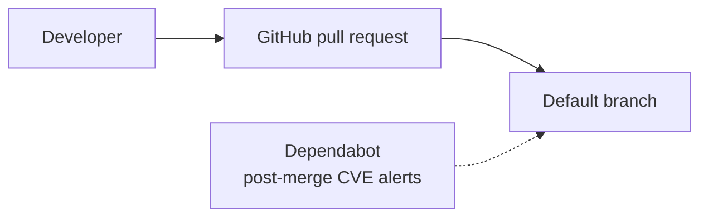
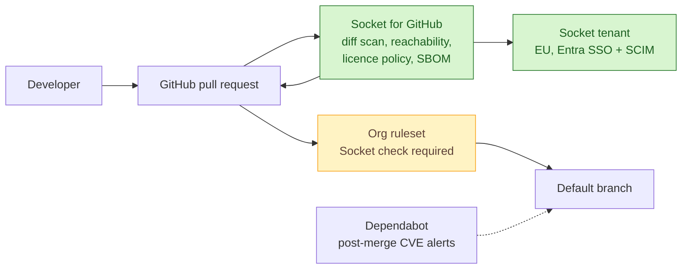

# SOAP-003 — Gate every pull request with Socket for GitHub

| | |
|---|---|
| **Status** | Draft |
| **Change type** | Security control |
| **Target solution** | Developer Platform — software supply chain slice, SAD v4.1 section 6 |
| **Author** | S. Morley, Solution Architect |
| **Approvers** | Architecture owner, Security, Developer Platform service owner (all to be named) |
| **Date** | 2026-09-24 |
| **Links** | DEVPLAT-2210, R-119, ADR-0031 (GitHub as strategic SCM), SEC-401 (third-party risk assessment of Socket), Threat model TM-SUPPLYCHAIN-2026-Q3. Part 1 of 3 of the Socket.dev programme; see [SOAP-004](SOAP-004-socket-desktop-and-assistant-toolchain.md) and [SOAP-005](SOAP-005-socket-firewall-registry-path.md) |

## Sizing gate

- [x] Touches at most three components inside one bounded context or one deployment unit. Every node marked added, changed or removed in the proposed-change diagram belongs to a row of the change delta table, and the table has at most three rows.
- [x] Does not change a contract other teams consume, or every consumer is listed under Impact.
- [x] Adds no new fail-closed dependency to the build, deploy or runtime path of any team outside the owning team.
- [x] If more than two teams beyond the owning team are affected, every one is named under Impact and the rollout starts with a report-only or small-wave stage.
- [x] Does not change data classification or residency, extend retention, or introduce new personal data.
- [ ] Sends no data to a new third party and adds no new supplier, unless its third-party risk assessment is complete, covers that data, and is linked above.
- [x] Weakens no security control.
- [x] Cost delta is within the service owner's delegated authority.
- [x] Can be rolled back without reversing a data migration.
- [x] Does not contradict an accepted ADR (or the superseding ADR is linked above).

**Gate notes.** Socket is a new supplier and receives manifests and reachability call graphs derived from first-party source. SEC-401 is not complete, so the supplier box stays unticked and this SOAP cannot move to In review until it is, and until RA-4 is confirmed. The Socket check sits on the merge path, not the build, deploy or runtime path, and a Socket outage is handled by the ruleset bypass described under Impact.

**Gate confirmed by:** not yet confirmed.

## Summary

Pull requests merge today with no dependency gate: Dependabot raises known-CVE alerts after merge, and nothing flags malware, typosquats, install scripts or licence breaches before code lands. This change installs the Socket for GitHub app on every repository to diff-scan each manifest change, apply org security and licence policy, export a CycloneDX SBOM per scan, and use Tier 1 reachability so that vulnerabilities with no call path are recorded without blocking, treating R-119. It costs about 1,200 USD a month for the Socket tenant, which SOAP-004 and SOAP-005 reuse, plus two engineer-days, and the thing most likely to go wrong is a false block holding up a merge, which the warn-only stage and the ruleset bypass contain.

## Current state

GitHub pull requests merge with no dependency gate. Dependabot raises known-CVE alerts after merge; nothing detects malware, typosquats or install-time scripts, and no licence policy is enforced. Full topology: SAD v4.1 section 6.

## Proposed change

A Socket organisation tenant is created in the EU region, federated to Entra ID with SAML and SCIM. The Socket for GitHub app is installed on all repositories with read on code and metadata and write on pull request comments and checks. On every pull request that changes a manifest it runs a diff scan against the org security and licence policy, runs Tier 1 reachability, and exports a CycloneDX SBOM. An org ruleset makes the Socket check required on default branches; the check fails only for high-severity malware alerts and licence-policy violations. Developer Platform is on the ruleset's bypass list for use during a Socket outage.

### Change delta

| # | Component | Action | Before | After | Owner |
|---|---|---|---|---|---|
| 1 | Socket tenant | Add | None | EU tenant, Entra ID SAML and SCIM; admin Developer Platform, policy-write Security, read all engineers; org security and licence policy | Developer Platform |
| 2 | Socket for GitHub app | Add | Dependabot post-merge alerts only | App on all repos: diff scan, Tier 1 reachability, CycloneDX SBOM per scan | Developer Platform |
| 3 | GitHub org rulesets | Modify | No dependency check required | Socket check required on default branches; Developer Platform on the bypass list | GitHub admins |

## Options considered

| Option | Summary | Chosen? | Why |
|---|---|---|---|
| A — Socket for GitHub with a required check | Scans every manifest change before merge, one policy shared with SOAP-004 and SOAP-005 | Yes | Stops malicious and non-compliant dependencies reaching the default branch, and gives reachability to cut CVE noise |
| B — Dependabot and GitHub dependency review only | Already licensed, CVE and licence checks at pull request | No | Detects known CVEs only; no malware, typosquat or install-script signal, so R-119 stays open |
| C — Do nothing until the firewall (SOAP-005) lands | Wait for the install-time control | No | SOAP-005 is escalated to a SAD addendum and will not land before the R-119 date |

## Security and compliance

| Item | Detail |
|---|---|
| **Controls added or strengthened** | A.5.21 Managing information security in the ICT supply chain, A.5.23 Information security for use of cloud services, A.8.8 Management of technical vulnerabilities, A.8.28 Secure coding, A.8.29 Security testing in development and acceptance |
| **Controls weakened or bypassed** | None. The ruleset bypass is a documented break-glass for Developer Platform, logged by GitHub |
| **Threat model delta** | Detects at pull request TM-SUPPLYCHAIN T2 typosquat and starjacking, T4 compromised maintainer publishing a malicious version. New surface: a stolen Socket token exposes scan data and policy; Socket's AI verdicts can be wrong in both directions |
| **Data** | Manifests, package names and versions, and reachability call graphs derived from first-party source leave to Socket's EU tenant. Classification Internal, unchanged. No source archive upload, verified under RA-4. No personal data beyond developer identity already in GitHub audit logs |
| **Identity and access** | Socket tenant federated to Entra ID; three roles as in the delta table. The GitHub app takes read on code and metadata and write on pull request comments and checks only. One CI service token, rotated 90-daily from the platform secret store |
| **Risk register** | R-119 treated (High → Medium, reachability filters but does not remove unpatched transitive CVEs) |
| **Gates and evidence** | SEC-401 third-party risk assessment complete before In review; security review sign-off on this SOAP; SoA rows A.5.21, A.5.23 and A.8.29 updated to Implemented |

## Impact

| Area | Impact |
|---|---|
| **Availability and resilience** | A Socket outage leaves the required check pending on pull requests that change manifests. Builds, deploys and running services are unaffected. Developer Platform uses the ruleset bypass for the outage window under RB-DEVPLAT-14 |
| **Performance** | Socket check completes in under two minutes on typical pull requests; no effect on CI build time |
| **Cost** | Socket Business tier at roughly 1,200 USD per month for 150 developers, shared with SOAP-004 and SOAP-005. One-off: two engineer-days across Developer Platform and Security |
| **Operations** | Runbook RB-DEVPLAT-14 gains block triage with a four-working-hour response target for a disputed block, and the ruleset bypass procedure; a shared Slack channel is the intake for override requests, which only Security can grant |
| **Consumers and dependencies** | Every engineering team that merges manifest changes: Payments, Customer Portal, Data Platform, Mobile, Internal Tools. GitHub admins approve the app at org level and own the ruleset |
| **Data** | None migrated |

## Implementation and rollout

1. Create the Socket tenant with SSO and SCIM; install the app on five repositories in warn-only mode; tune the org security and licence policy until the false-positive rate on merged changes is under one alert per twenty pull requests.
2. Extend warn-only to all repositories.
3. Cut-over: add the org ruleset making the Socket check required on default branches.

- **Rollback:** Remove the Socket check from the org ruleset (one change, under two minutes); the app keeps commenting in warn-only mode. Uninstalling the app removes it entirely.
- **Point of no return:** none. Every step can be undone by ruleset or app configuration.
- **Verification:** A test pull request adding a known-malicious package from Socket's sample set fails the check; one adding a GPL-3.0 dependency raises the licence alert; the reachability filter rate on the Payments repository is at or above 60 per cent.
- **Timeline:** five repositories warn-only 2026-09-29 once SEC-401 is complete, all repositories warn-only 2026-10-06, required check 2026-10-14.

## Risks and assumptions

| ID | Risk or assumption | Mitigation or how it is validated | Owner |
|---|---|---|---|
| RA-1 | The check blocks a legitimate dependency and holds up a release | Warn-only stage first, then the four-hour triage target and a Security-granted override with a mandatory expiry date | Developer Platform |
| RA-2 | Socket's AI analysis misses a malicious package, or a package author embeds text aimed at steering the analysis model | Treated as defence in depth: Dependabot and the EDR agent stay; any allow that rests only on an AI verdict is sampled weekly by Security (SEC-402) | Security |
| RA-3 | A Socket token is stolen and used to relax policy | Policy writes require SAML sign-in with MFA; 90-day token rotation; alert on any policy change made outside the Security group | Security |
| RA-4 | Assumption: reachability analysis sends derived call graphs, not source archives, and runs in the EU tenant | Confirmed in writing with Socket and evidenced by the SEC-401 assessment. If false, this change becomes a SAD and the data classification review reopens | Security |
| RA-5 | Assumption: 150 seats and the Business tier cover Tier 1 reachability, SBOM export and licence policy | Confirmed against the quote of 2026-09-02; enterprise-tier function-level reachability is out of scope | Developer Platform |

## Decision

We will gate every pull request that changes a manifest with the Socket for GitHub app and make its check required on default branches.

| Approver | Role | Decision | Date |
|---|---|---|---|
| | Architecture owner | | |
| | Security | | |
| | Developer Platform service owner | | |

**Conditions:** to be recorded at approval. SEC-401 and RA-4 are preconditions for In review.

**Records to update on approval:** tick each one and link the pull request or commit that updated it.

- [ ] SAD v4.1 section 6 topology and section 9 security controls · owner Developer Platform · evidence pending
- [ ] Statement of applicability rows A.5.21, A.5.23 and A.8.29 · owner Security · evidence pending
- [ ] Threat model TM-SUPPLYCHAIN-2026-Q3 detections for T2 and T4 · owner Security · evidence pending
- [ ] Runbook RB-DEVPLAT-14 · owner Developer Platform · evidence pending
- [ ] CMDB entry for the Socket SaaS tenant and the third-party register · owner Developer Platform · evidence pending

**Follow-ups:** SEC-401 third-party risk assessment, SEC-402 weekly sampling of AI-only allow decisions.

## References

- [Static reachability analysis](https://docs.socket.dev/docs/static-reachability-analysis) and [Introducing Tier 1 Reachability](https://socket.dev/blog/introducing-tier-1-reachability)
