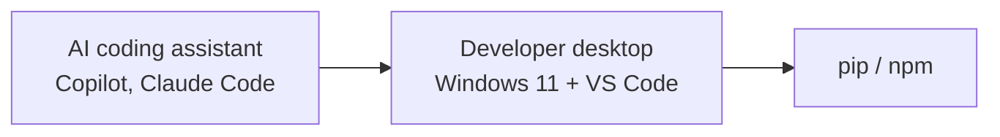
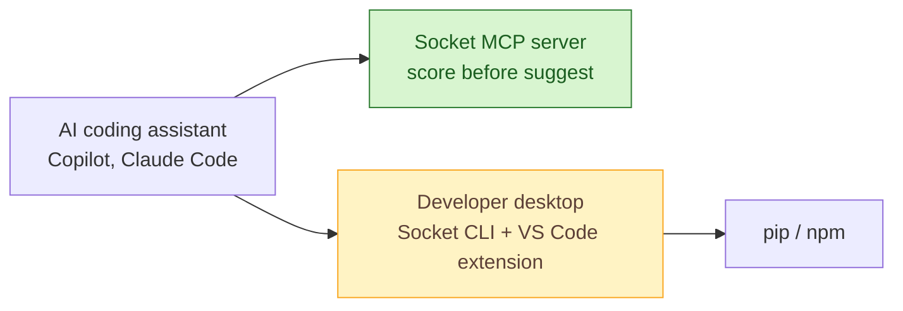

# SOAP-004 — Ship the Socket toolchain to developer desktops and AI coding assistants

| | |
|---|---|
| **Status** | Draft |
| **Change type** | Security control |
| **Target solution** | Developer Platform — software supply chain slice, SAD v4.1 section 6 |
| **Author** | S. Morley, Solution Architect |
| **Approvers** | Architecture owner, Security, Developer Platform service owner (all to be named) |
| **Date** | 2026-09-24 |
| **Links** | DEVPLAT-2212, R-118, ADR-0044 (approved AI coding assistants), SEC-401, Threat model TM-SUPPLYCHAIN-2026-Q3. Part 2 of 3; depends on [SOAP-003](SOAP-003-socket-github-pull-request-gate.md) for the Socket tenant |

## Sizing gate

- [x] Touches at most three components inside one bounded context or one deployment unit. Every node marked added, changed or removed in the proposed-change diagram belongs to a row of the change delta table, and the table has at most three rows.
- [x] Does not change a contract other teams consume, or every consumer is listed under Impact.
- [x] Adds no new fail-closed dependency to the build, deploy or runtime path of any team outside the owning team.
- [x] If more than two teams beyond the owning team are affected, every one is named under Impact and the rollout starts with a report-only or small-wave stage.
- [x] Does not change data classification or residency, extend retention, or introduce new personal data.
- [ ] Sends no data to a new third party and adds no new supplier, unless its third-party risk assessment is complete, covers that data, and is linked above.
- [x] Weakens no security control.
- [x] Cost delta is within the service owner's delegated authority.
- [x] Can be rolled back without reversing a data migration.
- [x] Does not contradict an accepted ADR (or the superseding ADR is linked above).

**Gate notes.** The supplier box waits on SEC-401, as for SOAP-003. Every tool in this SOAP advises; none blocks an install or a build, so a Socket outage degrades the desktop to today's behaviour. Blocking at install is SOAP-005.

**Gate confirmed by:** not yet confirmed.

## Summary

Developers and approved AI coding assistants choose packages today with no signal about whether they are malicious, and assistants suggest package names that attackers now register in advance. This change ships a managed Socket toolchain to every Windows 11 developer desktop, the Socket CLI and VS Code extension for scores where the package is chosen, and registers the Socket MCP server so assistants score a package before suggesting it, partly treating R-118 ahead of the install-time control. It costs no licence beyond SOAP-003's tenant and three engineer-days, and the thing most likely to go wrong is a broken desktop baseline, which the waves of thirty contain.

## Current state

Developer desktops on Windows 11 run VS Code and install packages with `pip` and `npm`. Approved AI coding assistants suggest package names that developers and agents install without any check. There is no supply chain tooling on the desktop. Full topology: SAD v4.1 section 6.

## Proposed change

An Intune-managed baseline adds the Python Socket CLI for local and pre-push scans and the Socket Security VS Code extension for inline package scores. The extension registers the Socket MCP server with the approved assistants, and the MCP endpoint URL is pinned in managed VS Code settings so a developer or a package cannot point it elsewhere. Tokens live in Windows Credential Manager, not in environment files.

### Developer desktop baseline — Windows 11 with VS Code

| Item | Detail |
|---|---|
| **Python and CLI** | Python 3.12 via `winget install Python.Python.3.12`, then `pipx install socketsecurity`, giving `socketcli` on `PATH` for `socketcli --target-path .` scans and pre-push checks |
| **Node runtime** | Node 22 LTS, because the npm-published Socket CLI is a Node package even on a Python-first desktop |
| **API token** | `SOCKET_SECURITY_API_TOKEN` held in Windows Credential Manager and injected per session by the profile script, never written to a plaintext user environment variable or a repo `.env` |
| **VS Code extensions** | `SocketSecurity.vscode-socket-security` for inline package scores and MCP registration; `ms-python.python` and `ms-python.vscode-pylance` for the import detection the extension keys off; `ms-vscode.powershell` for the baseline scripts |
| **Offline** | Extension reporting can be disabled for zero-network work; nothing in this SOAP blocks an install |

### Change delta

| # | Component | Action | Before | After | Owner |
|---|---|---|---|---|---|
| 1 | Developer desktop baseline | Modify | VS Code, ad hoc Python, no supply chain tooling | Intune baseline above: Socket CLI, VS Code extension, token in Credential Manager, pinned MCP endpoint in managed settings | Endpoint Engineering |
| 2 | Socket MCP registration | Add | Assistants suggest packages unchecked | Socket MCP server registered with approved assistants; output treated as untrusted data under ADR-0044 | Developer Platform |

## Options considered

| Option | Summary | Chosen? | Why |
|---|---|---|---|
| A — Managed CLI, extension and MCP | Score packages where they are chosen, by people and by assistants | Yes | Cheapest point to stop a bad choice; reuses the SOAP-003 tenant and policy |
| B — Rely on SOAP-003 pull request checks | No desktop change | No | A malicious `postinstall` script has already run on the laptop by the time the pull request exists |
| C — Do nothing until SOAP-005 | Wait for install-time blocking | No | SOAP-005 is escalated; assistants keep suggesting unchecked names in the meantime |

## Security and compliance

| Item | Detail |
|---|---|
| **Controls added or strengthened** | A.5.21 Managing information security in the ICT supply chain, A.8.28 Secure coding |
| **Controls weakened or bypassed** | None |
| **Threat model delta** | Reduces TM-SUPPLYCHAIN T8 slopsquatting, where an assistant suggests a name an attacker has registered, and T2 typosquat at the point of choice. New surface: the MCP server is an untrusted-content channel into the assistant; a stolen desktop token exposes scan data |
| **Data** | Package names, versions and local manifests go to Socket's EU tenant. Classification Internal, unchanged; no source upload |
| **Identity and access** | Desktop tokens are read-scoped, issued per user through the SOAP-003 tenant's SSO, and held in Credential Manager |
| **Risk register** | R-118 partly treated (desktop signal only; install-time blocking is SOAP-005) |
| **Gates and evidence** | SEC-401 complete; security review sign-off on this SOAP; SoA row A.8.28 evidence updated |

## Impact

| Area | Impact |
|---|---|
| **Availability and resilience** | None on builds or installs. A Socket outage removes the scores and leaves desktops as they are today |
| **Performance** | Extension scoring is asynchronous; no effect on editor responsiveness or install time |
| **Cost** | No licence beyond SOAP-003. One-off: three engineer-days across Endpoint Engineering and Developer Platform |
| **Operations** | Intune compliance report on baseline drift; RB-DEVPLAT-14 gains a desktop-baseline section |
| **Consumers and dependencies** | Every engineer on a Windows 11 desktop: Payments, Customer Portal, Data Platform, Mobile, Internal Tools. Endpoint Engineering owns the Intune baseline |
| **Data** | None migrated |

## Implementation and rollout

1. Pilot the baseline on ten volunteer desktops for one week.
2. Roll it to the fleet in waves of thirty, so a broken profile script or extension lands on a small group first.
3. Enable MCP registration for the approved assistants once the extension is on every desktop.

- **Rollback:** Reassign the previous Intune configuration profile; the next policy refresh removes the tools and the MCP registration.
- **Point of no return:** none.
- **Verification:** `socketcli --target-path .` reports on a sample repository; the extension shows scores in a Python and a Node project; a hallucinated package name suggested to Claude Code is scored by the MCP server before any install is attempted.
- **Timeline:** pilot 2026-09-29, fleet complete 2026-10-13, MCP enabled 2026-10-14.

## Risks and assumptions

| ID | Risk or assumption | Mitigation or how it is validated | Owner |
|---|---|---|---|
| RA-1 | The Socket MCP server returns content that an assistant treats as instructions, or a spoofed MCP endpoint is registered | Endpoint pinned over TLS in Intune-managed settings; assistants treat MCP output as untrusted data under ADR-0044; a score alone cannot cause an install | Developer Platform |
| RA-2 | A desktop token is stolen and used to read scan data | Tokens are read-scoped and per user; SSO revocation removes access; 90-day rotation | Security |
| RA-3 | The baseline breaks a developer's Python or Node setup | Pilot and waves of thirty; rollback by profile reassignment | Endpoint Engineering |

## Decision

We will ship a managed Socket toolchain to every Windows 11 developer desktop and register the Socket MCP server with approved AI coding assistants.

| Approver | Role | Decision | Date |
|---|---|---|---|
| | Architecture owner | | |
| | Security | | |
| | Developer Platform service owner | | |

**Conditions:** to be recorded at approval.

**Records to update on approval:** tick each one and link the pull request or commit that updated it.

- [ ] SAD v4.1 section 6 topology · owner Developer Platform · evidence pending
- [ ] Statement of applicability row A.8.28 · owner Security · evidence pending
- [ ] Threat model TM-SUPPLYCHAIN-2026-Q3 mitigations for T2 and T8, and the MCP surface · owner Security · evidence pending
- [ ] Intune desktop baseline document · owner Endpoint Engineering · evidence pending

**Follow-ups:** DEVPLAT-2212 Intune baseline package.

## References

- [Guide to Socket CLI](https://docs.socket.dev/docs/socket-cli) and [socketsecurity on PyPI](https://pypi.org/project/socketsecurity/)
- [Guide to Socket for VS Code](https://docs.socket.dev/docs/socket-for-vs-code) and the [Socket Security extension](https://marketplace.visualstudio.com/items?itemName=SocketSecurity.vscode-socket-security)
- [Socket MCP server](https://github.com/SocketDev/socket-mcp) and [Secure your AI-generated code with Socket MCP](https://socket.dev/blog/socket-mcp)
