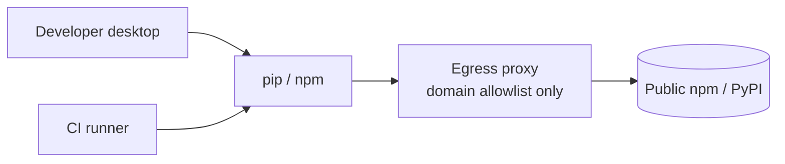
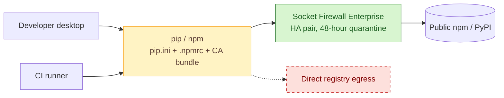

# SOAP-005 — Route every npm and PyPI install through Socket Firewall

| | |
|---|---|
| **Status** | Escalated to SAD v4.1 section 6 addendum |
| **Change type** | Security control |
| **Target solution** | Developer Platform — software supply chain slice, SAD v4.1 section 6 |
| **Author** | S. Morley, Solution Architect |
| **Approvers** | Architecture owner, Security, Developer Platform service owner (all to be named) |
| **Date** | 2026-09-24 |
| **Links** | DEVPLAT-2211, R-118, R-127, SEC-401, Threat model TM-SUPPLYCHAIN-2026-Q3. Part 3 of 3; depends on [SOAP-003](SOAP-003-socket-github-pull-request-gate.md) for the Socket tenant |

## Sizing gate

- [x] Touches at most three components inside one bounded context or one deployment unit. Every node marked added, changed or removed in the proposed-change diagram belongs to a row of the change delta table, and the table has at most three rows.
- [x] Does not change a contract other teams consume, or every consumer is listed under Impact.
- [ ] Adds no new fail-closed dependency to the build, deploy or runtime path of any team outside the owning team.
- [x] If more than two teams beyond the owning team are affected, every one is named under Impact and the rollout starts with a report-only or small-wave stage.
- [x] Does not change data classification or residency, extend retention, or introduce new personal data.
- [ ] Sends no data to a new third party and adds no new supplier, unless its third-party risk assessment is complete, covers that data, and is linked above.
- [x] Weakens no security control.
- [x] Cost delta is within the service owner's delegated authority.
- [x] Can be rolled back without reversing a data migration.
- [x] Does not contradict an accepted ADR (or the superseding ADR is linked above).

**Gate notes.** The firewall is fail-closed and becomes the only route to npm and PyPI, so every team's local installs and CI builds stop when it is down or wrong. That is a structural change to the build path of the whole engineering organisation, and the HA pair and break-glass reduce the risk without making it a single-team change. This SOAP is therefore escalated. Its content stands as input to the SAD v4.1 section 6 addendum, which should also settle the conda and R environments (SOAP-006 in the original plan) so the install path is designed once.

**Gate confirmed by:** not applicable; escalated by the author on 2026-09-24.

## Summary

Nothing today inspects the content of an npm or PyPI package before it is installed and its scripts run, on a developer desktop or in CI; the egress proxy filters by domain only. This change makes Socket Firewall Enterprise the only path to the public registries, refusing malware, install-script abuse, typosquats and dependency-confusion candidates before the bytes reach a machine, treating R-118 by its 2026-10-31 remediation date. That date is now at risk because of the escalation. It costs about 90 USD a month for the firewall pair on top of the SOAP-003 tenant, plus three engineer-days, and the thing most likely to go wrong is a false block stalling every build at once.

## Current state

Developer desktops and CI runners install packages with `pip` and `npm` straight from public PyPI and npm over the corporate egress proxy, which filters by domain only and inspects no package content. Full topology: SAD v4.1 section 6.

## Proposed change

Socket Firewall Enterprise runs as an HA pair across two availability zones in the platform VPC, behind an internal load balancer, and becomes the only route to npm and PyPI. It resolves each package request against org policy and Socket's package intelligence, and holds any package version published in the last 48 hours for review. Desktops and CI runners get `pip.ini`, `.npmrc` and the corporate CA bundle pointing at the firewall, shipped by Intune and the runner image. Direct registry egress is removed at the perimeter.

### Change delta

| # | Component | Action | Before | After | Owner |
|---|---|---|---|---|---|
| 1 | Socket Firewall | Add | None | HA pair in two zones behind an internal load balancer, fail-closed, 24-hour verdict cache, 48-hour new-version quarantine | Platform |
| 2 | Registry client configuration | Modify | Desktops and runners use public registries through the egress proxy | `pip.ini` `index-url`, `.npmrc` `registry`, `PIP_CERT` and `NODE_EXTRA_CA_CERTS` point at the firewall; Intune reverts local edits | Endpoint Engineering, Platform |
| 3 | Perimeter registry egress rule | Remove | Domain allowlist permits npm and PyPI | Rule disabled, then deleted after 30 days | Platform |

## Options considered

| Option | Summary | Chosen? | Why |
|---|---|---|---|
| A — Socket Firewall as the only registry path | Blocks at install, one policy with SOAP-003 and SOAP-004 | Yes | Install time is the only point where a malicious package is stopped before it executes |
| B — Artifactory remote repository with a curated allowlist | Reuse the artifact store already run | No | Curation is manual and lags publication by days, longer than the median malicious-package takedown window; no behavioural analysis |
| C — Do nothing beyond SOAP-003 and SOAP-004 | Pull request and desktop signals only | No | Leaves R-118 untreated: nothing stops an install script running |

## Security and compliance

| Item | Detail |
|---|---|
| **Controls added or strengthened** | A.5.21 Managing information security in the ICT supply chain, A.8.8 Management of technical vulnerabilities, A.8.19 Installation of software on operational systems, A.8.16 Monitoring activities |
| **Controls weakened or bypassed** | None. A.8.21 Security of network services is re-scoped: the firewall replaces the egress proxy as the enforcement point for registry traffic and inherits its logging obligations |
| **Threat model delta** | Mitigates TM-SUPPLYCHAIN T1 install-script execution, T2 typosquat, T3 dependency confusion, T4 compromised maintainer, T8 slopsquatting and T9 agent-initiated install at the point of install. New surface: the firewall terminates TLS for every install, so its compromise is a supply chain machine-in-the-middle; Socket's AI verdicts can be wrong; a package author can embed text aimed at the analysis model |
| **Data** | Package names and versions requested go to Socket's EU tenant. Classification Internal, unchanged |
| **Identity and access** | One firewall service token, rotated 90-daily from the platform secret store; policy writes by Security only, through the SOAP-003 tenant |
| **Risk register** | R-118 treated (High → Low); R-127 raised (dependency on a single vendor in the install path) |
| **Gates and evidence** | SEC-401 complete; a fortnight of firewall decision logs sampled; SoA rows A.5.21 and A.8.19 updated; change board for the perimeter rule removal |

## Impact

| Area | Impact |
|---|---|
| **Availability and resilience** | The firewall becomes a hard dependency for every build and every local install. HA pair across two zones, fail-closed, with a break-glass that re-enables the direct egress rule for a named change window. A Socket API outage degrades to cached verdicts for 24 hours, then blocks |
| **Performance** | Roughly 40 to 120 ms per uncached package request; a cold CI install of a 900-package lockfile is about 15 seconds slower on first run in a new cache region |
| **Cost** | About 90 USD per month for the firewall pair; licence covered by SOAP-003. One-off: three engineer-days across Platform, Endpoint Engineering and Security |
| **Operations** | Grafana panel for block rate and decision latency; PagerDuty alert on firewall health and cache staleness past 12 hours; RB-DEVPLAT-14 gains firewall block triage and break-glass |
| **Consumers and dependencies** | Every team that installs npm or PyPI packages, on desktop and in CI: Payments, Customer Portal, Data Platform, Mobile, Internal Tools. Data Platform's conda and R environments are out of scope and keep the existing path |
| **Data** | None migrated. Lockfiles and manifests unchanged |

## Implementation and rollout

1. Deploy the firewall pair in `staging` in report-only mode; point ten volunteer desktops and the Payments CI project at it; collect decision logs for one week.
2. Roll the client configuration to the fleet and runners in waves of thirty, still report-only.
3. Cut-over: switch the firewall policy to block, then disable the direct registry egress rule the following working day.

- **Rollback:** Set the firewall policy to allow-all in the Socket console (under two minutes) and re-enable the perimeter egress rule, which stays disabled rather than deleted for 30 days. Client configuration reverts by reassigning the previous Intune profile and runner image.
- **Point of no return:** deleting the perimeter egress rule after 30 days; after that, restoring direct egress goes through a normal firewall change.
- **Verification:** A known-malicious package from Socket's sample set is refused on a desktop `pip install` and in CI, with the block in the decision log; a package version under 48 hours old is held.
- **Timeline:** set by the SAD addendum. The original target of block mode on 2026-10-14 no longer holds.

## Risks and assumptions

| ID | Risk or assumption | Mitigation or how it is validated | Owner |
|---|---|---|---|
| RA-1 | The firewall blocks a legitimate package and stalls every release | One week report-only; four-hour triage target in RB-DEVPLAT-14; Security-granted override with a mandatory expiry | Developer Platform |
| RA-2 | The firewall is a single point of failure in every build | HA pair across two zones, 24-hour verdict cache, break-glass to re-enable direct egress under change control | Platform |
| RA-3 | Socket's AI analysis returns a false negative | Deterministic signals such as install scripts, network calls and obfuscation block independently of the model verdict; Dependabot and EDR stay; 48-hour quarantine | Security |
| RA-4 | A package author embeds text designed to steer Socket's analysis model toward a benign verdict | Policy blocks on deterministic signals regardless of the model verdict; AI-only allows sampled weekly (SEC-402); escalated to Socket as a vendor finding | Security |
| RA-5 | Developers bypass the control by editing `pip.ini` or exporting a different registry | Intune reverts drift; with the perimeter rule removed a direct request fails; weekly report on desktops whose config hash does not match | Endpoint Engineering |

## Decision

Escalated. The SAD v4.1 section 6 addendum will decide whether Socket Firewall becomes the only path to npm and PyPI.

| Approver | Role | Decision | Date |
|---|---|---|---|
| | Architecture owner | | |
| | Security | | |
| | Developer Platform service owner | | |

**Conditions:** not applicable while escalated.

**Records to update on approval:** carried into the SAD addendum.

- [ ] SAD v4.1 section 6 addendum raised · owner Developer Platform · evidence pending

**Follow-ups:** DEVPLAT-2211 SAD addendum for the install path, DEVPLAT-2215 conda and R environments, SEC-401 third-party risk assessment.

## References

- [Socket Firewall overview](https://docs.socket.dev/docs/socket-firewall-overview) and [Socket Firewall Free](https://docs.socket.dev/docs/socket-firewall-free)
