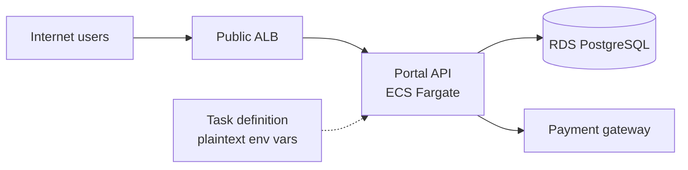
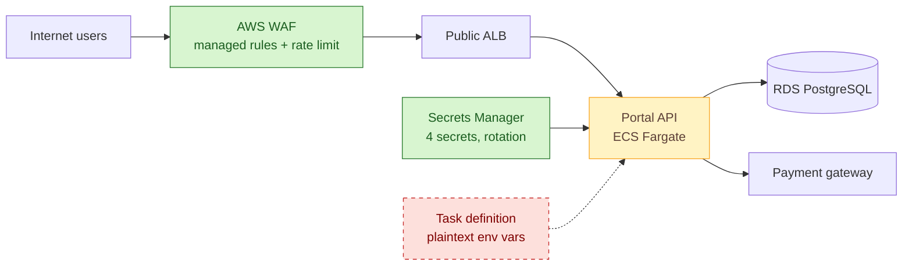

# SOAP-001 — Front the customer portal with a WAF and move secrets to a managed store

| | |
|---|---|
| **Status** | Approved |
| **Change type** | Security control |
| **Target solution** | Customer Portal — [SAD v2.3](../README.md) |
| **Author** | J. Okafor, Security Architect |
| **Approvers** | Architecture owner (M. Reyes), Security (P. Lindqvist), Service owner (A. Chen) |
| **Date** | 2026-08-28 |
| **Links** | PORTAL-1187, R-042, R-051, ADR-0009 (AWS as strategic cloud), Threat model TM-PORTAL-2026-Q2 |

## Sizing gate

- [x] Touches at most three components inside one bounded context or one deployment unit. Every node marked added, changed or removed in the proposed-change diagram belongs to a row of the change delta table, and the table has at most three rows.
- [x] Does not change a contract other teams consume, or every consumer is listed under Impact.
- [x] Adds no new fail-closed dependency to the build, deploy or runtime path of any team outside the owning team.
- [x] If more than two teams beyond the owning team are affected, every one is named under Impact and the rollout starts with a report-only or small-wave stage.
- [x] Does not change data classification or residency, extend retention, or introduce new personal data.
- [x] Sends no data to a new third party and adds no new supplier, unless its third-party risk assessment is complete, covers that data, and is linked above.
- [x] Weakens no security control.
- [x] Cost delta is within the service owner's delegated authority.
- [x] Can be rolled back without reversing a data migration.
- [x] Does not contradict an accepted ADR (or the superseding ADR is linked above).

**Gate confirmed by:** M. Reyes, 2026-08-28.

## Summary

The customer portal's public Application Load Balancer (ALB) accepts traffic with no web application firewall, and the portal API reads its database and third-party credentials from environment variables baked into the task definition. The Q2 penetration test raised both as high findings (R-042 injection exposure, R-051 secret sprawl) with a remediation deadline of 2026-09-30. This change adds AWS WAF with the managed core rule set in front of the ALB and moves the four secrets to AWS Secrets Manager with rotation, at roughly 60 USD a month and two sprint-days of work.

## Current state

Internet traffic reaches the ALB directly, which forwards to the portal API tasks on ECS Fargate. The API holds four secrets (database password, payment gateway key, email provider key, session signing key) as plaintext environment variables in the task definition. Rotation is manual and has not happened since go-live. Full topology: SAD v2.3, section 5.

## Proposed change

A regional AWS WAF web ACL attaches to the ALB, running the AWS managed core rule set, the known-bad-inputs set, and a rate-based rule at 2,000 requests per five minutes per IP. The web ACL starts in count mode for one week, then moves to block. The four secrets move to Secrets Manager; the task definition references them by ARN and the task execution role gains read access to those four secret ARNs only. Rotation is a separate, later step, because it is the point after which the old task definition can no longer start: the database password rotates every 30 days through the managed RDS rotation function, and the session signing key through a custom rotation function that keeps the previous key valid for verification for one period so live sessions survive. The two vendor keys stay manual until the vendors support rotation APIs.

### Change delta

| # | Component | Action | Before | After | Owner |
|---|---|---|---|---|---|
| 1 | AWS WAF web ACL | Add | None | Managed rule groups + rate rule, attached to ALB, logs to CloudWatch | Platform |
| 2 | Secrets Manager | Add | None | Four secrets, two with 30-day rotation | Platform |
| 3 | Portal API task definition | Modify | Plaintext env vars | `secrets` block referencing ARNs; execution role scoped to four ARNs; old revisions holding plaintext values deregistered after rotation | Portal team |

## Options considered

| Option | Summary | Chosen? | Why |
|---|---|---|---|
| A — AWS WAF + Secrets Manager | Native services, no new vendor, Terraform modules already exist in the platform repo | Yes | Fastest to the deadline, cheapest, and aligns with ADR-0009 |
| B — Third-party WAF (CDN vendor) + HashiCorp Vault | Stronger bot management, portable secrets | No | New vendor onboarding alone exceeds the 2026-09-30 deadline; Vault adds an operational component the team does not run today |
| C — Secrets Manager only, defer WAF | Halves the work | No | Leaves R-042 open past the pen-test remediation date |

## Security and compliance

| Item | Detail |
|---|---|
| **Controls added or strengthened** | A.8.20 Networks security, A.8.22 Segregation of networks, A.8.24 Use of cryptography, A.8.9 Configuration management, A.5.17 Authentication information |
| **Controls weakened or bypassed** | None |
| **Threat model delta** | Mitigates TM-PORTAL T3 (SQL injection via search), T7 (credential exposure from task metadata), T9 (credential-stuffing volume). New surface: WAF misconfiguration could block legitimate traffic; mitigated by count-mode week and the rollback below |
| **Data** | Customer PII (Confidential) unchanged; secrets move from task metadata to an encrypted store; no residency change (eu-west-2); no retention change |
| **Identity and access** | Task execution role gains read access on four secret ARNs; the RDS rotation function's role gains password change on one instance; the session-key rotation function's role gains write on one secret; all administered by Platform via Terraform |
| **Risk register** | R-042 treated (High → Low). R-051 treated (High → Medium): superseded task definition revisions still show the old plaintext values until step 4 rotates them and the revisions are deregistered, and the two vendor keys stay manual |
| **Gates and evidence** | Security review sign-off on this SOAP; WAF logs sampled for one week; SoA rows A.8.20 and A.5.17 updated to "Implemented" |

## Impact

| Area | Impact |
|---|---|
| **Availability and resilience** | WAF is a regional managed service with no SLO impact; secrets are injected by the ECS agent at task start, so a Secrets Manager outage delays new task launches but does not affect running tasks |
| **Performance** | Under 1 ms added latency per request at the ALB; no measurable API change |
| **Cost** | About 60 USD per month (WAF 5 USD ACL + 1 USD per rule group + request charges; Secrets Manager 0.40 USD per secret plus API calls); no one-off cost |
| **Operations** | New CloudWatch alarm on WAF blocked-request rate; runbook RB-PORTAL-07 gains a "WAF blocking legitimate traffic" section and a "rotation failed" section; rotation failure alarm routes to Platform on-call |
| **Consumers and dependencies** | None external. Portal mobile app team notified because the rate rule applies per IP and carrier NAT could trigger it; threshold reviewed with them |
| **Data** | None |

## Implementation and rollout

1. Terraform: create the Secrets Manager entries (rotation off) and the WAF web ACL in count mode in `staging`; update the task definition; deploy, run the regression suite, then rehearse the secrets rollback by redeploying the previous revision.
2. Promote to `production` with WAF still in count mode and rotation still off; monitor blocked-count metrics for seven days.
3. Cut-over: switch the web ACL default rule action to block on 2026-09-16 during the standard change window.
4. Rotation: on 2026-09-23, rotate the two vendor keys by hand, enable automatic rotation for the database password and session signing key and trigger the first rotation, then deregister every task definition revision that holds plaintext values.

- **Rollback:** WAF: set the web ACL to count mode (one Terraform apply, under two minutes). Secrets, until step 4: redeploy the previous task definition revision (about five minutes).
- **Point of no return:** step 4. Rotation invalidates the credentials in the old revisions, so from then on a secrets fault is fixed forward: Platform on-call pauses rotation and sets the secret to a known-good value by hand, under 15 minutes per RB-PORTAL-07. The WAF rollback is unaffected.
- **Verification:** WAF blocks the pen-test injection payloads replayed from the test harness; the Secrets Manager console shows a last-rotated date for both rotated secrets; no active task definition revision contains a plaintext secret; portal synthetic checks stay green through steps 3 and 4.
- **Timeline:** staging 2026-09-04, production count mode 2026-09-09, block mode 2026-09-16, rotation 2026-09-23.

## Risks and assumptions

| ID | Risk or assumption | Mitigation or how it is validated | Owner |
|---|---|---|---|
| RA-1 | Managed rules block a legitimate portal feature (file upload with embedded markup) | One week in count mode; upload paths added to an exclusion rule if they show up in count logs | Portal team |
| RA-2 | Rotation function cannot reach RDS because of security-group rules | Rotation rehearsed in staging before step 4; function placed in the same private subnets as the API | Platform |
| RA-3 | Assumption: payment gateway and email vendor have no rotation API | Confirmed with both vendors on 2026-08-20; revisit at contract renewal | Security |
| RA-4 | Session signing key rotation logs every user out | Rotation function keeps the previous key valid for verification for one rotation period; tested in staging with a live session across a rotation | Portal team |

## Decision

We will front the portal ALB with AWS WAF and move all four API secrets to Secrets Manager with rotation where the credential owner supports it.

| Approver | Role | Decision | Date |
|---|---|---|---|
| M. Reyes | Architecture owner | Approved | 2026-08-29 |
| P. Lindqvist | Security | Approved with conditions | 2026-08-29 |
| A. Chen | Service owner | Approved | 2026-09-01 |

**Conditions:** Security requires the two manually rotated vendor keys to be rotated by hand in step 4 and a calendar reminder set for 90-day manual rotation.

**Records to update on approval:** tick each one and link the pull request or commit that updated it.

- [ ] SAD v2.3 section 5 diagram and section 8 security controls · owner Portal team · evidence pending
- [ ] Statement of applicability rows A.8.20 and A.5.17 · owner Security · evidence pending
- [ ] Threat model TM-PORTAL-2026-Q2 mitigations · owner Security · evidence pending
- [ ] Runbook RB-PORTAL-07 · owner Portal team · evidence pending
- [ ] CMDB entry for Customer Portal · owner Platform · evidence pending

**Follow-ups:** PORTAL-1190 (WAF exclusion tuning), PORTAL-1191 (manual rotation reminder), SEC-233 (SoA update).
