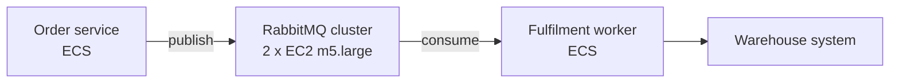
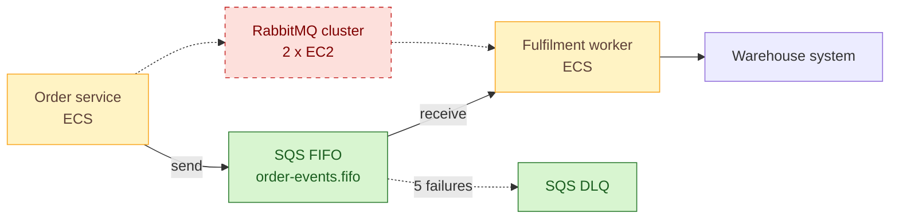

# SOAP-002 — Replace self-hosted RabbitMQ with Amazon SQS for order events

| | |
|---|---|
| **Status** | In review |
| **Change type** | Modernisation |
| **Target solution** | Order Management — [SAD v1.8](../README.md) |
| **Author** | D. Mbeki, Solution Architect |
| **Approvers** | Architecture owner (M. Reyes), Security (P. Lindqvist), Service owner (R. Novak) |
| **Date** | 2026-09-02 |
| **Links** | ORD-2041, R-077, ADR-0009 (AWS as strategic cloud), ADR-0014 (event-driven integration) |

## Sizing gate

- [x] Touches at most three components inside one bounded context or one deployment unit. Every node marked added, changed or removed in the proposed-change diagram belongs to a row of the change delta table, and the table has at most three rows.
- [x] Does not change a contract other teams consume, or every consumer is listed under Impact.
- [x] Adds no new fail-closed dependency to the build, deploy or runtime path of any team outside the owning team.
- [x] If more than two teams beyond the owning team are affected, every one is named under Impact and the rollout starts with a report-only or small-wave stage.
- [x] Does not change data classification or residency, extend retention, or introduce new personal data.
- [x] Sends no data to a new third party and adds no new supplier, unless its third-party risk assessment is complete, covers that data, and is linked above.
- [x] Weakens no security control.
- [x] Cost delta is within the service owner's delegated authority.
- [x] Can be rolled back without reversing a data migration.
- [x] Does not contradict an accepted ADR (or the superseding ADR is linked above).

**Gate confirmed by:** M. Reyes, 2026-09-02. Retention shortens from unbounded to 14 days, which the gate allows; it is recorded under Security and compliance and Impact.

## Summary

Order Management runs a two-node RabbitMQ cluster on EC2 that carries the `OrderPlaced` and `OrderCancelled` events from the order service to the fulfilment worker. The cluster is on an unsupported Erlang release, has no one on the team who knows how to operate it, and caused two Sev-2 incidents this year when a node's disk filled (R-077). This change replaces the cluster with an Amazon SQS FIFO queue and dead-letter queue, removing two servers and about 40 hours a year of patching, at a net saving of roughly 180 USD a month.

## Current state

The order service publishes to a RabbitMQ exchange; the fulfilment worker consumes from a durable queue bound to it. Both run as ECS services in the same VPC. The broker cluster runs on two `m5.large` instances patched by hand. There is one producer and one consumer; no other team reads from this broker. Full topology: SAD v1.8, section 4.

## Proposed change

The order service publishes to an SQS FIFO queue using the order ID as the message group ID, which preserves per-order ordering, the only ordering the fulfilment worker relies on. A dead-letter queue receives messages after five failed receives. The worker switches from the AMQP client to the AWS SDK with long polling. The message body and schema are unchanged, so no contract changes. Both services read an `ORDER_EVENT_TRANSPORT` flag. In `dual` mode the order service publishes to both transports, the worker fulfils from SQS, and a shadow AMQP consumer in the worker acknowledges broker messages without fulfilling them and records their order IDs. That keeps the broker queue empty, so the disk cannot fill during the dual window, and gives a count to compare against SQS.

### Change delta

| # | Component | Action | Before | After | Owner |
|---|---|---|---|---|---|
| 1 | Message transport | Replace | RabbitMQ cluster on EC2 | SQS FIFO queue + DLQ, KMS-encrypted, 14-day retention | Platform |
| 2 | Order service | Modify | AMQP publisher | SQS sender behind `ORDER_EVENT_TRANSPORT` (`rabbitmq`, `dual`, `sqs`); dual-publish during cut-over | Orders team |
| 3 | Fulfilment worker | Modify | AMQP consumer | SQS long-poll consumer behind the same flag, plus a shadow AMQP consumer in `dual` and an active-on-both mode `both` for rollback; idempotent on order ID | Orders team |

## Options considered

| Option | Summary | Chosen? | Why |
|---|---|---|---|
| A — SQS FIFO + DLQ | Managed, serverless, native IAM, exactly the ordering guarantee needed | Yes | Removes the operational burden entirely; cheapest; consistent with ADR-0014 |
| B — Amazon MQ (managed RabbitMQ) | Same protocol, no code change | No | Keeps broker-specific operations and cost (about 300 USD per month for a two-node cluster); the real problem is broker ownership, not hosting |
| C — Amazon EventBridge + SQS | Adds fan-out for future consumers | No | No second consumer exists today; add it in a later SOAP when one does |

## Security and compliance

| Item | Detail |
|---|---|
| **Controls added or strengthened** | A.8.24 Use of cryptography (KMS at rest; TLS in transit replaces plaintext AMQP inside the VPC), A.8.2 Privileged access rights (broker admin console removed), A.8.8 Management of technical vulnerabilities (unpatched Erlang removed) |
| **Controls weakened or bypassed** | None |
| **Threat model delta** | Removes the broker management console (an internal admin surface with a shared password). New surface: queue access is IAM-scoped, so the risk shifts to over-broad task roles; mitigated by per-queue resource policies |
| **Data** | Order events contain customer name and delivery address (Confidential); retention drops from unbounded on the broker disk to 14 days; residency unchanged (eu-west-2) |
| **Identity and access** | Order service task role gains send access on one queue; worker role gains receive and delete access on one queue; DLQ readable by Orders on-call role only |
| **Risk register** | R-077 treated (High → Low) |
| **Gates and evidence** | Security review on this SOAP; IAM policies reviewed in the Terraform pull request; SoA row A.8.8 evidence updated |

## Impact

| Area | Impact |
|---|---|
| **Availability and resilience** | SQS FIFO is multi-AZ with a 99.9 percent SLA, up from a two-node cluster with no automatic failover. FIFO throughput is 300 API calls per second per action per queue, or about 3,000 messages per second with batching, well above the peak of 40 per second |
| **Performance** | End-to-end event latency rises from about 5 ms to tens of milliseconds, because each event is an HTTPS send and receive instead of a pushed AMQP delivery; fulfilment has a 30-second target, so this is immaterial |
| **Cost** | Saves about 180 USD per month: removes two `m5.large` instances (about 140 USD) and 40 GB EBS (about 4 USD); adds SQS at under 5 USD for current volume; removes about 40 hours a year of patching effort |
| **Operations** | Broker patching, disk alarms, and runbook RB-ORD-03 retired; new alarm on DLQ depth greater than zero and on queue age greater than 60 seconds; dashboard panel replaced |
| **Consumers and dependencies** | Only the fulfilment worker consumes these events. Confirmed by broker connection audit on 2026-08-30. Warehouse system is unaffected |
| **Data** | Nothing is migrated. Retention of order events drops from unbounded to 14 days, agreed with the Orders data owner; the broker disk is wiped when the instances terminate |

## Implementation and rollout

1. Terraform: create the FIFO queue, DLQ, KMS key, and IAM policies in `staging`; deploy both services with the flag set to `rabbitmq`; run the order regression suite.
2. In `staging`, set the flag to `dual`; confirm over a 24-hour soak that every order appears exactly once at the warehouse, that the shadow consumer's order IDs match SQS, and that broker queue depth stays near zero. Rehearse the rollback below once.
3. Repeat steps 1 and 2 in `production`, with a 72-hour dual window.
4. Cut-over: set the flag to `sqs` on both services, confirm the broker receives no new publishes and its queue depth is zero, then stop the broker instances (retain for 14 days before termination).

- **Rollback:** Set the worker to `both` (fulfil from both transports, idempotent on order ID), then the order service to `rabbitmq`; once the SQS queue is empty, set the worker to `rabbitmq`. Each step is a task definition environment change of about five minutes, and no event is lost or fulfilled twice.
- **Point of no return:** broker termination on 2026-10-02. Until then the stopped instances can be started and the rollback above applies; after it, a fault is fixed forward on SQS.
- **Verification:** Zero DLQ messages during the dual window; warehouse order count equals order service count, and shadow consumer count equals SQS count, for the window; the broker's queue depth is zero before stop; incident class R-077 closed after 30 days at zero.
- **Timeline:** staging 2026-09-08, production dual mode 2026-09-15, cut-over 2026-09-18, broker terminated 2026-10-02.

## Risks and assumptions

| ID | Risk or assumption | Mitigation or how it is validated | Owner |
|---|---|---|---|
| RA-1 | Duplicate delivery during dual mode or rollback causes a double fulfilment | Worker is already idempotent on order ID (verified by test `FulfilmentIdempotencyTest`); soak test counts confirm | Orders team |
| RA-2 | Undiscovered consumer on the broker | Connection audit found one; broker access logs monitored through the dual window for any other client | Platform |
| RA-3 | Assumption: per-order ordering is the only ordering the worker needs | Confirmed with the Orders team lead on 2026-08-27; documented in the worker README | Orders team |
| RA-4 | FIFO message group hot-spotting if a single order generates a burst | Orders generate at most three events; not a concern at current volumes | Orders team |
| RA-5 | Shadow consumer fails and the broker queue grows during the dual window | Existing broker disk alarm stays on until cut-over; queue depth alarm at 10,000 messages pages Orders on-call, who restart the shadow consumer or roll back | Orders team |

## Decision

We will replace the self-hosted RabbitMQ cluster with an SQS FIFO queue and dead-letter queue, cut over behind a feature flag, and terminate the broker after a 14-day retention window.

| Approver | Role | Decision | Date |
|---|---|---|---|
| M. Reyes | Architecture owner | | |
| P. Lindqvist | Security | | |
| R. Novak | Service owner | | |

**Conditions:** none yet; review in progress.

**Records to update on approval:** tick each one and link the pull request or commit that updated it.

- [ ] SAD v1.8 section 4 diagram and section 7 operations · owner Orders team · evidence pending
- [ ] Context map in `docs/domain/orders/` · owner Orders team · evidence pending
- [ ] Statement of applicability row A.8.8 · owner Security · evidence pending
- [ ] Runbooks RB-ORD-03 (retire) and RB-ORD-09 (new DLQ procedure) · owner Orders team · evidence pending
- [ ] CMDB entries for the two EC2 instances (retire) · owner Platform · evidence pending

**Follow-ups:** ORD-2044 (Terraform), ORD-2045 (service changes), ORD-2046 (broker decommission), PLAT-880 (cost tracking update).
