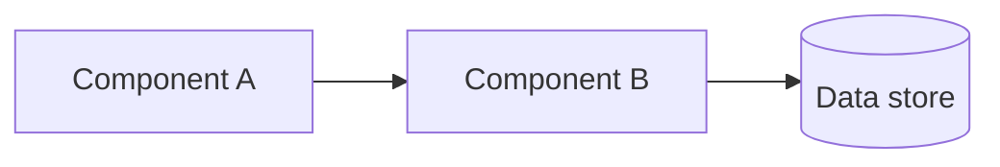
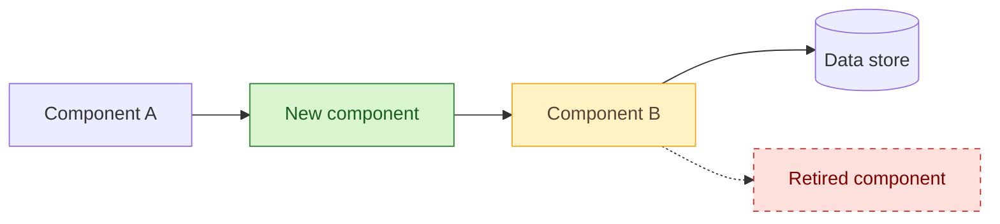

# Solution on a Page (SOAP) template

Template for describing an incremental change to an existing solution on one page, so it can be approved and built without a full Solution Architecture Design (SAD). Copy into `docs/soap/SOAP-NNN-short-title.md` (sequential number). One change per SOAP. Triage rules and filling guidance: [README](README.md).

Statuses: `Draft → In review → Approved | Rejected → Implemented`, later possibly `Superseded`. A SOAP whose sizing gate fails, or whose gate the architecture owner will not confirm, becomes `Escalated` and the work moves to an ADR or SAD. Never edit an approved SOAP's substance. Supersede it.

Front matter: the YAML block at the top is what `scripts/soap.py` reads to check the SOAP and build the register. Keep it in step with the header table; the check fails if the two disagree on status.

Diagram convention: every proposed-change diagram uses the three classes `added`, `changed`, `removed` exactly as shown in the template, so reviewers read every SOAP the same way.

---

````markdown
---
id: SOAP-NNN
status: Draft            # Draft | In review | Approved | Rejected | Implemented | Superseded | Escalated
change_type: Security control
solution: <solution name>
author: <name, role>
approvers: [<architecture owner>, <security>, <service owner>]
gate_confirmed_by: ""    # architecture owner; required before In review
gate_confirmed_on: ""    # YYYY-MM-DD
date: YYYY-MM-DD
components: [<component 1>, <component 2>]   # one entry per row of the change delta table
risks: [<R-NNN>]
controls: [<A.8.20>]
depends_on: []           # SOAP IDs that must be implemented first
superseded_by: ""
escalated_to: ""         # ADR or SAD reference when status is Escalated
---

# SOAP-NNN — <Change as a short assertive title, e.g. "Front the customer portal with a WAF">

| | |
|---|---|
| **Status** | Draft \| In review \| Approved \| Rejected \| Implemented \| Superseded by SOAP-NNN \| Escalated to ADR/SAD-NNN |
| **Change type** | Security control \| Modernisation \| Integration \| Resilience or scale \| Decommission \| Configuration |
| **Target solution** | <solution name> — <link to its SAD or architecture repo> |
| **Author** | <name, role> |
| **Approvers** | <architecture owner>, <security>, <service owner> |
| **Date** | YYYY-MM-DD |
| **Links** | <Jira epic>, <risk register IDs>, <related ADRs or SOAPs>, <threat model> |

## Sizing gate

All boxes must be ticked for this change to stay on a page. Any unticked box means
write an ADR (pure decision) or a full SAD (structural change) instead.

- [ ] Touches at most three components inside one bounded context or one deployment unit. Every node marked added, changed or removed in the proposed-change diagram belongs to a row of the change delta table, and the table has at most three rows.
- [ ] Does not change a contract other teams consume, or every consumer is listed under Impact.
- [ ] Adds no new fail-closed dependency to the build, deploy or runtime path of any team outside the owning team.
- [ ] If more than two teams beyond the owning team are affected, every one is named under Impact and the rollout starts with a report-only or small-wave stage.
- [ ] Does not change data classification or residency, extend retention, or introduce new personal data.
- [ ] Sends no data to a new third party and adds no new supplier, unless its third-party risk assessment is complete, covers that data, and is linked above.
- [ ] Weakens no security control.
- [ ] Cost delta is within the service owner's delegated authority.
- [ ] Can be rolled back without reversing a data migration.
- [ ] Does not contradict an accepted ADR (or the superseding ADR is linked above).

**Gate confirmed by:** <architecture owner>, YYYY-MM-DD. Required before the SOAP moves
to In review. The author ticks the boxes; the architecture owner confirms them.

## Summary

Three sentences. What changes. Why now (the risk, the audit finding, the end-of-life
date, the cost). What it costs and what could go wrong.

## Current state

One paragraph naming only the components this change touches, and how they connect today.
Link to the master diagram rather than redrawing the whole solution.



## Proposed change

One paragraph describing the target state of the affected slice. The diagram shows only
the delta: what is added, changed and removed. Everything else is drawn plain.



### Change delta

| # | Component | Action | Before | After | Owner |
|---|---|---|---|---|---|
| 1 | <name> | Add \| Modify \| Replace \| Remove | <state today> | <state after> | <team> |
| 2 | | | | | |

## Options considered

Two or three rows. The chosen option is first.

| Option | Summary | Chosen? | Why |
|---|---|---|---|
| A — <name> | <one line> | Yes | <the actual reason> |
| B — <name> | <one line> | No | <the actual reason, not a platitude> |

## Security and compliance

| Item | Detail |
|---|---|
| **Controls added or strengthened** | <ISO/IEC 27001 Annex A IDs or catalog IDs, e.g. A.8.20 Networks security> |
| **Controls weakened or bypassed** | None \| <ID and compensating control> |
| **Threat model delta** | <threats mitigated>, <new attack surface introduced> |
| **Data** | <classification of data in scope>, <flows that change>, <residency>, <retention> |
| **Identity and access** | <new principals, roles, secrets, and who administers them> |
| **Risk register** | <R-NNN treated>, <R-NNN raised> |
| **Gates and evidence** | <security review, pen test, SoA update, change board> |

## Impact

| Area | Impact |
|---|---|
| **Availability and resilience** | <SLO effect, new single points of failure, failure modes> |
| **Performance** | <latency or throughput effect, with numbers if known> |
| **Cost** | <monthly delta and one-off cost> |
| **Operations** | <runbooks, alerts, dashboards, on-call changes> |
| **Consumers and dependencies** | <every team or system that must change or be told> |
| **Data** | <migration, backfill, retention changes, or "none"> |

## Implementation and rollout

1. <Step, with the environment it lands in first>
2. <Step>
3. <Cut-over step, including the feature flag, DNS switch, or traffic weight>

- **Rollback:** <the exact action that restores the current state, and how long it takes>
- **Point of no return:** <the step after which the rollback above stops working, and what replaces it>
- **Verification:** <the test, metric, or log line that proves the change worked>
- **Timeline:** <target dates for each environment>

## Risks and assumptions

| ID | Risk or assumption | Mitigation or how it is validated | Owner |
|---|---|---|---|
| RA-1 | | | |
| RA-2 | | | |

## Decision

"We will <change>." One sentence, active voice.

| Approver | Role | Decision | Date |
|---|---|---|---|
| | Architecture owner | Approved \| Rejected \| Approved with conditions | |
| | Security | | |
| | Service owner | | |

**Conditions:** <anything the approval depends on, or "none">

**Records to update on approval:** tick each one and link the pull request or commit that
updated it. The SOAP moves to Implemented only when every box is ticked and linked.

- [ ] <master architecture diagram> · owner <team> · evidence <link>
- [ ] <SAD section> · owner <team> · evidence <link>
- [ ] <statement of applicability rows> · owner <team> · evidence <link>
- [ ] <CMDB or service catalog, runbooks, threat model> · owner <team> · evidence <link>

**Follow-ups:** <Jira keys for work this change creates>
````

---

**Why a SOAP and not an ADR or SAD:** an ADR records a decision and its reasoning but not the shape of the change, the control impact, or how it rolls out and rolls back. A SAD records all of that for a whole solution, at a cost most incremental changes cannot justify. A SOAP sits between them. It keeps the decision, the delta, and the approvals in one reviewable page, and it names the records the change must update so the master design does not drift.
