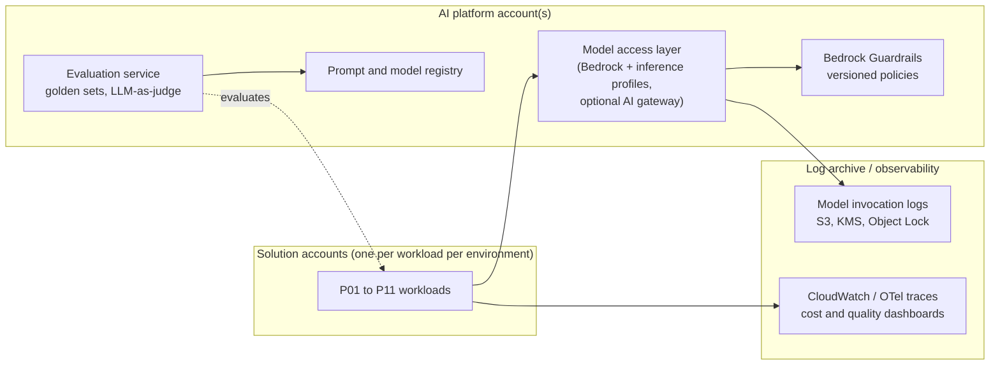

# 1. Shared Foundations for AI Workloads

The patterns in this series assume a set of **shared foundations**. Build these once, as paved-road platform components, and inherit them in every solution. Without them, each project reinvents model access, guardrails and cost tracking, and every SAR has to re-review them.

> Platform components are **always SAR Tier 1** ([review workflow §2.2](../docs/02-review-workflow.md#22-tiering)). An AI solution that inherits a reviewed foundation *references* these controls rather than re-proving them.

---

## 1.1 Model access layer

**Decisions to make once**

- **Approved models list.** Record the provider, Region availability, data-use terms, residency and evaluated use cases for each model. New models go through onboarding, as for any new service ([§4.1](../docs/04-cloud-security-architecture.md#41-shared-responsibility-and-service-selection)).
- **Access control.** Grant Bedrock model access per account. Scope IAM policies to specific model or inference-profile ARNs, and use SCPs to deny unapproved models and Regions.
- **Inference profiles.** Use **application inference profiles** per workload for cost allocation tags, and **cross-region inference profiles** for resilience where residency allows.
- **Quotas.** Treat tokens-per-minute and requests-per-minute quotas as capacity planning. Raise them before launch, alarm at 70% utilisation, and record the peak you expect.
- **AI gateway (optional, C3+).** A thin internal gateway adds central routing, fallbacks, per-team budgets, semantic caching and model abstraction. It runs on API Gateway + Lambda, or on ECS. Add one only when three or more workloads need these capabilities. Otherwise call Bedrock directly with application inference profiles.

## 1.2 Guardrails and content safety

- Define **Bedrock Guardrails** as versioned IaC: content filters, denied topics, word filters, PII detection/redaction, contextual grounding checks, and automated reasoning checks where they apply.
- Apply guardrails to **both input and output**. For RAG and agents, also screen **retrieved content and tool outputs**, because this is where indirect prompt injection enters.
- Guardrails reduce risk but are **not an authorisation control**. Enforce data access with IAM, retrieval-time filters and tool permissions. Never rely on a prompt that says "do not reveal".

## 1.3 Evaluation (LLMOps)

The quality SLOs in [§0.3](00-decision-framework.md#03-service-level-tiers) are only meaningful if something measures them.

| Stage | Mechanism |
|---|---|
| Development | A golden dataset (questions, expected answers, expected sources) owned by the business, with 50–500 items depending on risk |
| CI gate | Every change to a prompt, model, chunking, retrieval or tool is evaluated automatically: Bedrock Evaluations (LLM-as-judge, RAG evaluation) or an equivalent harness. Merge is blocked on regression |
| Release | Canary or shadow traffic for model/prompt changes at SL2+ |
| Production | Sampled online evaluation (groundedness, relevance, safety), user feedback capture, and drift alerts |
| Governance | Evaluation results are stored as release evidence ([DLC §5](../docs/05-delivery-lifecycle.md)) |

Treat **prompts, retrieval configuration and model IDs as versioned configuration**, promoted through environments like code ([§5.3](../docs/05-delivery-lifecycle.md#53-configuration)).

## 1.4 Observability

- **Bedrock model invocation logging** goes to a KMS-encrypted S3 bucket in the log archive account. Decide whether full prompts and responses are logged, and apply redaction for Confidential+ data. Logged prompts are themselves sensitive data.
- **Traces.** OpenTelemetry spans for each model call, retrieval, tool call and guardrail action, carrying model ID, token counts, latency, cache hits and a cost estimate. AgentCore Observability and CloudWatch generative AI observability provide much of this for managed runtimes.
- **Dashboards** per workload: the SLIs from §0.3, cost per transaction, and throttle rate.

## 1.5 FinOps for AI

- Tag every workload with application inference profiles and cost allocation tags. Snowflake: one warehouse and a resource monitor per workload, with Cortex usage attributed through query tags.
- Set **AWS Budgets** alarms at 50/80/100% of the monthly band, and a **per-transaction cost target** reviewed monthly.
- Add hard stops for runaway agents: a maximum number of steps, maximum tokens per session, and per-user rate limits.
- Review the fixed floor quarterly. Idle OpenSearch collections, running Snowflake warehouses, provisioned throughput and GPU endpoints are the usual waste.

## 1.6 Security considerations specific to AI

Map threats using the [threat model template](../templates/threat-model.md). The OWASP Top 10 for LLM Applications (2025) and MITRE ATLAS are the recommended catalogues. The recurring design-level threats are:

| Threat | Design control |
|---|---|
| **Prompt injection** (direct, and indirect through documents, web pages, tool output) | Separate instructions from data, screen inputs and retrieved content with guardrails, give tools least privilege, and require human approval for consequential actions |
| **Sensitive information disclosure** through retrieval | Document-level ACLs carried as metadata and enforced as **retrieval-time filters** from the caller's identity. Never trust the model to filter |
| **Excessive agency** | Tools are scoped per agent, write actions need confirmation, AgentCore Identity provides on-behalf-of credentials, and there are no broad service roles |
| **Data and model poisoning** | Controlled ingestion sources, provenance metadata, and review of new sources. Knowledge graph writes go through a governed pipeline |
| **Improper output handling** | Treat model output as untrusted input. Validate, escape and parameterise it before it reaches SQL, Cypher, shells or HTML |
| **Unbounded consumption** | Quotas, per-user rate limits, max-steps/max-tokens limits, budget alarms |
| **Supply chain** (models, weights, packages, MCP servers) | Approved-model list, a registry for self-hosted weights with integrity checks, and MCP servers treated as third-party integrations ([§4.11](../docs/04-cloud-security-architecture.md#411-third-parties-saas-and-integrations)) |

The AI review questions are consolidated in the [AI workload checklist](../checklists/ai-workloads.md).
