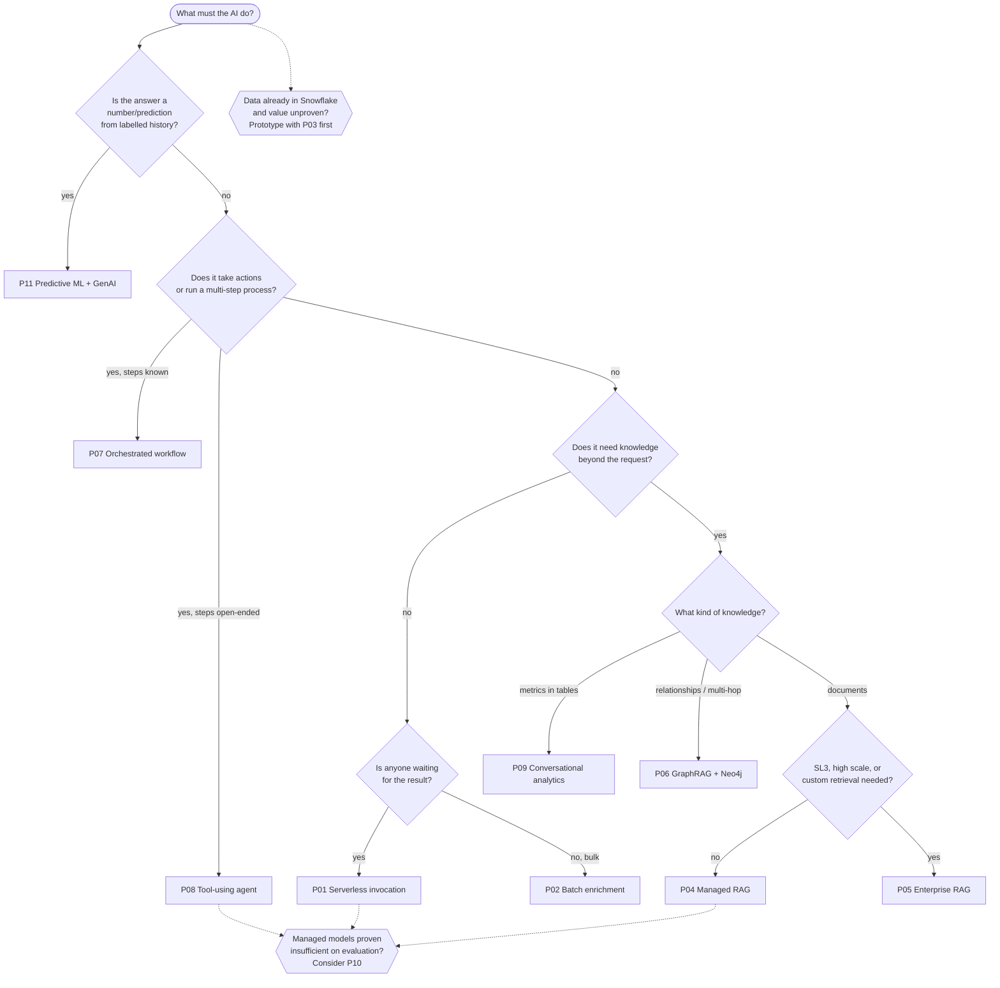

# AI Solution Architecture Patterns

A catalogue of reference architectures for AI solutions on **AWS** (primary platform), with **Snowflake** as an optional data pipeline and prototyping platform and **Neo4j** as an optional knowledge graph. Each pattern is scored on **budget**, **complexity** and **service level**, so delivery teams can pick the lightest pattern that meets their targets, and reviewers can challenge designs consistently.

These patterns feed the [Security Architecture Review process](../README.md). A team that picks a pattern and inherits the [shared foundations](01-shared-foundations.md) starts its SAR with most of the design questions already answered.

## Contents

| # | Document | Purpose |
|---|---|---|
| 0 | [Decision framework](00-decision-framework.md) | Budget bands, complexity levels, service level tiers, the AI cost model, platform roles |
| 1 | [Shared foundations](01-shared-foundations.md) | Model access, guardrails, evaluation, observability, FinOps and AI threats that every pattern inherits |
| — | [AI workload checklist](../checklists/ai-workloads.md) | Reviewer prompts for AI solutions |
| — | [AI pattern scoring sheet](../templates/ai-pattern-scoring-sheet.md) ([Excel workbook](../templates/ai-pattern-scoring.xlsx), [worked example](../templates/ai-pattern-scoring-example.xlsx), [CSV](../templates/ai-pattern-scoring.csv)) | Gates, weighted fit scoring and validation for comparing candidate patterns |
| — | [AI pattern selection record](../templates/ai-pattern-selection.md) | Records the chosen pattern, targets and trade-offs |

### Patterns

| ID | Pattern | Budget | Complexity | Max service level | Snowflake | Neo4j |
|---|---|---|---|---|---|---|
| [P01](patterns/P01-serverless-model-invocation.md) | Serverless model invocation | B1–B2 (≈$0 floor) | C1 | SL2 (SL3 with uplift) | — | — |
| [P02](patterns/P02-batch-enrichment-pipeline.md) | Batch AI enrichment pipeline | B1–B3 | C2 | SL2 (throughput) | Optional / central | Optional sink |
| [P03](patterns/P03-in-warehouse-ai-snowflake.md) | In-warehouse AI and prototyping | B1–B2 | C1 | SL1 (SL2 internal) | **Central** | — |
| [P04](patterns/P04-managed-rag.md) | Managed RAG (Bedrock Knowledge Bases) | B1–B2 | C2 | SL2 | Optional source | — |
| [P05](patterns/P05-enterprise-rag.md) | Enterprise RAG platform | B3–B4 | C3–C4 | **SL3** | Optional source | Optional |
| [P06](patterns/P06-graphrag-neo4j.md) | Knowledge graph RAG (GraphRAG) | B2–B3 | C3 | SL2–SL3 (by Neo4j tier) | Structured spine | **Central** |
| [P07](patterns/P07-orchestrated-agentic-workflow.md) | Orchestrated agentic workflow | B1–B2 | C2–C3 | SL2 (SL3 feasible) | Optional | Optional |
| [P08](patterns/P08-autonomous-agent.md) | Tool-using agent (bounded autonomy) | B2–B3 (variable) | C3–C4 | SL2 (success-rate SLOs) | Optional tool | Optional tool |
| [P09](patterns/P09-conversational-analytics.md) | Conversational analytics | B1–B2 | C2 | SL2 | **Central** (variant A) | Optional |
| [P10](patterns/P10-custom-and-self-hosted-models.md) | Customised and self-hosted models | B3–B4 | C4 | SL3 | Training data | Optional |
| [P11](patterns/P11-predictive-ml-with-genai.md) | Predictive ML with a generative interface | B2–B3 | C3 | SL3 (scoring path) | Features / scoring | Graph features |

### Suitability profile at a glance

Definitions are in [§0.6](00-decision-framework.md#06-suitability-dimensions). Each pattern's page gives the conditions behind its rating.

| ID | Max consequence | Data demand | Evaluability | Cost elasticity | Lock-in | Explainability | Regulatory fit | Model-change sensitivity | Human review |
|---|---|---|---|---|---|---|---|---|---|
| P01 | E2 | Low | High | Linear | Low | Low | R1 | Medium | None/Low |
| P02 | E3 (with review queue) | Medium | High | Linear | Low / High (Cortex) | Medium | R2 (with review) | Medium | Medium |
| P03 | E1–E2 | Medium | Medium | Linear | High | Medium | R0–R1 | Low–Medium | None |
| P04 | E2 (E3 advisory) | Medium | Medium | Linear | Medium | Medium | R1 | Low–Medium | Low |
| P05 | E3 advisory | High | Medium–High | Sub-linear | Low–Medium | Medium | R1 (R2 assistive) | Low | Low |
| P06 | E3 advisory | High | Medium | Sub-linear (serving) | Medium–High | **High** | R2 assistive | Medium | Medium |
| P07 | **E3–E4** (with approval bands) | Medium | High | Linear | Low–Medium | **High** | **R2 best fit** | Low | Medium–High |
| P08 | E2 (E3 with confirmed writes) | Medium–High | **Low** | **Super-linear** | Medium | Low–Medium | R1 | **High** | Low–Medium |
| P09 | E2 | High | High | Linear | High (A) / Medium (B) | **High** | R1 | Low–Medium | Low |
| P10 | Inherits host | High | High | Sub-linear at high utilisation | Low–High | Low | Adds training-data obligations | Self-owned lifecycle | Low |
| P11 | **E4** (with human oversight) | High | High | Sub-linear | Low–Medium | **High** | **R2 best fit** | Low | Medium |

## Choosing a pattern

The decision tree gives a starting shortlist. For any solution at SAR Tier 1–2, or when two or more patterns are plausible, compare them with the [scoring sheet](../templates/ai-pattern-scoring-sheet.md): hard **gates**, then **weighted fit**, then a **bake-off** of the top two ([§0.8](00-decision-framework.md#08-evaluating-suitability-for-a-specific-problem)). For lighter cases, apply the **constraint checks** below. If any check fails, move to a heavier pattern or renegotiate the target:

1. **Budget:** does the pattern's fixed floor fit the band? Is the modelled unit cost × expected volume within the band? (See [§0.1](00-decision-framework.md#01-budget-bands-monthly-run-cost-excluding-people).)
2. **Service level:** does the composite availability of the serial dependencies reach the target tier? Is there a degraded mode? (See [§0.3](00-decision-framework.md#03-service-level-tiers).)
3. **Complexity:** does the team have the skills and on-call capacity for the level? (See [§0.2](00-decision-framework.md#02-complexity-levels).)
4. **Data classification and residency:** do the patterns' model access, cross-region inference and platform choices satisfy the classification? (See [§0.4](00-decision-framework.md#04-data-classification-and-residency).)
5. **Consequence of error and regulation:** does the pattern support the problem's E-level and R-level? (See [§0.6.1](00-decision-framework.md#061-consequence-of-error-severity--reversibility) and [§0.6.7](00-decision-framework.md#067-regulatory-profile).)
6. **Data readiness:** does every prerequisite the pattern needs exist, or have a funded plan? (See [§0.6.2](00-decision-framework.md#062-data-readiness).)

## Budget × service level quick reference

Which patterns are **typically viable** in each combination of budget band and service level tier:

| | SL0–SL1 | SL2 | SL3 |
|---|---|---|---|
| **B1 < $1k** | P01, P02, P03, P04 (S3 Vectors), P07, P09, P06 (Aura Free/Pro prototype) | P01, P07 (low volume) | Not realistic. Renegotiate the SLO or the budget |
| **B2 $1k–10k** | All except P05, P10 | P01, P02, P04, P06 (Aura BC at the upper end), P07, P08 (internal, capped), P09 | P01, P07 with uplifts (low volume) |
| **B3 $10k–50k** | All | All | P05, P06 (Business Critical / self-managed cluster), P07, P11 |
| **B4 > $50k** | All | All | All, including P10 multi-region |

## Composing patterns

Real solutions combine patterns. The common compositions are:

- **P03 → P04/P06 → P08:** prototype in Snowflake, productionise retrieval on AWS, then expose retrieval as tools to an agent.
- **P02 + P06:** a batch pipeline extracts entities and relationships that build and refresh the knowledge graph.
- **P07 + P04/P06/P09:** workflow steps call retrieval and analytics services for context.
- **P11 + P04:** the ML score is explained using policy documents retrieved via RAG.

When composing, the **highest SAR tier** and the **most demanding SLO** among the components apply to the shared parts, and composite availability is calculated over the combined serial path.

## Anti-patterns

| Anti-pattern | Why it fails | Instead |
|---|---|---|
| Starting with an agent | Unpredictable cost and quality; hard to test | Start with P01/P04/P07; add autonomy with evidence |
| Fine-tuning to add knowledge | Costly, goes stale, and can memorise sensitive data | Retrieval (P04–P06) |
| A graph "because GraphRAG" | Ontology work without questions that need it | Prove vector RAG fails on a multi-hop evaluation set first |
| SL3 on single-region managed services | Composite availability cannot reach the target | P05 multi-region, or renegotiate to SL2 with a degraded mode |
| Copying all of Snowflake into a vector store | Duplicate governance, egress cost, stale copies | Curate a subset; use Iceberg hand-off; or keep retrieval in Cortex Search |
| No evaluation set | Quality SLOs cannot be measured; model upgrades become gambles | A golden set before build; CI gates ([§1.3](01-shared-foundations.md#13-evaluation-llmops)) |
| The model as the access-control layer | Prompt injection bypasses it | Identity-based retrieval filters and tool permissions |
| Provisioned capacity at low utilisation | Pays for idle capacity | On-demand, the Flex tier or batch, until the break-even is proven |

## Maintaining this catalogue

- Re-validate service names, tiers and indicative prices **every six months**, because the AI services landscape changes quickly.
- When ratings change, update `PATTERNS` in [tools/build_ai_scoring_workbook.py](../tools/build_ai_scoring_workbook.py) and rebuild the scoring workbooks, so that the gate hints stay in step with this catalogue.
- Update the pattern ratings using **evidence from post-implementation reviews** (scoring sheet Stage 4). When several solutions show a material variance on a dimension, change the published rating.
- New patterns follow the same structure: summary card, use when / avoid when, architecture, key decisions, cost profile, service levels, complexity, security review focus, evolution.
