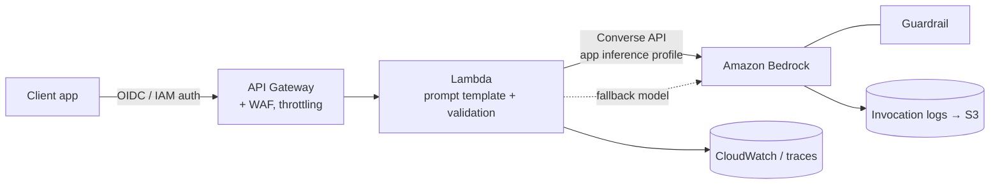

# P01: Serverless Model Invocation

A thin, stateless service that wraps a foundation model call behind an internal API for one well-defined task: summarising, drafting, classifying, extracting or translating. The request carries everything the model needs, so there is no retrieval.

| Dimension | Rating |
|---|---|
| Budget band | **B1–B2**. Fixed floor near **$0** (pay-per-request) |
| Complexity | **C1** |
| Service level fit | Up to **SL2** as-is; **SL3** with the uplifts below |
| Time to first value | 1–3 weeks |
| Snowflake role | None (see [P03](P03-in-warehouse-ai-snowflake.md) if the data is in Snowflake) |
| Neo4j role | None |
| Typical SAR tier | Tier 3 (Internal data) to Tier 2 (Confidential or external users) |

**Suitability profile** ([definitions](../00-decision-framework.md#06-suitability-dimensions))

| Dimension | Rating |
|---|---|
| Max consequence of error | **E2** (E3 only when a person reviews every output before use) |
| Data prerequisites | Low: task definition, 50–200 labelled examples for the golden set |
| Evaluability | **High** (narrow task, checkable output) |
| Cost elasticity | Linear |
| Lock-in / exit cost | **Low** (Converse API; prompts portable) |
| Explainability | Low (no sources; the stated rationale may not be faithful) |
| Regulatory fit | R1; R2 only as an assistive draft that a human decides on |
| Model-change sensitivity | Medium (prompt-tuned behaviour) |
| Human review demand | None/Low |
| Typical value metrics | Time saved per task, adoption, edit distance of accepted drafts |

## Use when

- The task is **self-contained**: the input text is all the context needed.
- The volume is unpredictable or low, and you want no fixed cost.
- You need to embed AI into an existing application quickly.

## Avoid when

- Answers depend on organisational knowledge the caller cannot supply. Use [P04](P04-managed-rag.md) instead.
- The work is bulk and offline. [P02](P02-batch-enrichment-pipeline.md) is cheaper.
- The model must take actions. See [P07](P07-orchestrated-agentic-workflow.md) and [P08](P08-autonomous-agent.md).

## Architecture

- **Streaming.** Use `ConverseStream` through API Gateway WebSocket, Lambda response streaming via a Function URL fronted by CloudFront, or ALB + ECS Fargate for long streams.
- **Structured output.** Use tool/JSON schema output with schema validation in Lambda. Reject and retry once on invalid output.
- **Prompt management.** Keep templates versioned in the repository or in Bedrock Prompt Management, and promote them with the code.

## Component choices

| Concern | Default | When to change |
|---|---|---|
| Compute | Lambda | ECS Fargate if responses exceed Lambda limits or need long-lived streams |
| Model | The smallest model that passes the evaluation | Route to a larger model only for complex inputs (Bedrock Intelligent Prompt Routing or a custom router) |
| Auth | Cognito / corporate IdP JWT authoriser, or IAM for service-to-service | — |
| Safety | Bedrock Guardrail on input and output | Add a PII redaction step before logging for Confidential data |

## Cost profile

- **Fixed:** effectively zero (API Gateway, Lambda and Bedrock on-demand are all per-request).
- **Variable:** dominated by model tokens. Unit cost ≈ (input tokens × price_in + output tokens × price_out) + guardrail text units.
- **Levers:** a smaller model, prompt caching for long system prompts, capping `maxTokens`, and batching requests that are not time-sensitive through [P02](P02-batch-enrichment-pipeline.md).
- **Watch for:** unbounded input size (callers pasting whole documents). Enforce input limits at the API.

## Service levels

| Tier | What to add |
|---|---|
| SL1 | Defaults; on-demand model access; retries with back-off |
| SL2 | A cross-region inference profile; a fallback model of a different family; quota increases confirmed; alarms on throttle rate and p95 TTFT |
| SL3 | Priority service tier or provisioned throughput for the primary model; multi-region API (Route 53 failover) with Lambda in two Regions; a degraded response mode (for example "summary unavailable, showing original") |

## Complexity and operations

- One team, standard serverless skills. The main new skill is **evaluation**: a golden set of 50–200 examples run in CI.
- Operational toil is low. Watch model deprecation notices, and plan to re-evaluate on model upgrades.

## Security review focus

- Direct prompt injection from users. Keep the task narrow, and validate structured outputs.
- Output handling: never render model output as HTML or execute it without encoding and validation.
- Logging of prompts containing personal data. Configure redaction and retention.

## Evolution

- Knowledge needed → **P04**. Volume grows and latency is tolerant → **P02**. Needs actions → **P07**.
