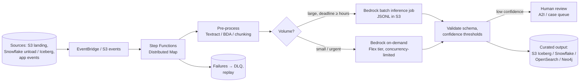
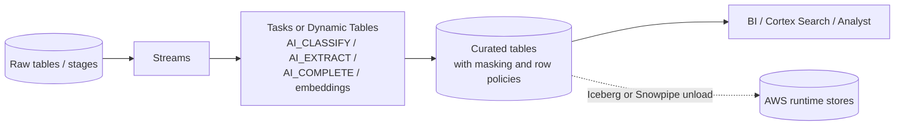

# P02: Batch AI Enrichment Pipeline

An asynchronous pipeline that applies models to large volumes of records or documents: classification, entity extraction, summarisation, translation, embedding generation, document understanding. Results land in a governed store for downstream systems and analytics.

| Dimension | Rating |
|---|---|
| Budget band | **B1–B3**, scaling with volume. Fixed floor near **$0** |
| Complexity | **C2** |
| Service level fit | **SL1–SL2**, framed as *throughput and completion-time* objectives rather than latency |
| Time to first value | 3–6 weeks |
| Snowflake role | **Optional, often central.** As source, sink, or the enrichment engine itself (Cortex AI SQL) |
| Neo4j role | Optional sink. Extracted entities and relations feed [P06](P06-graphrag-neo4j.md) |
| Typical SAR tier | Tier 3–2 (depends on the data classification) |

**Suitability profile** ([definitions](../00-decision-framework.md#06-suitability-dimensions))

| Dimension | Rating |
|---|---|
| Max consequence of error | **E3** with confidence thresholds and a human-review queue |
| Data prerequisites | Medium: accessible sources, output schema, labelled sample for per-field accuracy |
| Evaluability | **High** (per-field accuracy against labelled samples) |
| Cost elasticity | Linear (batch/Flex discounts lower the slope) |
| Lock-in / exit cost | Low (AWS variant) / **High** (Cortex variant) |
| Explainability | Medium (per-record provenance, source spans) |
| Regulatory fit | R2 when low-confidence and consequential items go to a human |
| Model-change sensitivity | Medium (a change of model or prompt needs a backfill) |
| Human review demand | Medium (low-confidence queue) |
| Typical value metrics | Cost per record against manual handling, throughput, accuracy |

## Use when

- Nobody is waiting on the result interactively. An SLO such as "all of yesterday's documents processed by 07:00" fits.
- The volume is high enough that on-demand pricing and quota pressure matter.
- Outputs feed analytics, search indexes, knowledge graphs or case-management queues.

## Avoid when

- Per-item latency matters to a user. Use [P01](P01-serverless-model-invocation.md).
- The volume is tiny and ad hoc. A scheduled Lambda calling P01 is simpler.

## Architecture (AWS-native)

## Architecture (Snowflake-centric variant)

Use this when the data already lives in Snowflake and the consumers are analysts or data products:

- **Trade-off.** Cortex runs inside Snowflake's governance boundary with no data movement, and it is fast to build (SQL only). You pay in credits, the model choice is limited to those available in your Snowflake Region, and it is less suited to complex document parsing than AWS document services. **Prototype in Snowflake; move the heavy or complex stages to AWS only if cost or capability requires it.**

## Component choices

| Concern | Default | Alternatives |
|---|---|---|
| Orchestration | Step Functions (Distributed Map for fan-out) | MWAA if the organisation standardises on Airflow; Snowflake Tasks for the in-warehouse variant |
| Document parsing | Amazon Bedrock Data Automation or Textract | Model-based extraction for simple text; Snowflake `AI_PARSE_DOCUMENT` in-warehouse |
| Inference mode | **Bedrock batch inference** for large jobs; the Flex tier for latency-tolerant on-demand | Cortex AI SQL functions |
| Output store | S3 Iceberg tables (open, queryable from both Athena and Snowflake) | Snowflake native tables; Neo4j for entities and relationships |

## Cost profile

- **Fixed:** near zero. There are no always-on components unless you add an MWAA environment or a running Snowflake warehouse.
- **Variable:** tokens × volume. This is where **batch inference and the Flex tier pay off**: discounted rates for work that can wait.
- **Levers:** pre-filter records that do not need a model (rules first, model second), use the smallest adequate model, send only the fields needed, and avoid re-processing unchanged records (content hashes).
- **Snowflake variant:** size warehouses small (AI function cost is mostly the per-token charge, not warehouse size), set auto-suspend to 60 s, and put a resource monitor on the warehouse.

## Service levels

Express the SLO as **completion time and correctness**, not uptime:

| Tier | Objective example | What to add |
|---|---|---|
| SL1 | 99% of the daily batch done within 12 h; extraction accuracy ≥ target on the golden set | Retries, DLQ, replay tooling |
| SL2 | 99.5% within 4 h; per-field accuracy monitored on samples | Fallback from batch to on-demand when the deadline is at risk; a second model/Region; a human-review queue for low-confidence items; data quality checks before publishing |

Batch pipelines tolerate model outages well. A backlog simply waits, so SL3 is rarely justified.

## Complexity and operations

- Needs data engineering skills: idempotency, schema evolution, backfills.
- Key operational tasks are **backfills after prompt or model changes**. Version the outputs with the prompt and model version so you know which records need reprocessing.

## Security review focus

- Indirect prompt injection embedded in documents. Screen with guardrails, and never let extracted content drive actions without validation.
- Classification of the **outputs**: extraction can create new sensitive data, such as PII pulled out of free text.
- Cross-platform data movement (Snowflake ↔ S3). Use PrivateLink, storage integrations with scoped IAM roles, and KMS.

## Evolution

- Outputs become a searchable corpus → **P04/P05**. Extracted entities and relations → knowledge graph in **P06**.
