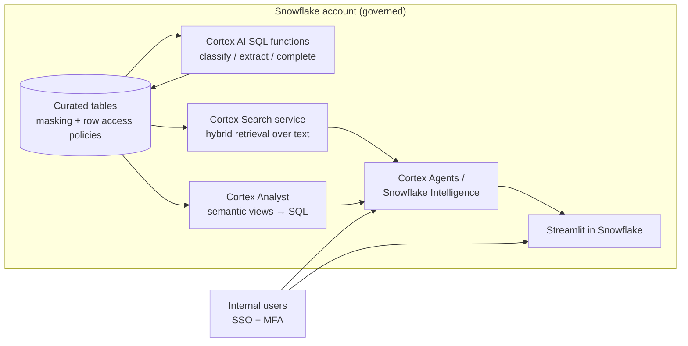

# P03: In-Warehouse AI and Rapid Prototyping (Snowflake)

AI capabilities built **inside Snowflake**, next to governed data: Cortex AI SQL functions, Cortex Search, Cortex Analyst, Cortex Agents / Snowflake Intelligence, and Streamlit in Snowflake. The aim is to prove value in days, with no new infrastructure and no data movement. The result then either stays in Snowflake as an analyst-facing product or graduates to an AWS runtime pattern.

| Dimension | Rating |
|---|---|
| Budget band | **B1–B2**. Fixed floor = warehouse credits while active, plus Cortex Search serving (if used) |
| Complexity | **C1** (SQL and Python skills; no infrastructure) |
| Service level fit | **SL0–SL1**. Up to SL2 for internal analyst tools, bounded by Snowflake's SLA and region |
| Time to first value | Days to 2 weeks |
| Snowflake role | **Central** |
| Neo4j role | None; optional graph export for exploration |
| Typical SAR tier | Tier 3 when the data is already approved for the account; Tier 2 when new data is introduced or external access is added |

**Suitability profile** ([definitions](../00-decision-framework.md#06-suitability-dimensions))

| Dimension | Rating |
|---|---|
| Max consequence of error | **E1–E2** (analysis and prototypes, not decisions) |
| Data prerequisites | Medium: the data is already curated and governed in Snowflake (masking, row policies) |
| Evaluability | Medium |
| Cost elasticity | Linear (credits) |
| Lock-in / exit cost | **High** (Cortex-specific constructs); mitigated by owning the prompts, evaluation set and semantic model |
| Explainability | Medium (Analyst shows SQL; Search shows sources) |
| Regulatory fit | R0–R1; not for R2 decisions |
| Model-change sensitivity | Low–Medium (managed models) |
| Human review demand | None |
| Typical value metrics | Time to insight; go/no-go evidence for a production build |

## Use when

- The data is **already in Snowflake** and governed there.
- The users are analysts or internal teams, and the goal is **proof of value** or a light internal tool.
- You want to test whether AI adds value **before** funding an AWS build.
- The question is analytical ("what were sales by region last quarter?"). Use Cortex Analyst with semantic views.

## Avoid when

- The users are external customers, or the latency objectives are SL2+ interactive.
- The workload needs models, tools or agent actions that Snowflake does not offer in your Region.
- You need a strict **residency** guarantee and cross-region inference would be required in Snowflake to reach the model you want. Check the account's cross-region setting explicitly.

## Architecture

## Prototype-to-production graduation

A prototype that succeeds usually takes one of three paths. Decide at the start which **exit criteria** trigger a move:

| Stay in Snowflake if… | Graduate to AWS if… |
|---|---|
| Users are internal analysts | Users are customers or large employee populations |
| Latency of seconds to tens of seconds is fine | Interactive SL2+ with TTFT targets |
| Queries and data are tabular or analytical | Unstructured corpora from many non-Snowflake sources |
| Cost per query is acceptable at the expected volume | The unit cost at the target volume beats Snowflake credits on AWS |
| Governance through Snowflake roles is sufficient | Integration with application identity, agents acting on external systems |

**Carry forward from the prototype:** the golden evaluation set, prompts, the semantic model, chunking choices, and the observed cost per query. These are the valuable outputs of the prototype, more than the code.

**Hand-off options:**

- Keep Snowflake as the **curated source**. Publish to AWS through Iceberg tables on S3, or via Snowpipe/unload to S3, then feed [P04](P04-managed-rag.md) or [P05](P05-enterprise-rag.md).
- Keep Cortex Search/Analyst as a **retrieval backend** called from an AWS-hosted application or agent over PrivateLink. This is simple, but it adds a cross-platform dependency to the SLO chain.

## Cost profile

- **Fixed:** warehouse time (set auto-suspend to 60 s, and use a dedicated warehouse per workload), plus Cortex Search serving cost while the service is active and indexing refresh compute.
- **Variable:** Cortex functions are billed per token in credits. Cortex Analyst is billed per message.
- **Levers:** a small warehouse for AI functions, `TARGET_LAG` on Search and Dynamic Tables set no fresher than the business needs, resource monitors with a hard suspend, and query tags for attribution.
- **Watch for:** exploratory notebooks running AI functions over full tables. Always run on `SAMPLE` or `LIMIT` first.

## Service levels

- Bounded by Snowflake's regional availability and the capacity of Cortex models in that Region. There is no multi-region failover without replication and a second account.
- Freshness is controlled by `TARGET_LAG` and the task schedule. State it as an SLO.

## Complexity and operations

- Lowest complexity in the series. Skills: SQL, Snowpark Python, semantic modelling.
- The main risk is **prototype sprawl**: many unowned Streamlit apps and Search services. Require an owner and an expiry date for each.

## Security review focus

- Role design. Cortex functions and services run with the caller's role, so masking and row access policies must already be correct.
- Account-level settings: cross-region inference permission, and which models are allowed (model allow-lists).
- External access integrations (if the prototype calls out to AWS or the internet). Scope network rules and secrets.
- Sharing of Streamlit apps outside the intended audience.

## Evolution

- Customer-facing or SL2+ → **P04/P05** on AWS. Relationship-heavy questions → **P06**. Analytical Q&A at scale → **P09**.
