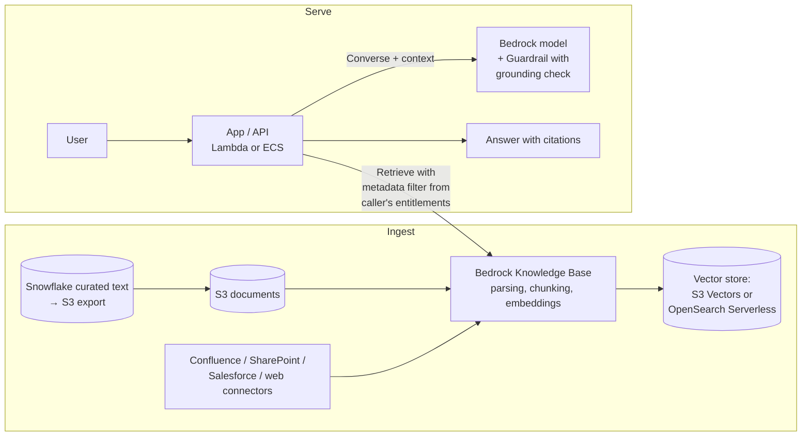

# P04: Managed Retrieval-Augmented Generation (RAG)

Question answering and assistance grounded in an organisational corpus, built on **Amazon Bedrock Knowledge Bases**. The managed service handles ingestion, chunking, embedding, the vector store and retrieval. The team owns the data sources, access filters, prompts and evaluation.

| Dimension | Rating |
|---|---|
| Budget band | **B1–B2**. Floor near **$0** with S3 Vectors; **hundreds of dollars a month** with an always-on OpenSearch collection |
| Complexity | **C2** |
| Service level fit | **SL1–SL2** |
| Time to first value | 2–6 weeks |
| Snowflake role | Optional: a curated source exported to S3, or Cortex Search as an alternative retriever |
| Neo4j role | None. For graph-enhanced retrieval see [P06](P06-graphrag-neo4j.md) |
| Typical SAR tier | Tier 2 (organisational knowledge is usually Confidential) |

**Suitability profile** ([definitions](../00-decision-framework.md#06-suitability-dimensions))

| Dimension | Rating |
|---|---|
| Max consequence of error | **E2**; E3 as advisory with citations that the user verifies |
| Data prerequisites | Medium: curated documents with owners, ACL metadata, a removal process |
| Evaluability | Medium (golden Q&A plus groundedness; open questions are harder) |
| Cost elasticity | Linear |
| Lock-in / exit cost | Medium (Knowledge Base configuration to rebuild; data in S3 portable) |
| Explainability | Medium (citations) |
| Regulatory fit | R1; R2 only as assistive, with a human deciding |
| Model-change sensitivity | Low–Medium |
| Human review demand | Low |
| Typical value metrics | Deflection rate, time to answer, % answers accepted without escalation |

## Use when

- The answers exist in documents (policies, manuals, knowledge articles, contracts, tickets).
- The corpus is up to hundreds of thousands of documents, and freshness of hours to a day is acceptable.
- The team wants a production-grade RAG system **without** owning retrieval infrastructure.

## Avoid when

- You need fine control of retrieval: custom hybrid scoring, domain-specific rerankers, multi-index federation, sub-second latency at high QPS. Use [P05](P05-enterprise-rag.md).
- The questions need multi-hop reasoning over relationships. Use [P06](P06-graphrag-neo4j.md).
- The questions are about numbers in tables. Use [P09](P09-conversational-analytics.md).

## Architecture

**Use `Retrieve` + your own `Converse` call** (rather than `RetrieveAndGenerate`) when you need control over prompts, citation format, access filters or model routing. Use `RetrieveAndGenerate` for the fastest start.

## Key design decisions

| Decision | Guidance |
|---|---|
| **Vector store** | **S3 Vectors** for the lowest cost and a zero floor, where query latency in the hundreds of milliseconds is acceptable (B1–B2, SL1–SL2). **OpenSearch Serverless** for hybrid (keyword + vector) search, lower latency and higher QPS. Consider NextGen collections, which scale to zero when idle. **Aurora pgvector** if the team already runs Aurora and wants SQL joins |
| **Chunking** | Start with the defaults (fixed-size or hierarchical). Use semantic or hierarchical chunking for long structured documents. Evaluate chunking before tuning the prompt |
| **Access control** | Attach ACL metadata (groups, classification, business unit) to each document using metadata files, and apply a **retrieval filter built from the caller's verified identity**. This is the single most important security control in this pattern |
| **Freshness** | Scheduled or event-driven ingestion jobs. State the freshness SLO (for example "new policy documents are answerable within 4 h") |
| **Citations** | Always return sources. Users verify, and citations make evaluation easier |
| **Grounding** | Use the contextual grounding check in Guardrails to block answers that are unsupported by the retrieved context |

## Cost profile

| Component | Fixed | Variable |
|---|---|---|
| Knowledge Base ingestion | — | Embedding tokens (one-off plus changes), parsing (if using advanced parsing) |
| Vector store | S3 Vectors: none. OpenSearch Serverless classic: a minimum OCU floor; NextGen: scales to zero | Storage plus queries/OCU-hours |
| Generation | — | Tokens per answer (context is usually 70–90% of the input) |
| Guardrails | — | Per text unit screened |

- **Levers:** retrieve fewer chunks (top-k 3–5 after reranking), prompt caching for the system prompt, a smaller model for simple questions, and caching answers to FAQ-style queries.
- **Watch for:** re-ingesting the whole corpus on every sync. Use incremental sync.

## Service levels

| Tier | What to add |
|---|---|
| SL1 | Defaults; a single Region; business-hours support |
| SL2 | OpenSearch Serverless with redundancy (or confirmed S3 Vectors latency within budget); cross-region inference profile; a fallback model; degraded mode "show top documents without a generated answer"; online sampling of groundedness |
| SL3 | Generally **move to [P05](P05-enterprise-rag.md)**. Managed Knowledge Bases are regional, and a multi-region design needs a duplicate knowledge base and ingestion in the second Region |

## Complexity and operations

- The effort sits in **data preparation, metadata and evaluation**, not infrastructure.
- Ownership: every source needs a content owner who is accountable for accuracy and for removing stale content.

## Security review focus

- **Retrieval-time authorisation** (see above). Test it with users who have different entitlements as part of the evaluation.
- Connector credentials for SaaS sources: store them in Secrets Manager, with read-only scopes.
- Indirect prompt injection through document content. Apply guardrails to the retrieved context, and allow-list the sources that are ingested.
- Deletion: documents removed at the source must be removed from the index within a defined time (right to erasure, legal holds).

## Evolution

- Latency, scale or retrieval quality limits → **P05**. Multi-hop, entity-centric questions → **P06**. The assistant must act → **P07/P08**.
