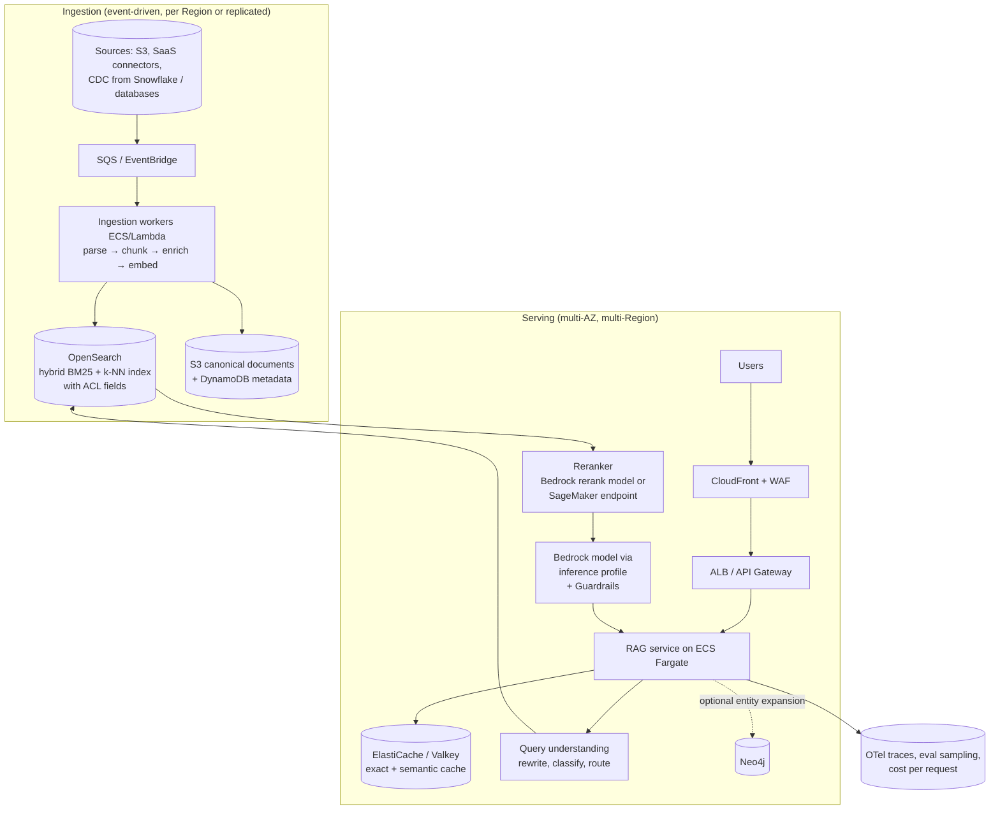

# P05: Enterprise RAG Platform (Custom Retrieval, High Service Level)

A custom-built retrieval and generation service for **high-volume, customer-facing or business-critical** assistants. The team owns ingestion, hybrid retrieval, reranking, caching, routing and multi-region resilience, in exchange for control over quality, latency and unit cost.

| Dimension | Rating |
|---|---|
| Budget band | **B3–B4**. Fixed floor in the **thousands per month** (redundant search clusters, containers, multi-region) |
| Complexity | **C3–C4** |
| Service level fit | **SL2–SL3** |
| Time to first value | 3–6 months (faster if P04 already exists as a baseline) |
| Snowflake role | Optional curated source (Iceberg/CDC to S3); not in the serving path |
| Neo4j role | Optional retrieval source for entity expansion (see [P06](P06-graphrag-neo4j.md)) |
| Typical SAR tier | Tier 1 (external exposure, critical service) or Tier 2 |

**Suitability profile** ([definitions](../00-decision-framework.md#06-suitability-dimensions))

| Dimension | Rating |
|---|---|
| Max consequence of error | **E3** as advisory, with citations and audit |
| Data prerequisites | High: multi-source corpora, ACLs, rich metadata, relevance judgements |
| Evaluability | Medium–High (with investment in relevance judgements) |
| Cost elasticity | **Sub-linear** (platform amortised; cache hit rate rises with volume) |
| Lock-in / exit cost | Low–Medium (OpenSearch and own code; model access via inference profiles or a gateway) |
| Explainability | Medium (citations, full retrieval traces) |
| Regulatory fit | R1; R2 as assistive, with strong audit |
| Model-change sensitivity | Low (router, fallback models, evaluation harness) |
| Human review demand | Low |
| Typical value metrics | Deflection, CSAT, cost per resolved query |

## Use when

- There are thousands of concurrent users, or customer-facing traffic, with **latency SLOs** (TTFT p95 < 1–2 s).
- Retrieval quality needs **hybrid search, domain rerankers, query rewriting and multiple indexes**.
- The unit cost at scale justifies engineering investment: caching, routing, self-tuned retrieval.
- **SL3** availability is required, which means multi-region serving.

## Avoid when

- A managed knowledge base (P04) meets the quality and latency targets. Prove that it does not before building this.
- There is no team to run it 24×7.

## Architecture

## Key design decisions

| Decision | Guidance |
|---|---|
| **Search engine** | OpenSearch Service managed domains (multi-AZ with standby) for predictable latency and full control; OpenSearch Serverless for less operations work. Hybrid search (BM25 + vector) with score normalisation is the default, because lexical matching catches IDs, codes and names that embeddings miss |
| **Reranking** | A cross-encoder reranker over the top 50 → top 5 usually gives the largest quality gain per dollar |
| **Caching** | An exact-match cache on normalised query + entitlements hash. A semantic cache **only** for non-personalised content, and always keyed by the entitlement scope so answers never leak across users |
| **Routing** | Classify query complexity; send simple queries to a small model and hard ones to a large model. Track quality per route |
| **Multi-region** | Stateless services active/active behind Route 53 latency or failover routing. Indexes built independently in each Region from the same event stream (preferred over cross-region index replication). Validate cross-region inference profiles against residency |
| **Degradation** | Ordered fallbacks: fallback model → cached answer → search results only → graceful error. Test each in game days |

## Cost profile

- **Fixed floor:** OpenSearch domains or collections (multi-AZ, and ×2 for multi-region), ECS services at minimum capacity, ElastiCache, NAT/VPC endpoints, and a reranker endpoint if self-hosted.
- **Variable:** generation tokens (still usually the biggest line at scale), rerank calls, embeddings for changed content.
- **Levers:** cache hit rate (target it explicitly), routing share to the small model, prompt caching, context size after reranking. Graviton instances for OpenSearch and ECS. Consider **provisioned throughput** only when sustained utilisation is above break-even.
- **Unit-cost target:** set one per answered query, and report it alongside SLOs.

## Service levels

| Tier | Design |
|---|---|
| SL2 | Single Region, multi-AZ; OpenSearch with standby; cross-region inference profile; fallback model; autoscaling on concurrency |
| SL3 | Two Regions active/active or warm standby; independent indexes per Region; Priority tier or provisioned throughput for the primary model; a documented degraded mode; synthetic canaries measuring TTFT and groundedness every minute; 24×7 on-call |

## Complexity and operations

- Needs search relevance, platform, and ML engineering skills, plus an evaluation owner.
- Run relevance-tuning cycles regularly: review failed queries, then change chunking, synonyms, metadata or the reranker, then re-evaluate.
- Reindexing (for example when changing the embedding model) is a **blue/green index** operation. Plan capacity for both indexes at once.

## Security review focus

- Entitlement-aware retrieval enforced in the retrieval query. Cache keys include the entitlement scope.
- Multi-tenant separation, if it serves multiple customers: an index per tenant or mandatory tenant filters, tested adversarially.
- WAF rules and per-user rate limits (unbounded consumption and cost attacks).
- The data residency of every Region involved, including inference profiles.

## Evolution

- Add a knowledge-graph expansion step → **P06 hybrid**. Add actions → **P08** with this service exposed as a retrieval tool.
