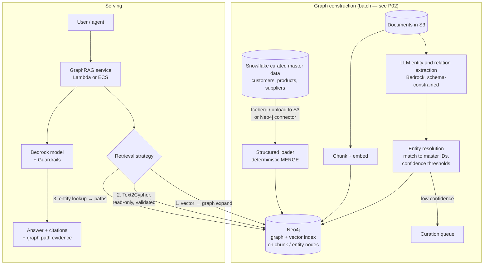

# P06: Knowledge Graph RAG (GraphRAG) with Neo4j

Retrieval over a **knowledge graph** of entities and relationships, combined with vector search over the source text. It answers questions that require connecting facts across documents and systems, and returns the path through the graph as explainable evidence.

| Dimension | Rating |
|---|---|
| Budget band | **B2–B3**. Fixed floor = the Neo4j deployment (Aura Professional: low hundreds/month; Business Critical or a self-managed cluster: thousands/month) |
| Complexity | **C3**. The ontology and entity resolution are the hard parts, not the database |
| Service level fit | **SL1–SL2** on Aura Professional; **SL2–SL3** on Aura Business Critical / VDC or a self-managed cluster |
| Time to first value | 2–4 weeks for a prototype; 3–6 months for production |
| Snowflake role | **Often central as the structured source.** Master data (customers, products, suppliers, assets) flows from Snowflake to create the graph's "spine" |
| Neo4j role | **Central** |
| Typical SAR tier | Tier 2; Tier 1 if the graph combines Restricted datasets (aggregation risk) |

**Suitability profile** ([definitions](../00-decision-framework.md#06-suitability-dimensions))

| Dimension | Rating |
|---|---|
| Max consequence of error | **E3** as advisory; explainable paths support expert decisions |
| Data prerequisites | **High**: master data spine, an ontology owner, entity-resolution rules, a multi-hop golden set |
| Evaluability | Medium (multi-hop sets are harder to build) |
| Cost elasticity | Sub-linear at serving (fixed graph); linear in corpus size for extraction |
| Lock-in / exit cost | Medium–High (Cypher/Neo4j specifics; openCypher/GQL patterns reduce it) |
| Explainability | **High** (the graph path is the evidence) |
| Regulatory fit | R2 as expert assistance: explainability suits audit-heavy uses |
| Model-change sensitivity | Medium (re-extraction when the model changes) |
| Human review demand | Medium (curation queue) |
| Typical value metrics | Investigation time, multi-hop answer accuracy, analyst throughput |

## Use when

- The questions are **multi-hop**: "Which customers are affected if supplier X fails?" or "Which controls mitigate risks linked to this regulation, and who owns them?"
- The domain has **stable, nameable entities** (products, parties, assets, regulations, systems) whose relationships carry meaning.
- **Explainability matters.** The answer must show *why*, as a traversable path.
- Plain vector RAG answers in fragments or misses connections, and the evaluation proves it.

## Avoid when

- The questions are single-document lookups. [P04](P04-managed-rag.md) is cheaper and simpler.
- No one will own the **ontology** and the entity-resolution rules. The graph will decay.
- You want "GraphRAG" as a buzzword without questions that need it. Build the evaluation set first, and show that vector RAG fails on it.

## Architecture

### Retrieval strategies (combine as needed)

| Strategy | How it works | Best for | Risk |
|---|---|---|---|
| **Vector + graph expansion** | Vector search finds chunks or entities, then a fixed Cypher pattern expands 1–2 hops for context | The default; robust | Over-expansion inflates context (cost) |
| **Templated Cypher (tools)** | The model selects from a catalogue of parameterised, pre-approved queries | High-value recurring questions; SL2+ | Coverage is limited to the catalogue |
| **Text2Cypher** | The model writes Cypher from the schema | Exploratory analyst use | Wrong or expensive queries; injection. Run it with a **read-only role**, query timeouts, row limits, and validation |
| **Community / global summaries** | Pre-computed summaries of graph communities (GDS algorithms) | "What are the main themes across…" | Build cost; summaries go stale |

**Recommendation:** in production, use vector + expansion plus a **catalogue of templated Cypher queries**. Keep Text2Cypher for analyst tools with human review.

### Graph construction principles

1. **Spine first.** Load authoritative master data deterministically (from Snowflake or the systems of record) before any LLM extraction. Extracted facts attach to known entities.
2. **Schema-constrained extraction.** Give the model the allowed node labels, relationship types and properties. Reject anything outside the ontology.
3. **Provenance on every edge.** Record the source document, chunk, extraction model/prompt version, confidence and timestamp. This enables evidence, deletion and reprocessing.
4. **Entity resolution is a product.** Use deterministic keys where possible and probabilistic matching with thresholds otherwise, with a human curation queue for ambiguous cases.

## Deployment options

| Option | Budget | Service level | Notes |
|---|---|---|---|
| Neo4j Aura Free / Professional | B1–B2 | SL0–SL1 | Prototype quickly. Check the tier for private networking before loading Confidential data |
| Neo4j Aura Business Critical / VDC | B2–B3 | SL2–SL3 | Clustered, SLA-backed, private connectivity (PrivateLink), CMK options per tier |
| Neo4j Enterprise self-managed on EC2/EKS (cluster of 3+ primaries across AZs) | B3 | SL2–SL3 | Full control and residency; you own operations, backups, upgrades and licensing |
| **AWS-native alternative:** Bedrock Knowledge Bases GraphRAG on Neptune Analytics | B2 | SL1–SL2 | Fully managed graph construction from documents, with less ontology control. Choose it when you want graph-enhanced retrieval without owning a graph |

## Cost profile

- **Fixed:** the Neo4j deployment (the dominant floor), plus serving compute.
- **Variable:** **extraction tokens during the build** (often the largest one-off cost: every chunk goes through a model, so use batch inference and a mid-size model), embedding tokens, and generation tokens (graph context can be verbose, so serialise paths compactly).
- **Levers:** extract only from document types that carry relationships; incremental extraction on changed documents; cap expansion hops and nodes; cache templated query results.

## Service levels

- Neo4j is now in the serial path, so include its SLA in the composite availability.
- **Degraded mode:** fall back to vector-only retrieval (from a replicated vector index in OpenSearch or S3 Vectors) if the graph is unavailable. Answers will be less complete but still grounded.
- **Freshness:** separate SLOs for structured spine updates (for example daily from Snowflake) and document-derived facts.
- **Quality:** add a multi-hop evaluation set; single-hop metrics will not show the value or the regressions.

## Complexity and operations

- Skills: graph data modelling, Cypher, entity resolution, data engineering, plus RAG evaluation.
- Recurring operations: ontology change management (versioned, reviewed), re-extraction after prompt or model changes, index maintenance, backups and restore tests.

## Security review focus

- **Aggregation risk.** A graph that joins datasets can reveal what no single source does (for example, linking people across systems). Classify the graph at the level of its most sensitive *combination*.
- **Access control.** Neo4j Enterprise/Aura supports role-based and fine-grained (label/property) privileges. Map application entitlements to these, or enforce filters in templated queries. Never let the model choose the security context.
- **Cypher injection.** Parameterise all queries. Text2Cypher runs as a read-only user with timeouts.
- Provenance-based deletion: removing a source must remove or re-derive the facts extracted from it.

## Evolution

- Graph as a **tool for agents** (P08): templated Cypher exposed via AgentCore Gateway / MCP.
- Graph expansion added to **P05** for high-scale serving.
