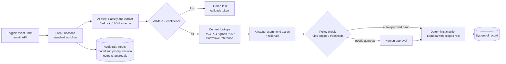

# P07: Orchestrated Agentic Workflow (Deterministic Flow, AI Steps)

A **business process** in which the control flow is defined in code (Step Functions), and models perform specific judgement steps: triage, extraction, drafting, decision recommendation. Actions against systems of record are made by deterministic workflow steps, not freely by the model. Humans approve at defined checkpoints.

| Dimension | Rating |
|---|---|
| Budget band | **B1–B2** (pay-per-use; fixed floor near $0) |
| Complexity | **C2–C3** |
| Service level fit | **SL1–SL2**; SL3 feasible because each step is retryable and the state is durable |
| Time to first value | 1–3 months |
| Snowflake role | Optional: reference data lookups, outcome analytics |
| Neo4j role | Optional: context lookups (for example, related parties for a case) |
| Typical SAR tier | Tier 2; Tier 1 if it writes to regulated systems of record |

**Suitability profile** ([definitions](../00-decision-framework.md#06-suitability-dimensions))

| Dimension | Rating |
|---|---|
| Max consequence of error | **E3–E4** with autonomy bands and human approval (designed for this) |
| Data prerequisites | Medium: a documented process, historical cases for evaluation, policy thresholds |
| Evaluability | **High** (per-step accuracy, override rate) |
| Cost elasticity | Linear (predictable cost per case) |
| Lock-in / exit cost | Low–Medium (Step Functions; AI steps are portable) |
| Explainability | **High** (step-level audit of inputs, versions, approvals) |
| Regulatory fit | **R2 best fit** for consequential automated decisions |
| Model-change sensitivity | Low (narrow, schema-constrained steps) |
| Human review demand | Medium–High (approval queues; check capacity) |
| Typical value metrics | Cycle time, straight-through rate, cost per case, override rate |

## Use when

- The process is **known and auditable**: claims intake, KYC refresh, invoice exception handling, access request triage, incident summarisation and routing.
- Regulators or auditors need to see **which step made which decision**.
- You want AI benefits with **bounded agency**. The model recommends; the workflow acts.

## Avoid when

- The path through the task cannot be predicted in advance (open-ended research, multi-system troubleshooting). See [P08](P08-autonomous-agent.md).
- There is a single step. Use [P01](P01-serverless-model-invocation.md).

## Architecture

## Key design decisions

| Decision | Guidance |
|---|---|
| **Where the model acts** | Nowhere directly. Models return structured recommendations; separate Lambda functions with narrowly scoped IAM roles perform writes |
| **Autonomy bands** | Define thresholds (value, risk, confidence) below which actions auto-execute and above which a human approves. Start with *everything approved by a human*, and widen the bands using the evidence gathered |
| **Human tasks** | Step Functions task tokens with a case UI, or Amazon A2I for review of extractions. Set timeouts with an escalation path |
| **Idempotency** | Every action step is idempotent (idempotency keys) so that retries never double-execute |
| **Explainability** | Store the rationale, the evidence retrieved, and the model and prompt versions per decision |

## Cost profile

- **Fixed:** negligible (Step Functions standard is per state transition).
- **Variable:** 2–5 model calls per case plus retrieval, so costs are predictable and **per case**. Express the budget as a cost per case processed, and compare it with the manual handling cost.
- **Levers:** a small model for classification, a larger one only for the recommendation step, and the Flex tier for non-urgent cases.

## Service levels

- Durable state makes this pattern resilient: a model outage pauses the workflow, which resumes on retry. There is no lost work.
- SLOs: **case cycle time** (for example 95% of cases complete within 4 business hours, excluding human wait), **straight-through rate**, **override rate** (how often humans reject AI recommendations — the key quality SLI).

## Complexity and operations

- Mostly workflow and integration engineering. AI skills are needed for prompts and evaluation of each AI step.
- Operations: monitor override rates per step. A rising rate signals drift or process change.

## Security review focus

- Separation of the **decision identity** (the model step, with no write permissions) from the **action identity** (a scoped Lambda role).
- Prompt injection in case inputs (emails, attachments) must not be able to change the workflow path. Validate outputs against enumerations and the schema.
- Accountability for automated decisions: human oversight, and records suitable for regulatory challenge (for example, automated decision-making rights under data protection law).

## Evolution

- Steps that need open-ended investigation can call a bounded **P08** agent as a sub-task with its own step and token budget.
