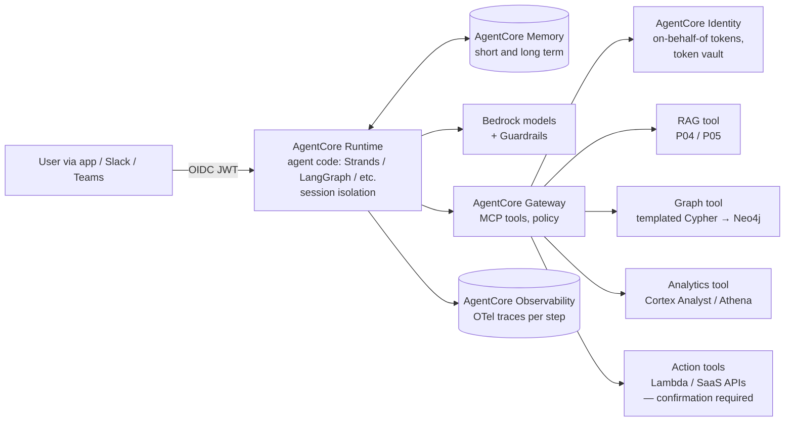

# P08: Tool-Using Agent (Model-Directed, Bounded Autonomy)

An agent in which the **model decides the sequence of steps**: which tools to call, what to retrieve, when it is done. It runs on **Amazon Bedrock AgentCore** with tools exposed through a governed gateway (MCP), per-user delegated identity, memory, and full tracing.

| Dimension | Rating |
|---|---|
| Budget band | **B2–B3**. Low fixed floor, but a **high and variable unit cost** (many model calls per task) |
| Complexity | **C3–C4** |
| Service level fit | **SL1–SL2**. Task success is probabilistic, so express SLOs as success *rates* |
| Time to first value | 1–2 months for an internal pilot; 4–6+ months for production with write actions |
| Snowflake role | Optional tool: Cortex Analyst / Cortex Search / SQL via a governed tool |
| Neo4j role | Optional tool: templated Cypher over the knowledge graph ([P06](P06-graphrag-neo4j.md)); the graph can also define the ontology of allowed entities and actions |
| Typical SAR tier | **Tier 1** where the agent can write to systems or act for users; Tier 2 for read-only assistants |

**Suitability profile** ([definitions](../00-decision-framework.md#06-suitability-dimensions))

| Dimension | Rating |
|---|---|
| Max consequence of error | **E2** read-only; **E3** only with confirmation of writes; not E4 |
| Data prerequisites | Medium–High: documented tool APIs, a delegated permission model, a scenario set |
| Evaluability | **Low** (emergent behaviour; needs scenario suites and trace review) |
| Cost elasticity | **Super-linear** in task length (context grows with every step) |
| Lock-in / exit cost | Medium (AgentCore specifics; open frameworks and MCP reduce it) |
| Explainability | Low–Medium (traces exist; the stated reasoning may not be faithful) |
| Regulatory fit | R1; not for R2 decisions unless wrapped in a P07 workflow |
| Model-change sensitivity | **High** (behaviour shifts with the model) |
| Human review demand | Low–Medium (confirmations of writes) |
| Typical value metrics | Task success rate, task completion time, escalations avoided |

## Use when

- The task is **open-ended** and spans multiple systems: research and synthesis, IT or ops troubleshooting, a developer assistant, a sales or account-planning copilot.
- The steps cannot be enumerated in advance, but the **tools** can.
- Users benefit from a conversational, iterative interaction.

## Avoid when

- The process is known. [P07](P07-orchestrated-agentic-workflow.md) is cheaper, more predictable and easier to audit.
- Errors are high-impact and irreversible, and humans cannot confirm them in time.
- The budget cannot tolerate a variable unit cost.

## Architecture

## Key design decisions

| Decision | Guidance |
|---|---|
| **Tool design** | A few coarse-grained, well-described tools beat many thin API wrappers. Each tool validates its inputs and returns concise outputs. Tool output is untrusted input to the model |
| **Identity** | Tools act **on behalf of the user** with the user's delegated permissions (AgentCore Identity, OAuth 3LO), never through a shared super-user service account |
| **Write actions** | Classify every tool as read / reversible write / irreversible write. Irreversible writes require explicit user confirmation, shown in the UI with the exact parameters |
| **Budgets** | Hard limits per session: maximum steps, maximum tokens, maximum wall-clock time, maximum cost. When a limit is hit, stop and summarise progress |
| **Memory** | Scope memory per user and tenant, with retention limits. Never share long-term memory across users |
| **Framework** | Any framework that runs on AgentCore Runtime. Choose the one the team can test well, with deterministic unit tests for tools and scenario evaluations for the agent |
| **Model** | Agents are sensitive to model tool-use quality. Evaluate agent task success per candidate model, not just general benchmarks |

## Cost profile

- **Fixed:** low (AgentCore bills per use: runtime compute, gateway invocations, memory). A Neo4j or OpenSearch floor applies if those tools are dedicated to the agent.
- **Variable:** **calls per task × context size**. Context grows with every step (tool results pile up), so cost per task grows faster than linearly in the number of steps.
- **Levers:** **prompt caching** (tool definitions and system prompt are stable, so the saving is large), summarising or compacting tool outputs, a smaller model for sub-tasks (planner/executor split), a step cap, and caching of tool results.
- **Budget framing:** report the **P50 and P95 cost per task**. The tail matters, because a handful of runaway sessions can dominate the bill.

## Service levels

| SLI | Example SL2 objective |
|---|---|
| Task success rate (scenario evaluation) | ≥ 85% on the golden scenario set; no regression > 2 pts at release |
| Escalation / give-up rate | Tracked; a spike indicates a tool or model issue |
| Unsafe action rate | 0 unconfirmed irreversible writes (enforced by design, verified by tests) |
| Latency | First visible progress < 3 s (stream the plan/status); task P95 within the agreed budget |
| Availability | The agent runtime plus the *minimum set of tools* the task needs. Degrade by disabling non-critical tools |

## Complexity and operations

- The hardest pattern to test: behaviour is emergent. Needs a scenario-based evaluation suite, trace review, and red teaming before each significant release.
- Operations: trace sampling review, tool error rates, cost-tail monitoring, and model upgrade re-evaluation.

## Security review focus (in addition to the [foundations](../01-shared-foundations.md#16-security-considerations-specific-to-ai))

- **Excessive agency** is the headline threat. Least privilege per tool, on-behalf-of identity, confirmation for irreversible actions.
- **Indirect prompt injection** from any tool output (web pages, emails, tickets, documents) that tries to trigger other tools. Mitigate with guardrails on tool outputs, by not letting untrusted content select privileged tools, and by separating read-only agents from action agents.
- **MCP servers are third-party code or services.** Maintain an allow-list, pin versions, review them, and run them in isolated compute with egress controls.
- **Session isolation** between users (AgentCore Runtime provides session isolation; verify that your memory and cache keys do too).
- Full traceability: every tool call is logged with user identity, parameters and outcome.

## Evolution

- Recurring task shapes that emerge from agent traces should be **codified into P07 workflows**. They become cheaper, faster and more auditable.
