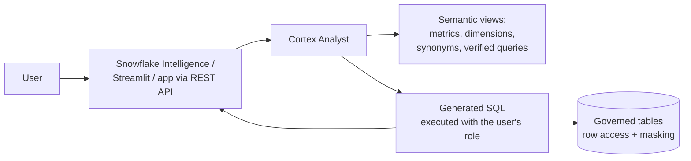
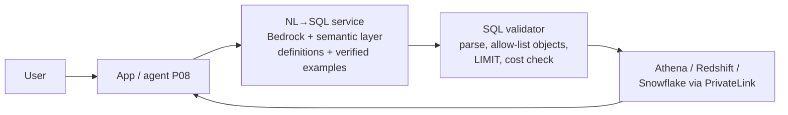

# P09: Conversational Analytics (Natural Language to Governed Data)

Business users ask questions of structured data in natural language. The system translates each question into a query over a **governed semantic layer**, runs it under the user's permissions, and returns the answer with the query, the numbers and a chart.

| Dimension | Rating |
|---|---|
| Budget band | **B1–B2** (Snowflake-native) or **B2** (AWS-hosted) |
| Complexity | **C2**. The semantic model is the real work |
| Service level fit | **SL1–SL2** |
| Time to first value | 2–6 weeks per subject area |
| Snowflake role | **Central** in variant A (Cortex Analyst + semantic views); the data source in variant B |
| Neo4j role | Optional: questions about relationships and networks, via templated Cypher (see [P06](P06-graphrag-neo4j.md)) |
| Typical SAR tier | Tier 2 (business data, typically Confidential) |

**Suitability profile** ([definitions](../00-decision-framework.md#06-suitability-dimensions))

| Dimension | Rating |
|---|---|
| Max consequence of error | **E2**; E3 when a person verifies figures before acting on them |
| Data prerequisites | **High**: agreed metric definitions, a semantic model, verified queries |
| Evaluability | **High** (result match on verified queries) |
| Cost elasticity | Linear (plus query-engine cost) |
| Lock-in / exit cost | **High** (variant A: semantic views) / Medium (variant B) |
| Explainability | **High** (shows the generated SQL and its interpretation) |
| Regulatory fit | R1; small-cohort rules for sensitive data |
| Model-change sensitivity | Low–Medium |
| Human review demand | Low |
| Typical value metrics | Reduction in analyst requests, time to insight, verified-query accuracy |

## Use when

- The question is about **metrics and dimensions** ("revenue by region for Q2 versus plan").
- A curated, well-defined data model exists, or the business is willing to define one.
- Analysts are a bottleneck for ad hoc questions.

## Avoid when

- There is no agreed metric definition. The system will confidently produce three different "revenue" numbers.
- The questions are about document content ([P04](P04-managed-rag.md)).

## Architecture

**Variant A: Snowflake-native (recommended when data is in Snowflake)**

**Variant B: AWS-hosted (data in S3/Athena/Redshift, or an AWS agent)**

## Key design decisions

| Decision | Guidance |
|---|---|
| **Semantic layer** | Mandatory. Defines metrics, joins, synonyms and **verified queries** (question → trusted SQL). Accuracy on the verified-query set is the quality SLI |
| **Execution identity** | Always the end user's identity or role, so row-level and masking policies apply. Never a shared analytics super-user |
| **Transparency** | Show the generated SQL or an interpretation ("I interpreted 'active customer' as…"), and allow feedback. Accepted Q→SQL pairs are added to the verified set after review |
| **Guardrails on queries** | Read-only roles, statement allow-list (SELECT only), row limits, query timeouts, warehouse or workgroup cost caps |

## Cost profile

- **Variant A:** per-message Cortex Analyst charges plus warehouse compute for the queries. Use a small, auto-suspending warehouse per workload.
- **Variant B:** model tokens (the schema and semantic context are large, so **prompt caching** helps greatly) plus query engine costs (Athena per TB scanned: partition and use Iceberg/Parquet).
- **Watch for:** generated queries scanning huge tables. Enforce cost caps (Snowflake resource monitors; Athena workgroup data-scanned limits).

## Service levels

- Quality SLI: **accuracy on the verified question set** (for example ≥ 90% exact-result match), plus **user-reported wrong answers**.
- Latency: SQL generation plus query execution. Set expectations of seconds to tens of seconds; stream the interpretation first.
- Availability is bounded by the query engine. Snowflake-native (variant A) has a single-platform dependency.

## Complexity and operations

- Ownership of the semantic model by the data/BI team, reviewed like code.
- A regular review of failed or low-rated questions to extend synonyms and verified queries.

## Security review focus

- **Authorisation through the user's own role** (the key control). Test with users who have different row-level scopes.
- SQL injection via generated SQL. Parse and validate; read-only; no dynamic DDL/DML.
- Inference and aggregation attacks on small cohorts (for example, deriving an individual's salary). Apply minimum group-size rules for sensitive datasets.

## Evolution

- Expose it as a **tool** to a P08 agent, so analytical answers can be combined with document and graph retrieval.
