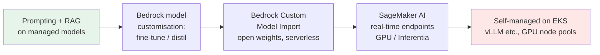
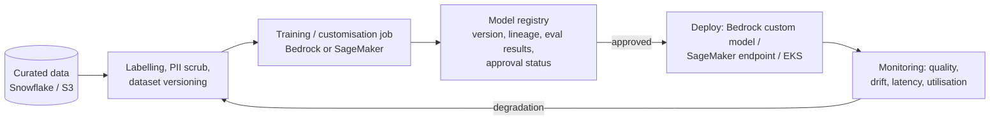

# P10: Customised and Self-Hosted Models

Adapting or hosting models yourself: **fine-tuning or distillation** in Bedrock, **Bedrock Custom Model Import** for open-weight models, or **self-hosting** on SageMaker AI / EKS with GPUs or AWS Inferentia/Trainium. Use it when managed foundation models cannot meet a quality, latency, cost-at-scale, or sovereignty requirement.

| Dimension | Rating |
|---|---|
| Budget band | **B3–B4**. Training runs plus, if self-hosted, **GPU/accelerator endpoints with a high fixed floor** |
| Complexity | **C4** |
| Service level fit | **SL1–SL3**. Self-hosting gives full control of capacity, but the whole availability burden is yours |
| Time to first value | 2–6 months |
| Snowflake role | Optional: the training data curation source (governed, labelled data exported to S3) |
| Neo4j role | Optional: graph-derived features or training examples |
| Typical SAR tier | Tier 1 (new model supply chain, training data governance) |

**Suitability profile** ([definitions](../00-decision-framework.md#06-suitability-dimensions))

| Dimension | Rating |
|---|---|
| Max consequence of error | Inherits the host pattern's level |
| Data prerequisites | **High**: labelled training data, a lawful basis for training, an evaluation set |
| Evaluability | **High** (required before any investment) |
| Cost elasticity | Sub-linear at high utilisation; very poor at low utilisation |
| Lock-in / exit cost | Low (open weights) / **High** (non-exportable customised managed models) |
| Explainability | Low |
| Regulatory fit | Adds training-data governance and memorisation risk to the host's profile |
| Model-change sensitivity | Low to vendor changes; **high** self-owned lifecycle burden |
| Human review demand | Low (labelling effort) |
| Typical value metrics | Unit cost against managed models, quality uplift on the golden set |

## Use when (and only when evaluation proves it)

| Driver | Evidence required |
|---|---|
| **Quality** on a narrow, specialised task (domain language, a strict output format) | Prompting and RAG on managed models plateau below target on the golden set |
| **Latency** | A small tuned or distilled model meets a TTFT target that large models cannot |
| **Cost at scale** | Sustained volume where a smaller tuned model, or dedicated capacity at high utilisation, beats on-demand pricing. Show the break-even calculation |
| **Sovereignty / isolation** | Requirements that data or weights never leave a controlled environment, or offline/air-gapped operation |

## Avoid when

- The problem is **missing knowledge**. That is solved by retrieval (P04–P06), not fine-tuning.
- There is no labelled data, no evaluation set, or no team to own the model lifecycle.

## Options (from least to most operational burden)

| Option | Fixed floor | You operate |
|---|---|---|
| Bedrock fine-tuning / distillation | The training job; inference may need provisioned throughput depending on the model | Data preparation, evaluation |
| Bedrock Custom Model Import | Per-use inference (billed by active model copies) | Weights provenance, evaluation |
| SageMaker AI endpoints | Instances running 24×7 (scale-to-zero options exist for some configurations) | Scaling, instance selection, patching of containers |
| EKS self-hosting | GPU nodes, cluster | Everything: serving stack, autoscaling, capacity reservations, drivers |

## Architecture (training and serving lifecycle)

## Cost profile

- **Break-even rule:** dedicated capacity (provisioned throughput, endpoints, GPUs) pays off only when **sustained utilisation** is high. Model your traffic shape (peak vs average). Spiky interactive traffic rarely reaches break-even without scale-to-zero or pooling.
- **Hidden costs:** retraining cadence, evaluation runs, the platform team, GPU capacity reservations for SL3, and duplicate endpoints for multi-AZ/multi-region.
- **Levers:** distil to smaller models, quantisation, Inferentia/Graviton where supported, multi-model endpoints, and scheduled scaling to business hours.

## Service levels

- SL2+: at least two instances across AZs, autoscaling on concurrency or queue depth, and a **fallback to a managed Bedrock model** (lower quality, but available).
- SL3: capacity reservations in two Regions, and tested failover. Accelerator capacity shortages are a real availability risk; plan capacity explicitly.

## Security review focus

- **Model supply chain:** provenance of weights, integrity (hashes/signatures), licence terms, scanning of model artefacts (unsafe serialisation formats), and a private model registry.
- **Training data governance:** consent and lawful basis, PII scrubbing, and the **memorisation risk**: fine-tuned models can regurgitate training data, so classify the model at the level of its training data.
- Endpoint isolation: VPC-only endpoints, no internet egress from training/inference containers, KMS for artefacts.

## Evolution

- Revisit managed models regularly. New managed releases often erase the advantage of a custom model; keep the evaluation harness ready to compare.
