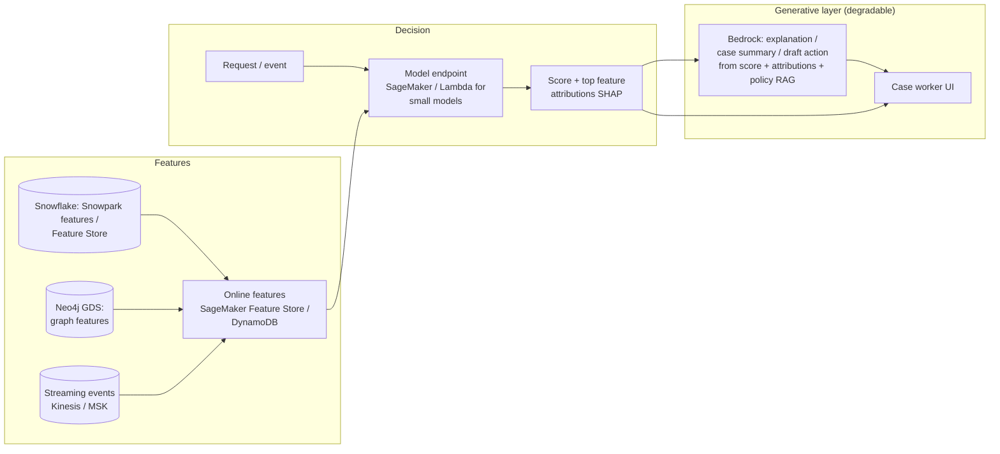

# P11: Predictive ML with a Generative Interface

A classical machine-learning model (scoring, forecasting, anomaly detection, recommendation) makes the **decision or prediction**. A generative model **explains, summarises or drafts** around it. Each technique does what it is good at: calibrated, measurable predictions from ML, and language from the LLM.

| Dimension | Rating |
|---|---|
| Budget band | **B2–B3** |
| Complexity | **C3** (ML engineering + GenAI) |
| Service level fit | **SL2–SL3** for the scoring path; the GenAI explanation can degrade independently |
| Time to first value | 2–4 months (faster if the ML model already exists) |
| Snowflake role | **Often central:** feature engineering (Snowpark, Feature Store) and batch scoring; optionally model training/registry in Snowflake ML |
| Neo4j role | Optional: graph features (centrality, community, shortest paths via Graph Data Science) improve fraud, risk and recommendation models |
| Typical SAR tier | Tier 2; Tier 1 for consequential decisions about individuals (credit, fraud, eligibility) |

**Suitability profile** ([definitions](../00-decision-framework.md#06-suitability-dimensions))

| Dimension | Rating |
|---|---|
| Max consequence of error | **E4** with human oversight: a testable ML model decides; the LLM only explains |
| Data prerequisites | **High**: labelled outcome history, features, fairness attributes where lawful |
| Evaluability | **High** (standard ML metrics and calibration) |
| Cost elasticity | **Sub-linear** (scoring is cheap; explanations generated on demand) |
| Lock-in / exit cost | Low–Medium |
| Explainability | **High** (feature attributions, versioned models) |
| Regulatory fit | **R2 best fit** for regulated decisions about individuals |
| Model-change sensitivity | Low for the LLM part (degradable); retraining for ML drift |
| Human review demand | Medium (case review) |
| Typical value metrics | Loss prevented, precision/recall in business terms, handling time per case |

## Use when

- The core problem is **numeric or classification** with labelled history: churn, fraud, demand, failure prediction, next best action.
- Users need the prediction **explained in context** ("why is this account flagged, and what should I do?").
- Regulators need a **measurable, testable** decision model. LLMs should not be the decision-maker here.

## Avoid when

- There is no labelled outcome data, or the "prediction" is really text understanding (use P01/P02).

## Architecture

**Batch variant:** score nightly in Snowflake (Snowpark / Snowflake ML) or with SageMaker batch transform, then generate explanations only for the top-N cases that people will actually review (P02). This dramatically reduces token cost.

## Key design decisions

| Decision | Guidance |
|---|---|
| **Separation of concerns** | The ML model decides; the LLM explains, using the model's *actual* attributions as input. The LLM must not invent reasons. Ground it on the attribution values and the policy text, and check it with guardrail grounding |
| **Where to train** | Snowflake ML when the features and team are Snowflake-centric; SageMaker AI when you need custom containers, GPUs or real-time endpoints at SL3 |
| **Real-time vs batch** | Real-time only if the decision is made in-line (for example payment fraud). Otherwise batch is cheaper and simpler |

## Cost profile

- **Fixed:** real-time endpoints (multi-AZ), online feature store, streaming ingestion. Batch-only designs have a much lower floor.
- **Variable:** the LLM explanation per case. Generate explanations **on demand** when a user opens a case, not for every score.
- **Levers:** batch scoring, explaining only the reviewed cases, and small models for explanation (the task is constrained).

## Service levels

- The scoring path carries the SLO (for example p99 < 100 ms, 99.95%). Keep it free of LLM dependencies.
- The explanation path is **SL1–SL2 and degradable**. If Bedrock is unavailable, show the score and raw attributions.
- Model quality SLIs: AUC/precision/recall on recent labelled data, calibration, **drift** (feature and prediction distributions), and fairness metrics across protected groups where relevant.

## Security review focus

- Consequential automated decisions: human oversight, contestability, and records of the model version and inputs per decision.
- Training data governance and bias evaluation.
- Feature store access control: features can be sensitive derived data.

## Evolution

- An agent (P08) can use the scoring endpoint as a tool; the scoring model itself stays deterministic and governed.
