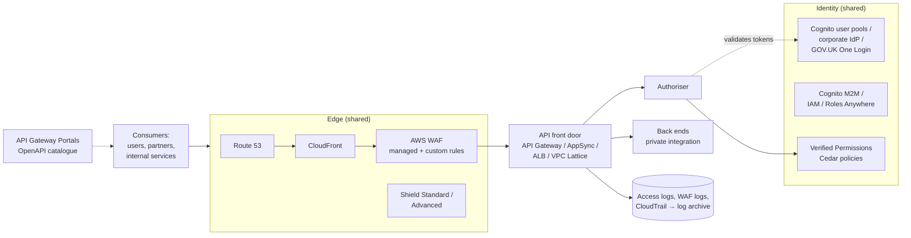

# 1. Shared Foundations for APIs

Every API pattern in this series assumes these **shared foundations**. Build them once as paved-road components (IaC modules, organisation guardrails, pipeline templates) and inherit them. A pattern that inherits a reviewed foundation *references* these controls in its SAR instead of re-proving them.

> Shared edge, identity and API platform components are **always SAR Tier 1** ([review workflow §2.2](../docs/02-review-workflow.md#22-tiering)).

---

## 1.1 API governance and lifecycle

- **Design first.** Every API has an OpenAPI 3.x (or GraphQL SDL) contract that is reviewed before build, linted in CI (naming, error format, security schemes declared, no sensitive data in paths), and published to the catalogue.
- **Standard conventions:** RFC 9457 problem-details error format; `Idempotency-Key` for non-idempotent writes; pagination and filtering conventions; correlation ID header propagated end to end.
- **Versioning policy:** major versions in the path (`/v1`) via custom-domain base-path mappings; additive changes within a version; `Deprecation` and `Sunset` headers with a published notice period.
- **Inventory:** every API (and every stage) is registered, with an owner, classification and exposure. Unknown or old stages are the "improper inventory management" risk in the OWASP API Top 10. **Disable the default `execute-api` endpoint** when a custom domain is used, so that nobody can bypass edge controls.
- **Developer portal:** API Gateway Portals (or an equivalent) for discovery, documentation, sandbox credentials and consumer onboarding. This is the main lever for the integration-ease SLI.

## 1.2 Edge protection

| Control | Baseline |
|---|---|
| CloudFront | In front of internet-facing APIs for TLS termination at the edge, origin protection, and to allow WAF in front of HTTP APIs (which cannot attach WAF directly) |
| TLS policy | TLS 1.2 minimum, TLS 1.3 preferred; modern cipher suites (API Gateway security policies, CloudFront security policy) |
| AWS WAF | AWS managed rule groups (core rule set, known bad inputs, IP reputation, anonymous IP where appropriate); rate-based rules per IP and per API key/token; body size limits; geo rules if justified. Bot Control and account-takeover prevention for user-facing login flows |
| Shield | Shield Standard is automatic. Shield Advanced (an organisation-level subscription) for SL3 or high-profile public services, with proactive engagement and cost protection |
| Origin protection | Back ends accept traffic only from the edge: CloudFront origin access control, a secret header verified at the origin, or private integration. Regional API endpoints are not left open to bypass CloudFront |

## 1.3 Identity and access

**Consumer identity model** (choose per consumer type):

| Consumer | Recommended identity | Assurance |
|---|---|---|
| Staff users | Corporate IdP (OIDC/SAML) federated to Cognito or used directly as the OIDC issuer; MFA; phishing-resistant for admins | L2–L3 |
| Citizens / customers | Cognito user pools (passkeys, MFA, threat protection on the Plus tier) or an external OIDC provider such as **GOV.UK One Login** | L2–L3 |
| Workloads in the same AWS organisation | IAM roles with SigV4 signing; no API keys, no shared secrets | L3 |
| Workloads outside AWS (on-premises, other clouds) | **IAM Roles Anywhere** (X.509 → short-lived IAM credentials), or OAuth client credentials (Cognito M2M), or mTLS | L2–L4 |
| Partner organisations | mTLS plus OAuth client credentials, with the token bound to the certificate by the authoriser; client registry | L3–L4 |

**Token validation rules** for authorisers: verify signature against the issuer's JWKS; check `iss`, `aud`, `exp`, `nbf`, `token_use`/type and required scopes; reject `alg: none` and unexpected algorithms. Keep access tokens short-lived (5–60 minutes). Refresh tokens are never sent to APIs.

**Authorisation:**
- Every request is checked for **function-level** access (can this caller use this operation?) and **object-level** access (can this caller access *this* record?). Object-level checks prevent BOLA, the #1 API risk.
- For fine-grained or need-to-know rules, **Amazon Verified Permissions** (Cedar) gives centrally managed, testable and auditable policies. Call it from a Lambda authoriser (coarse, cached) and from the service (object-level, uncached).
- **Lambda authoriser caching:** the cache key must include every input the decision depends on. Returned policies must not be broader than the request being authorised. Otherwise a cached "Allow" leaks across resources or callers.
- **API keys and usage plans are for metering and throttling, not authentication.**

## 1.4 Data protection

- TLS end to end, including private integrations and VPC Lattice (HTTPS listeners).
- KMS customer-managed keys for OFFICIAL-SENSITIVE data stores, queues, logs and caches.
- No sensitive data in URLs, paths or query strings (they end up in logs, caches and browser history).
- Log **metadata, not payloads**. Where payload logging is needed for debugging, enable it temporarily, with redaction, in non-production only.
- Response shaping: return only the fields the caller is entitled to. Excessive data exposure is broken object property level authorisation (BOPLA).

## 1.5 Network

- Back ends run in private subnets and are reached through private integrations: VPC link (REST/HTTP APIs), VPC Lattice, or PrivateLink.
- **Interface VPC endpoints** for AWS services that workloads call, instead of NAT for everything. Egress to the internet goes through a controlled path (AWS Network Firewall or a proxy) with an allow-list.
- Security groups reference other security groups rather than CIDR ranges, and default deny.
- Private APIs: `execute-api` VPC endpoints with endpoint policies, and API resource policies that restrict `aws:SourceVpce` and `aws:PrincipalOrgID`.

## 1.6 Resilience and performance

- **Multi-AZ** for every stateful and stateless component. Test static stability (can the API run through the loss of an AZ without control-plane actions?).
- **Throttling in layers:** account/Region quotas, stage and method throttles, per-client usage plans, WAF rate-based rules, and back-end concurrency limits. Consumers receive 429 with `Retry-After`.
- **Timeouts:** API Gateway's integration timeout defaults to 29 s. It can be raised for Regional and private REST APIs, at the cost of reduced throttle quota. Long work should be asynchronous ([A08](patterns/A08-async-event-driven-api.md)), not a long-held request.
- **Idempotency** for writes, so that consumer retries are safe (Powertools for AWS Lambda provides an idempotency utility).
- **Caching** where the data allows: CloudFront for public GETs, the API Gateway REST cache, or ElastiCache. Cache keys include authorisation context where responses differ by caller.

## 1.7 Observability and audit

- Structured JSON **access logs** on every API: request ID, caller identity (principal / client ID / certificate subject), route, status, latency, WAF action. Retention set to policy.
- **Tracing** with X-Ray or OpenTelemetry across the edge, authoriser and back end.
- **Synthetic canaries** (CloudWatch Synthetics) from outside the VPC measuring availability and latency per critical route, including an authenticated call.
- **Alarms:** 5xx rate, p99 latency, 429 rate, 401/403 spikes, authoriser errors, certificate and secret expiry (30 days), WAF blocked-request anomalies.
- Security telemetry to the log archive and security tooling: WAF logs, CloudTrail (management events, plus data events where relevant), Security Hub API Gateway and CloudFront controls, and GuardDuty (including Lambda protection). Detection itself is handed over to operational security ([handover](../docs/02-review-workflow.md#stage-7-handover-to-operational-security)).

## 1.8 Delivery

- APIs are deployed via IaC (CDK, SAM or Terraform) from reviewed pipelines ([DLC §5](../docs/05-delivery-lifecycle.md)).
- Pipeline gates: OpenAPI lint, contract tests, unit tests of the authoriser including negative cases, DAST against a test stage (OWASP ZAP or equivalent), dependency and IaC scanning.
- Canary deployments (API Gateway canary settings, Lambda aliases with traffic shifting, ECS blue/green) with automatic rollback on alarms.
- Automated secret and certificate rotation; ACM-managed certificates renew automatically, but imported certificates and partner CA bundles need expiry alarms.

## 1.9 Threats: OWASP API Security Top 10 (2023) mapped to design controls

| Risk | Design control |
|---|---|
| API1 Broken object level authorisation | Object-level checks in the service on every request; Verified Permissions for need-to-know; negative tests with other callers' IDs |
| API2 Broken authentication | Standard OAuth/OIDC or IAM; token validation rules (§1.3); no API keys as authentication; MFA for users; credential stuffing protection on login |
| API3 Broken object property level authorisation | Response shaping and request allow-listing (no mass assignment); field-level rules in GraphQL |
| API4 Unrestricted resource consumption | Layered throttling, payload size limits, pagination caps, GraphQL depth/complexity limits, Lambda reserved concurrency, budget alarms |
| API5 Broken function level authorisation | Deny-by-default route authorisation; admin operations on separate APIs or with separate scopes |
| API6 Unrestricted access to sensitive business flows | Bot Control / fraud rules, per-user limits on sensitive flows, step-up authentication |
| API7 Server-side request forgery | No user-supplied URLs fetched by back ends without allow-lists; egress filtering; IMDSv2 |
| API8 Security misconfiguration | IaC guardrails, Config rules, disabled default endpoints, strict CORS (no wildcard with credentials), TLS policy |
| API9 Improper inventory management | Catalogue with owners; stage lifecycle; decommission old versions; no undocumented debug routes |
| API10 Unsafe consumption of APIs | Validate responses from third-party APIs; timeouts and circuit breakers; treat upstream data as untrusted |

The API review questions are consolidated in the [API workload checklist](../checklists/api-workloads.md).
