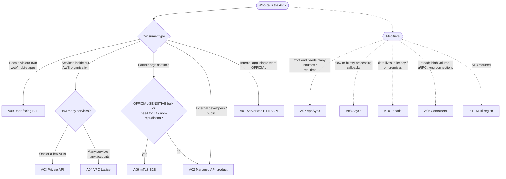

# API Solution Architecture Patterns (AWS)

A catalogue of reference architectures for **secure, highly available, performant APIs on AWS**, using AWS-native components only. It focuses on **authentication, authorisation and ease of integration** for data classified **OFFICIAL**, including the **OFFICIAL-SENSITIVE** handling caveat.

Each pattern uses the same budget, complexity and service level scales as the [AI patterns](../ai-patterns/README.md). They add API-specific suitability ratings, led by authentication assurance and integration ease, so teams can pick the lightest pattern that meets their targets and reviewers can challenge designs consistently. The patterns feed the [Security Architecture Review process](../README.md).

## Contents

| # | Document | Purpose |
|---|---|---|
| 0 | [Decision framework](00-decision-framework.md) | Budget bands, complexity, service levels, OFFICIAL / OFFICIAL-SENSITIVE control baselines, authentication assurance L1–L4, suitability dimensions |
| 1 | [Shared foundations](01-shared-foundations.md) | API governance, edge protection, identity model, data protection, network, resilience, observability, delivery, OWASP API Top 10 mapping |
| — | [API workload checklist](../checklists/api-workloads.md) | Reviewer prompts for API solutions |
| — | [API pattern scoring sheet](../templates/api-pattern-scoring-sheet.md) | Gates, weighted fit scoring, validation and a worked example |
| — | [API pattern selection record](../templates/api-pattern-selection.md) | Records the chosen pattern, targets and trade-offs |

### Patterns

| ID | Pattern | Budget | Complexity | Max service level | Max auth assurance | Exposure |
|---|---|---|---|---|---|---|
| [A01](patterns/A01-serverless-http-api.md) | Serverless HTTP API | B1 | C1 | SL2 | L2 (L3 with IAM/mTLS) | Public / Partner |
| [A02](patterns/A02-managed-api-product.md) | Managed API product (public or partner) | B2 | C2 | SL2 | L3 | Public / Partner |
| [A03](patterns/A03-private-api.md) | Private API (internal, cross-account) | B1–B2 | C2 | SL2 | L3 | Private |
| [A04](patterns/A04-service-network-vpc-lattice.md) | Service-to-service network (VPC Lattice) | B2 | C2–C3 | SL2 | L3 | Private |
| [A05](patterns/A05-containerised-api.md) | Containerised API (ALB + ECS) | B2–B3 | C2–C3 | SL2 | L3 | Any |
| [A06](patterns/A06-mtls-b2b-integration.md) | Mutual TLS B2B integration (high assurance) | B2 | C3 | SL2 | **L4** | Partner |
| [A07](patterns/A07-graphql-realtime-appsync.md) | GraphQL and real-time (AppSync) | B1–B2 | C2 | SL2 | L2 users / L3 services | Any |
| [A08](patterns/A08-async-event-driven-api.md) | Asynchronous and event-driven API | B1 | C2 | SL2–SL3 (acceptance) | Inherits front door | Any |
| [A09](patterns/A09-user-facing-api-bff.md) | User-facing API with BFF and managed identity | B2 | C2–C3 | SL2 | L3 (users) | Public |
| [A10](patterns/A10-legacy-integration-facade.md) | Legacy and on-premises integration facade | B2 | C3 | SL1–SL2 (legacy-bound) | L2–L3 | Any |
| [A11](patterns/A11-multi-region-active-active.md) | Multi-region active/active (SL3 uplift) | B3–B4 | C4 | **SL3** | Inherits base | Inherits base |

### Security and integration profile at a glance

Definitions are in [§0.6](00-decision-framework.md#06-suitability-dimensions-for-apis).

| ID | Auth assurance | Authorisation | Integration ease | Protocols | OFFICIAL-SENSITIVE fit | Cost elasticity | Lock-in | Auditability | Ops burden |
|---|---|---|---|---|---|---|---|---|---|
| A01 | L2 (L3 with IAM/mTLS) | Coarse (+ code) | **High** | REST | Only with CloudFront/WAF + L3; prefer A02/A03 | Linear | Low–Medium | Medium | **Low** |
| A02 | L3 | **Fine** | **High** | REST | Yes, with L3 + CMK + pen test | Linear | Medium | **High** | Low–Medium |
| A03 | L3 | Coarse–Fine | Medium | REST | **Strong fit** | Linear + endpoint floor | Medium | **High** | Low |
| A04 | L3 | Coarse–Fine | High (AWS teams) | HTTP, gRPC, TCP | **Strong fit** | Linear + per-service floor | Medium | **High** | Low–Medium |
| A05 | L3 | **Fine** | **High** | REST, gRPC, streaming | Yes, with L3 + CMK | **Sub-linear** | **Low** | Medium–High | Medium–High |
| A06 | **L4** | **Fine** (+ partitions) | **Low–Medium** | REST | **Best fit** | Step, then linear | Low–Medium | **High** | Medium |
| A07 | L2 / L3 | **Field-level** | **High** (front ends) | GraphQL, WebSocket | Yes, with field rules + private/WAF | Linear | Medium | Medium–High | Low |
| A08 | Inherits | Coarse → re-checked | Medium | REST, webhooks, events | Yes (thin events, CMK) | Linear, low | Medium | High | Low–Medium |
| A09 | L3 (users) | **Fine** | **High** (app team) | REST / GraphQL | Yes, with MFA/step-up | Linear | Medium | **High** | Medium |
| A10 | L2–L3 | Fine at facade | High (consumers) | REST → legacy | Yes, with encrypted DX | Step, then linear | Low | Medium–High | Medium–High |
| A11 | Inherits | Inherits | High | Inherits | **Residency decision required** | Step | Medium–High | High | **High** |

## Choosing a pattern

The tree gives a shortlist, and the modifiers combine with it (for example A02 + A08, or A09 + A07). For SAR Tier 1–2 solutions, or when two or more patterns are plausible, compare them with the [scoring sheet](../templates/api-pattern-scoring-sheet.md): gates, then weighted fit, then validation with a pilot consumer ([§0.8](00-decision-framework.md#08-evaluating-suitability-for-a-specific-problem)).

Constraint checks for lighter cases:

1. **Classification:** can the pattern meet the OFFICIAL or OFFICIAL-SENSITIVE control baseline ([§0.4](00-decision-framework.md#04-data-classification-official-and-official-sensitive))?
2. **Authentication assurance:** does the pattern natively support the required L-level ([§0.6.1](00-decision-framework.md#061-authentication-assurance))?
3. **Exposure:** does the pattern support who the consumers are, and where they are?
4. **Service level:** does the composite availability, including the identity provider, reach the tier? For SL3, is the residency decision in place ([§0.3](00-decision-framework.md#uk-residency-and-multi-region))?
5. **Budget:** does the fixed floor fit the band? Remember the per-AZ and per-VPC endpoint floors and organisation-level services such as Shield Advanced.
6. **Integration:** can a representative consumer reach a first successful call within the target time?

## Classification × exposure quick reference

The default pattern choice when nothing else points elsewhere:

| | Private (inside the organisation) | Partner (known organisations) | Public (citizens, customers, developers) |
|---|---|---|---|
| **OFFICIAL** | A03, or A04 for many services (A01 for a single internal app) | A02 (L2) | A02 for developers; A09 for your own apps |
| **OFFICIAL-SENSITIVE** | A03 / A04 with fine-grained authorisation and per-record audit | **A06** (L4), or A02 with L3 for lower-volume, lower-impact data | A09 with MFA/step-up; A02 at L3 only with strong justification |

## Budget × service level quick reference

| | SL0–SL1 | SL2 | SL3 |
|---|---|---|---|
| **B1 < $1k** | A01, A03, A07, A08 | A01, A03 (few consumer VPCs), A07, A08 | Not realistic |
| **B2 $1k–10k** | All except A11 | A02, A03, A04, A05 (small), A06, A07, A08, A09, A10 | A08 acceptance path only |
| **B3 $10k–50k** | All | All | A11 on A01/A02/A07 bases |
| **B4 > $50k** | All | All | A11 on any base, including A05 at scale |

## Composing patterns

Most real solutions combine patterns:

- **A09 → A04:** citizen app BFF calling internal domain services over VPC Lattice.
- **A02 + A08:** a partner product API whose long-running operations return 202 and a callback.
- **A06 + A08:** bulk OFFICIAL-SENSITIVE submissions from partners accepted asynchronously.
- **A02 / A03 → A10:** modern front doors over legacy systems during migration.
- **Any synchronous pattern + A11:** the SL3 uplift.

When composing, the **highest SAR tier**, the **most demanding SLO** and the **strictest classification baseline** apply to the shared parts. Calculate composite availability over the combined serial path, including identity providers and authorisers.

## Anti-patterns

| Anti-pattern | Why it fails | Instead |
|---|---|---|
| API keys used as authentication | Keys are shared, long-lived and not bound to identity | OAuth client credentials, IAM or mTLS. Keys only for metering |
| Tokens stored in browser `localStorage` | Any XSS steals them | BFF with HttpOnly session cookies (A09) |
| Default `execute-api` endpoint left enabled | Bypasses CloudFront/WAF and mTLS | Disable it; custom domains only |
| Authoriser cache key missing inputs | A cached Allow leaks across callers or resources | Cache keys include every decision input; scoped policies |
| Object IDs trusted from the client (BOLA) | Callers read other people's records | Ownership and need-to-know checks on every request |
| Sensitive data in paths or query strings | Leaks into logs, caches and history | Request bodies or opaque IDs; log redaction |
| Business logic in VTL mapping templates | Hard to test, high lock-in | Code in Lambda or containers; thin gateway configuration |
| "Multi-region" with a single-Region IdP | Sign-in fails with the primary Region | Design identity resilience explicitly (A11) |
| Direct Connect assumed to be encrypted | It is not encrypted by default | MACsec or IPsec over DX, plus TLS |
| Unbounded GraphQL queries | Resource exhaustion and cost attacks | Depth and resolver limits, pagination caps, WAF |
| One OAuth client shared by many consumers | No attribution, no targeted revocation | One client per consumer system |
| SL3 promised on a single-Region design | Composite availability cannot reach it | A11, or SL2 with a documented residency trade-off |

## Maintaining this catalogue

- Re-validate service capabilities, quotas and indicative prices **every six months**. API Gateway, AppSync, Cognito and VPC Lattice change regularly.
- Update pattern ratings using evidence from post-implementation reviews (scoring sheet Stage 4).
- New patterns follow the same structure: two profile tables, use when / avoid when, architecture, authentication and authorisation, component choices, cost profile, service levels, security review focus and evolution.
