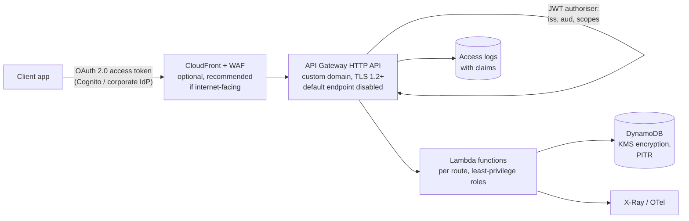

# A01: Serverless HTTP API

A lightweight RESTful API on **API Gateway HTTP APIs** with a built-in **JWT authoriser**, **Lambda** back ends and **DynamoDB**. It is the cheapest, simplest way to put an authenticated API in front of a small domain service. There is no fixed cost and nothing to patch.

| Dimension | Rating |
|---|---|
| Budget band | **B1** (fixed floor ≈ $0; ~$1 per million requests plus Lambda and DynamoDB) |
| Complexity | **C1** |
| Service level fit | **SL2** in one Region; SL3 only via [A11](A11-multi-region-active-active.md) |
| Time to first value | 1–3 weeks |
| Typical SAR tier | Tier 3 (internal, OFFICIAL) to Tier 2 |

**Security and integration profile** ([definitions](../00-decision-framework.md#06-suitability-dimensions-for-apis))

| Dimension | Rating |
|---|---|
| Max authentication assurance | **L2** natively (JWT authoriser). L3 with the IAM authoriser (SigV4) or mTLS on a custom domain |
| Authorisation granularity | Coarse (route + scopes) at the gateway; fine only in function code |
| Exposure | Public / Partner (**no private endpoint type**; for private use see [A03](A03-private-api.md)) |
| Integration ease | **High** (OAuth + REST, OpenAPI import/export, CORS built in) |
| Protocols | REST / HTTP |
| Classification fit | **OFFICIAL.** OFFICIAL-SENSITIVE only with CloudFront + WAF in front, L3 authentication and fine-grained checks in code. Usually better served by A02 or A03 |
| Cost elasticity | Linear (lowest per-request price) |
| Lock-in / exit cost | Low–Medium (Lambda code and OpenAPI are portable) |
| Auditability | Medium (access logs with JWT claims; no per-request CloudTrail) |
| Change and versioning | Stages with auto-deploy; base-path mappings on custom domains |
| Operational burden | **Low** |

## Use when

- Internal or single-consumer APIs, such as a web or mobile app's back end or a team's domain service.
- OFFICIAL data, OAuth/OIDC-based consumers, and unpredictable or low volume.
- You want the fastest path to a secure, production-grade API.

## Avoid when

- You need **WAF directly on the API**, API keys and usage plans, request validation, caching or a **private endpoint**. HTTP APIs do not support these; use [A02](A02-managed-api-product.md) or [A03](A03-private-api.md).
- The data is OFFICIAL-SENSITIVE and consumers are external. Use A02 with L3, or [A06](A06-mtls-b2b-integration.md).

## Architecture

## Authentication and authorisation

- **JWT authoriser** configured with the issuer and audience. Routes declare required scopes (`orders:read`, `orders:write`).
- **Object-level checks in code:** the function compares the resource owner or tenant with the token's `sub`/tenant claim before returning data (prevents BOLA).
- **Service-to-service callers inside AWS:** use the IAM authoriser on those routes (SigV4, L3) rather than issuing them OAuth clients.
- **CORS:** explicit origins; never `*` with credentials.

## Component choices

| Concern | Default | When to change |
|---|---|---|
| Front door | HTTP API | REST API (A02) for WAF, usage plans, validation, caching, private endpoints |
| Edge | CloudFront + WAF when internet-facing (HTTP APIs cannot attach WAF directly) | Omit only for low-risk internal consumers reaching a partner-restricted endpoint |
| Compute | Lambda (Powertools for logging, tracing, idempotency, validation) | ECS (A05) for long-running or steady high-throughput work |
| Data | DynamoDB on-demand | Aurora Serverless v2 for relational needs (adds a floor and VPC networking) |

## Cost profile

- Fixed: ≈ $0 (CloudFront/WAF add a small floor: web ACL + rules).
- Variable: API requests + Lambda duration + DynamoDB requests. Typically the lowest unit cost in the series.
- Watch: log volume (set retention), and Lambda memory right-sizing.

## Service levels

| Tier | What to add |
|---|---|
| SL1 | Defaults |
| SL2 | Throttling per route, reserved concurrency on critical functions, DynamoDB PITR, synthetic canaries, alarms on 5xx/p99/429, idempotent writes |
| SL3 | Move to [A11](A11-multi-region-active-active.md) (two Regions with DynamoDB global tables). Composite single-Region availability is about 99.89% |

## Security review focus

- Default `execute-api` endpoint disabled when fronted by CloudFront, so that WAF cannot be bypassed.
- Scopes and object-level checks tested with negative cases (another user's ID, missing scope, expired token, wrong audience).
- Function roles scoped to the specific table and actions; no wildcard `dynamodb:*`.

## Evolution

- Needs WAF on the API, API keys, validation or a portal → **A02**. Internal-only consumers → **A03**. Steady high volume → **A05**.
