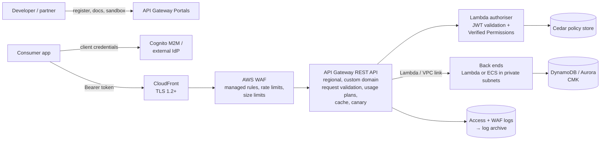

# A02: Managed API Product (Public or Partner)

A fully managed **API product** on **API Gateway REST APIs**, protected at the edge by **CloudFront and AWS WAF**. It uses OAuth 2.0 authentication and fine-grained authorisation through **Amazon Verified Permissions**, validates requests against the OpenAPI schema, meters consumers with usage plans, and handles onboarding through **API Gateway Portals**. This is the default pattern for APIs that external developers or partner organisations consume.

| Dimension | Rating |
|---|---|
| Budget band | **B2** (fixed floor: WAF web ACL + rules, portal, optional cache; ~$3.50 per million requests) |
| Complexity | **C2** |
| Service level fit | **SL2**; SL3 via [A11](A11-multi-region-active-active.md) |
| Time to first value | 1–3 months |
| Typical SAR tier | Tier 2 (Tier 1 for OFFICIAL-SENSITIVE internet-facing) |

**Security and integration profile** ([definitions](../00-decision-framework.md#06-suitability-dimensions-for-apis))

| Dimension | Rating |
|---|---|
| Max authentication assurance | **L3** (OAuth client credentials plus mTLS on the custom domain with token-to-certificate binding in the authoriser; or IAM for AWS consumers). L4 is [A06](A06-mtls-b2b-integration.md) |
| Authorisation granularity | **Fine** (Lambda authoriser + Verified Permissions; object-level checks in the service) |
| Exposure | Public / Partner |
| Integration ease | **High** (portal, OpenAPI, SDK generation, sandbox stage, self-service keys) |
| Protocols | REST |
| Classification fit | **OFFICIAL**; **OFFICIAL-SENSITIVE** with L3 authentication, CMK encryption, response shaping, log redaction and a penetration test |
| Cost elasticity | Linear |
| Lock-in / exit cost | Medium (usage plans, authoriser wiring; avoid business logic in VTL mapping templates) |
| Auditability | **High** (access logs with principal and client ID; WAF logs; authorisation decisions logged) |
| Change and versioning | **Strong** (stages, base-path versions, canary release settings) |
| Operational burden | Low–Medium (rule tuning, key and client management) |

## Use when

- Developers or partners outside your team consume the API, and you need **metering, throttling per consumer, and self-service onboarding**.
- The API is internet-facing and needs WAF, request validation and caching.
- Authorisation rules go beyond scopes (need-to-know, per-organisation data partitioning).

## Avoid when

- It is a simple internal API. [A01](A01-serverless-http-api.md) is cheaper and simpler.
- Consumers are only inside your AWS organisation. [A03](A03-private-api.md) gives L3 with no internet exposure.
- Partners exchange OFFICIAL-SENSITIVE data in bulk and need non-repudiation. Use [A06](A06-mtls-b2b-integration.md).

## Architecture

## Authentication and authorisation

| Consumer type | Mechanism |
|---|---|
| Partner or developer systems | OAuth 2.0 **client credentials** (Cognito machine-to-machine app clients or the organisation's IdP). One client per consumer, never shared. Short-lived tokens |
| End users via partner apps | Authorisation code + PKCE with the partner's user context passed as a delegated token; the API checks both the client and the user |
| OFFICIAL-SENSITIVE consumers | Add **mTLS** on the custom domain (truststore in S3). The authoriser checks that the certificate subject matches the registered client ID of the token, so a stolen token alone cannot be replayed (L3) |
| AWS-native consumers | IAM authorisation (SigV4) on dedicated routes |

- **API keys** identify the consumer for usage plans and throttling. They are **never** the authentication mechanism.
- **Lambda authoriser** validates the token, then asks Verified Permissions for a coarse decision (principal, action, resource type). Cache the result, keyed on token + route. The **service** performs object-level checks on every request.
- **Request validation** (body schema, required parameters) rejects malformed input at the edge of the API before it reaches code.

## Component choices

| Concern | Default | Alternatives |
|---|---|---|
| Endpoint type | Regional REST API behind your own CloudFront distribution (full control of caching, WAF, headers) | Edge-optimised endpoint (AWS-managed distribution, less control) |
| Authoriser | Lambda authoriser + Verified Permissions | Cognito authoriser (scopes only); IAM authoriser for AWS consumers |
| Developer experience | API Gateway Portals with sandbox stage and generated SDKs | Static docs from OpenAPI (lower cost, weaker onboarding) |
| Back end | Lambda | ECS/EKS via VPC link ([A05](A05-containerised-api.md)) |

## Cost profile

- **Fixed:** WAF (web ACL + rules; Bot Control extra), portal, and cache (per hour by size) if enabled. Shield Advanced is an organisation-level decision.
- **Variable:** REST requests (~3.5× the HTTP API price), authoriser invocations (reduced by caching), back end.
- **Levers:** authoriser caching with correct cache keys; CloudFront caching of public GETs; right-sized log retention.

## Service levels

| Tier | What to add |
|---|---|
| SL1 | Defaults |
| SL2 | Per-consumer usage plans, stage throttles, canary deployments with alarm rollback, synthetic canaries per consumer journey, IdP availability in the composite calculation |
| SL3 | [A11](A11-multi-region-active-active.md). Note that the identity provider (Cognito user pools are regional) must also be resilient |

## Security review focus

- WAF cannot be bypassed: the default endpoint is disabled, and the regional API accepts traffic only via the custom domain.
- The authoriser cache cannot leak decisions across callers or resources.
- Per-consumer credentials; revocation tested (disable a client and confirm its access stops within the token lifetime).
- Mass assignment and excessive data exposure prevented by request and response schemas.

## Evolution

- Bulk OFFICIAL-SENSITIVE partner exchange → **A06**. Long-running operations → add **A08**. SL3 → **A11**.
