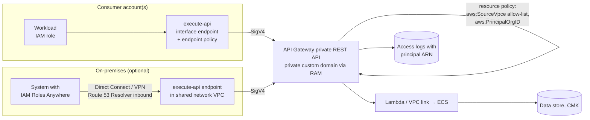

# A03: Private API (Internal, Cross-Account)

An API that is **never reachable from the internet**. It is built on **API Gateway private REST APIs** and accessed through `execute-api` **interface VPC endpoints**. **IAM (SigV4)** authenticates callers, and a **resource policy** restricts access to named VPC endpoints and to principals in your AWS organisation. Private custom domain names can be **shared across accounts** with AWS RAM.

| Dimension | Rating |
|---|---|
| Budget band | **B1–B2** (fixed floor: interface endpoints ≈ $7–8/month per AZ in each consumer VPC; ~$3.50 per million requests) |
| Complexity | **C2** |
| Service level fit | **SL2** |
| Time to first value | 2–6 weeks |
| Typical SAR tier | Tier 2 (Tier 3 for OFFICIAL internal read-only) |

**Security and integration profile** ([definitions](../00-decision-framework.md#06-suitability-dimensions-for-apis))

| Dimension | Rating |
|---|---|
| Max authentication assurance | **L3** (IAM SigV4 with short-lived role credentials, plus the network restriction). Approaches L4 with a per-consumer VPC endpoint allow-list |
| Authorisation granularity | Coarse to fine (IAM conditions per resource path and principal tag; a Lambda authoriser or Verified Permissions for record-level) |
| Exposure | **Private** (organisation and connected networks only) |
| Integration ease | Medium (callers must SigV4-sign: easy with AWS SDKs, harder for non-AWS clients; network set-up per consumer VPC) |
| Protocols | REST |
| Classification fit | **OFFICIAL and OFFICIAL-SENSITIVE** (strong fit) |
| Cost elasticity | Linear, plus a per-VPC endpoint floor |
| Lock-in / exit cost | Medium (IAM-based auth is AWS-specific) |
| Auditability | **High** (IAM principal ARN in every access log line) |
| Change and versioning | Stages, base-path mappings on the private custom domain |
| Operational burden | Low |

## Use when

- Consumers are workloads inside your AWS organisation: other teams' services, batch jobs, internal portals' back ends.
- The data is OFFICIAL-SENSITIVE and there is no need for internet exposure.
- You want strong authentication **without** managing OAuth clients or secrets, because IAM roles already exist.

## Avoid when

- Consumers are outside AWS and cannot obtain IAM credentials. [IAM Roles Anywhere](../01-shared-foundations.md#13-identity-and-access) can bridge this gap; otherwise use A02 or A06.
- There are many services calling each other in a mesh. [A04](A04-service-network-vpc-lattice.md) avoids per-API endpoint sprawl.

## Architecture

## Authentication and authorisation

- **Authentication:** the IAM authoriser. Callers sign with SigV4 using role credentials. No long-lived keys: workloads use instance, task or function roles; on-premises systems use IAM Roles Anywhere.
- **Resource policy** (deny-by-default): allow `execute-api:Invoke` only from listed VPC endpoints **and** only for principals in the organisation (`aws:PrincipalOrgID`), optionally further scoped by principal tags (`aws:PrincipalTag/team`) per resource path.
- **Endpoint policy** on each consumer's VPC endpoint limits which APIs that VPC can call.
- **Record-level (need-to-know):** a Lambda authoriser or in-service check with Verified Permissions, using the caller's role and tags as principal attributes.

## Cost profile

- **Fixed:** one `execute-api` interface endpoint per consumer VPC, per AZ. Centralise in a shared network VPC where the network design allows, to avoid multiplying this floor.
- **Variable:** REST requests and back end.

## Service levels

- SL2 with multi-AZ endpoints and back ends. Consumer-side endpoints are part of the composite path: deploy them in every AZ the consumer uses.
- DNS resolution of the private custom domain must work from every consumer network (Route 53 private hosted zones, Resolver rules for on-premises).

## Security review focus

- The resource policy has no `Principal: *` without both VPC-endpoint and organisation conditions.
- IAM policies granting `execute-api:Invoke` are scoped to specific API/stage/method ARNs, not `*`.
- No path to the API from the internet (private endpoint type; no public DNS).
- Roles Anywhere trust anchors restricted to your private CA and to certificate attributes.

## Evolution

- Many internal services → **A04**. Some consumers become external → publish a separate external API (**A02** or **A06**), and keep the private API for internal callers.
