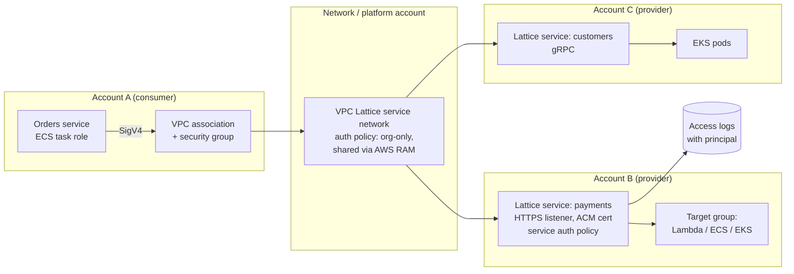

# A04: Service-to-Service Network (Amazon VPC Lattice)

Internal APIs between services across **many VPCs and accounts**, connected through an **Amazon VPC Lattice service network**. VPC Lattice provides discovery, routing, HTTP/HTTPS/gRPC/TCP connectivity, and **IAM auth policies** evaluated on every request. There is no VPC peering, no Transit Gateway routing for these flows, and no load balancer per service.

| Dimension | Rating |
|---|---|
| Budget band | **B2** (fixed floor: per-service hourly charge; plus per GB and per request) |
| Complexity | **C2–C3** (network and platform design across accounts) |
| Service level fit | **SL2** |
| Time to first value | 1–2 months for the platform; days per service after that |
| Typical SAR tier | **Tier 1** for the shared service network (platform component); Tier 2–3 per service |

**Security and integration profile** ([definitions](../00-decision-framework.md#06-suitability-dimensions-for-apis))

| Dimension | Rating |
|---|---|
| Max authentication assurance | **L3** (SigV4 with IAM roles; auth policies at both service network and service level) |
| Authorisation granularity | Coarse to fine (auth policy conditions on principal, organisation, path, method, headers, principal tags) |
| Exposure | **Private** |
| Integration ease | **High** for AWS-hosted teams (DNS name, no network plumbing); Medium for non-SigV4 clients |
| Protocols | HTTP/HTTPS, **gRPC**, TCP |
| Classification fit | **OFFICIAL and OFFICIAL-SENSITIVE** |
| Cost elasticity | Linear with a per-service floor; sub-linear compared with an ALB per service |
| Lock-in / exit cost | Medium (AWS-specific service network; services themselves stay portable) |
| Auditability | **High** (access logs with the caller's principal, to CloudWatch, S3 or Firehose) |
| Change and versioning | Weighted target groups for canary and blue/green; path- and header-based routing |
| Operational burden | Low–Medium |

## Use when

- There are dozens of services owned by different teams, in different accounts, calling each other.
- You want **zero-trust service-to-service** access: every call authenticated and authorised by identity, not by network location.
- Mixed compute (Lambda, ECS, EKS, EC2) needs one consistent connectivity and authorisation model.

## Avoid when

- There are one or two internal APIs. [A03](A03-private-api.md) or an internal ALB is simpler.
- Consumers are outside AWS. Use a front door for them (A02, A06) that calls Lattice services internally.

## Architecture

## Authentication and authorisation

- **Two policy layers:** the service network auth policy (for example, callers must be in the organisation and carry a `workload` tag) and each **service's** auth policy (for example, only the `orders` role may `POST /payments`). Both must allow the call, as well as the caller's own IAM policy.
- Callers **SigV4-sign** requests (AWS SDKs, or a sidecar/proxy for non-AWS-SDK code).
- **Network controls stay** as defence in depth: security groups on VPC associations and on targets.
- Record-level authorisation remains the provider service's job (or Verified Permissions).

## Cost profile

- **Fixed:** an hourly charge per service. For many small services this is usually still cheaper than an ALB per service plus Transit Gateway attachments.
- **Variable:** per GB processed and per request.

## Service levels

- SL2: multi-AZ targets, health checks, weighted routing for safe releases.
- The service network is a shared dependency. Treat its configuration as platform code with change control.

## Security review focus

- Auth type set to `AWS_IAM` on the service network and on sensitive services (not `NONE`).
- Auth policies do not use `Principal: *` without organisation and tag conditions.
- RAM sharing restricted to the organisation.
- Access logs enabled and routed to the log archive.

## Evolution

- External consumers → put **A02**, **A06** or **A09** in front, with the Lattice services behind.
