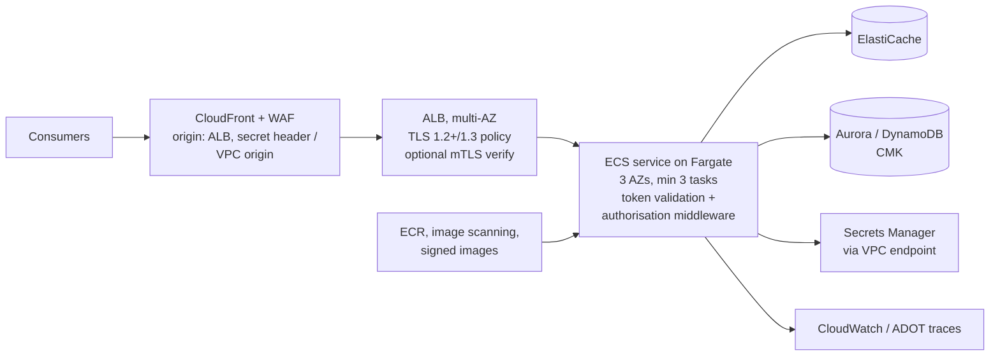

# A05: Containerised API (ALB + ECS on Fargate)

An API running as containers on **Amazon ECS with Fargate** (or EKS where a platform team already runs it), behind an **Application Load Balancer**, with **CloudFront and AWS WAF** at the edge. Choose it for sustained high throughput, long-lived connections, gRPC or HTTP/2 streaming, and existing containerised frameworks (Spring, .NET, FastAPI, Express) where per-request serverless pricing or Lambda limits do not fit.

| Dimension | Rating |
|---|---|
| Budget band | **B2–B3** (fixed floor: ALB + at least 2–3 always-on tasks across AZs + VPC endpoints/NAT) |
| Complexity | **C2–C3** |
| Service level fit | **SL2**; SL3 via [A11](A11-multi-region-active-active.md) |
| Time to first value | 1–2 months |
| Typical SAR tier | Tier 2 |

**Security and integration profile** ([definitions](../00-decision-framework.md#06-suitability-dimensions-for-apis))

| Dimension | Rating |
|---|---|
| Max authentication assurance | **L3** (OAuth tokens validated in the service; ALB mTLS in verify mode with a trust store) |
| Authorisation granularity | **Fine** (in-service, with Verified Permissions or a policy library) |
| Exposure | Public / Partner / Private (internal ALB) |
| Integration ease | **High** (any HTTP protocol, OpenAPI, long-lived connections) |
| Protocols | REST, gRPC, HTTP/2, WebSocket, server-sent events |
| Classification fit | **OFFICIAL and OFFICIAL-SENSITIVE** (with L3 and CMK) |
| Cost elasticity | **Sub-linear** at steady volume (capacity amortised); poor at very low or spiky volume |
| Lock-in / exit cost | **Low** (containers and standard frameworks) |
| Auditability | Medium–High (ALB access logs plus application logs with principal) |
| Change and versioning | Blue/green or canary via ECS deployment controllers; weighted target groups |
| Operational burden | **Medium–High** (image patching, capacity, scaling policies) |

## Use when

- Traffic is **steady and high**: millions of requests per day, where per-request pricing exceeds container costs. Show the break-even.
- Requests are long-running, stream, use gRPC, or hold connections open.
- The team already builds containerised services and wants portability.

## Avoid when

- Volume is low or spiky. [A01](A01-serverless-http-api.md) or [A02](A02-managed-api-product.md) costs less and needs no patching.
- You need API-product features (usage plans, portal, per-consumer keys). Put [A02](A02-managed-api-product.md) in front via a VPC link, or accept building them in-service.

## Architecture

**Private variant:** an internal ALB, reached via [A04](A04-service-network-vpc-lattice.md) (VPC Lattice), via PrivateLink (NLB endpoint service), or via [A03](A03-private-api.md) (API Gateway private API with a VPC link).

## Authentication and authorisation

- **Token validation in the service** using a maintained OIDC/JWT library (issuer, audience, expiry, algorithm allow-list, JWKS caching with rotation).
- **Browser-based internal tools:** the ALB `authenticate-oidc` action can handle login against the corporate IdP. The service must still verify the identity headers ALB adds (verify the signed header, and do not trust it from any other source).
- **High-assurance machine clients:** ALB mTLS in verify mode with a trust store (your private CA or the partner CA bundle). The service binds the certificate identity (passed in headers by the ALB) to the OAuth client (L3).
- **Object-level checks** in the service layer for every data access.

## Cost profile

- **Fixed:** the ALB, minimum task count across AZs, NAT gateways or VPC endpoints, and ElastiCache if used.
- **Variable:** task scaling (target tracking on CPU or request count), data transfer.
- **Levers:** Graviton (ARM) tasks, Fargate Spot for non-critical capacity, right-sizing, VPC endpoints instead of NAT for AWS traffic.

## Service levels

| Tier | What to add |
|---|---|
| SL2 | 3 AZs; minimum tasks sized for AZ loss (N+1); health checks with sensible thresholds; deployment circuit breaker with rollback; connection draining |
| SL3 | [A11](A11-multi-region-active-active.md), with the same service in two Regions |

## Security review focus

- Origin protection: the ALB accepts only CloudFront traffic (CloudFront VPC origins, or managed prefix list + secret header), or it is internal.
- Container supply chain: base-image patching cadence, image scanning, signing, and a read-only root filesystem ([build pipeline checklist](../../checklists/build-pipeline.md)).
- Task roles least-privilege; no secrets in environment variables baked into images.
- Header trust: identity headers from the ALB (OIDC, mTLS) are only accepted when the request came through that ALB.

## Evolution

- Add **A02** in front for product features. Break into services connected by **A04**. SL3 → **A11**.
