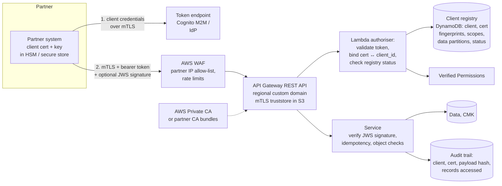

# A06: Mutual TLS B2B Integration API (High Assurance)

A **partner-facing** API for exchanging OFFICIAL-SENSITIVE data with known organisations: other departments, local authorities, suppliers, regulated third parties. It layers **mutual TLS** (client certificates from a managed PKI), **OAuth client credentials bound to the certificate**, a **client registry**, network restriction, and optional **message signing**. This is the highest-assurance pattern in the series (L4).

| Dimension | Rating |
|---|---|
| Budget band | **B2** (fixed floor: WAF; AWS Private CA ~$400/month if you issue client certificates, ~$50/month in short-lived mode; client registry) |
| Complexity | **C3** (PKI and certificate lifecycle, partner onboarding) |
| Service level fit | **SL2**; SL3 via [A11](A11-multi-region-active-active.md) |
| Time to first value | 2–4 months (the first partner); days to weeks per additional partner |
| Typical SAR tier | **Tier 1** (OFFICIAL-SENSITIVE, external privileged access) |

**Security and integration profile** ([definitions](../00-decision-framework.md#06-suitability-dimensions-for-apis))

| Dimension | Rating |
|---|---|
| Max authentication assurance | **L4** |
| Authorisation granularity | **Fine** (per client and per data partition from the registry; Verified Permissions for need-to-know) |
| Exposure | **Partner** |
| Integration ease | **Low–Medium** (certificate exchange, rotation, token binding. Mitigate with an onboarding kit, a sandbox and a portal) |
| Protocols | REST; bulk transfers via [A08](A08-async-event-driven-api.md) |
| Classification fit | **OFFICIAL-SENSITIVE: best fit**, including bulk personal data exchange |
| Cost elasticity | Step (the PKI floor), then linear |
| Lock-in / exit cost | Low–Medium (mTLS and OAuth are standards; the registry and authoriser are yours) |
| Auditability | **High** (certificate subject, client ID and signed payload hash in the audit trail) |
| Change and versioning | Base-path versions. Partner change windows make breaking changes costly, so plan for long deprecation periods |
| Operational burden | Medium (certificate expiry, CRL/revocation, partner support) |

## Use when

- Data is OFFICIAL-SENSITIVE (often bulk personal data), consumers are **named organisations**, and a data-sharing agreement exists.
- You need **strong, replay-resistant machine authentication** and, often, **non-repudiation** (who sent which payload).
- Partners run systems outside AWS, so IAM-based authentication (A03) is not practical for them.

## Avoid when

- Consumers are the public or many unknown developers. The onboarding cost is too high; use [A02](A02-managed-api-product.md).
- All consumers are in your AWS organisation. [A03](A03-private-api.md) achieves L3 with less effort.

## Architecture

**Alternative private path:** for partners who are themselves on AWS, publish the API through a **PrivateLink endpoint service** (NLB) so that traffic never crosses the internet. The authentication layers stay the same.

## Authentication and authorisation (defence in depth)

| Layer | Control |
|---|---|
| Network | WAF IP allow-list for partners with stable egress IPs; PrivateLink for AWS-hosted partners |
| Transport | **mTLS** on the custom domain. The truststore holds your private CA (if you issue certificates) or approved partner CA bundles. Disable the default endpoint so mTLS cannot be bypassed |
| Client authentication | OAuth **client credentials**, one client per partner system |
| Binding | The authoriser checks that the presented client certificate (fingerprint/subject from the request context) is registered to the token's `client_id`. A stolen token without the key, or a certificate without a token, fails |
| Authorisation | The client registry defines scopes and **data partitions** (for example, a council sees only its own residents). Enforced in the authoriser (coarse) and the service (record-level) |
| Integrity / non-repudiation (optional) | Partner signs payloads (JWS detached signature); the service verifies against the partner's registered public key and stores the payload hash |
| Revocation | Registry status flag (immediate) plus certificate revocation (CRL/OCSP from Private CA). Test that suspension takes effect within minutes |

## Certificate lifecycle

- Issuing certificates yourself (AWS Private CA): provide an onboarding kit (CSR instructions, key protection requirements, test endpoint). Rotate at least annually, or use short-lived certificates.
- Accepting partner CAs: keep a controlled truststore update process (change-managed, versioned in S3), and alarm on partner certificate expiry at 60/30/7 days.

## Cost profile

- **Fixed:** Private CA (if issuing), WAF, and registry (DynamoDB on-demand is negligible). Onboarding effort per partner is the real cost; track it.
- **Variable:** requests and authoriser invocations (cache carefully: include the certificate fingerprint in the cache key).

## Service levels

- SL2 with multi-AZ services. Certificate expiry is the most common cause of outages in this pattern, so treat expiry alarms as availability controls.
- Bulk submissions go through [A08](A08-async-event-driven-api.md) (202 + status), so partner batch jobs do not depend on synchronous processing.

## Security review focus

- mTLS cannot be bypassed (default endpoint disabled; no alternative routes).
- Token-certificate binding is actually enforced (test: valid token with another partner's certificate → 403).
- Partner key protection requirements are written into the data-sharing agreement.
- The per-record access audit trail meets the OFFICIAL-SENSITIVE audit requirement.

## Evolution

- Many partners with lower sensitivity → **A02** with L3. Event-driven exchanges → **A08** webhooks with signed payloads.
