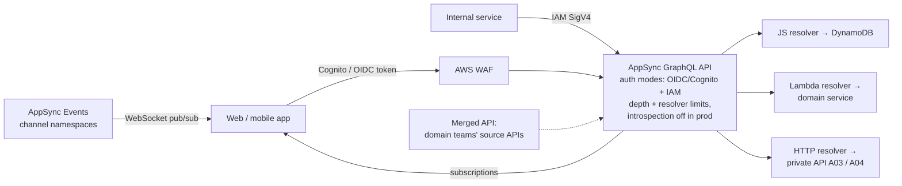

# A07: GraphQL and Real-Time API (AWS AppSync)

A single **GraphQL** endpoint on **AWS AppSync** that aggregates several data sources. It supports multiple authorisation modes per operation, **field-level authorisation**, and real-time updates through **subscriptions** or **AppSync Events** (WebSocket pub/sub). Front-end teams get one typed schema and generated clients, and domain teams can federate their schemas through **merged APIs**.

| Dimension | Rating |
|---|---|
| Budget band | **B1–B2** (fixed floor ≈ $0; ~$4 per million operations; real-time billed per message and connection-minute; optional caching) |
| Complexity | **C2** |
| Service level fit | **SL2** |
| Time to first value | 3–8 weeks |
| Typical SAR tier | Tier 2 |

**Security and integration profile** ([definitions](../00-decision-framework.md#06-suitability-dimensions-for-apis))

| Dimension | Rating |
|---|---|
| Max authentication assurance | **L2** for users (Cognito / OIDC); **L3** for AWS workloads (IAM mode) |
| Authorisation granularity | **Field-level** (auth directives per type or field, resolver-level checks, Lambda authoriser mode) |
| Exposure | Public / Partner / Private (AppSync private APIs via VPC endpoint) |
| Integration ease | **High** for front-end and mobile teams (typed schema, codegen, one endpoint); Medium for traditional B2B consumers |
| Protocols | GraphQL, WebSocket (subscriptions, Events) |
| Classification fit | **OFFICIAL**; **OFFICIAL-SENSITIVE** with field-level rules, private API or WAF, and introspection disabled |
| Cost elasticity | Linear |
| Lock-in / exit cost | Medium (AppSync resolvers and directives; the schema is portable) |
| Auditability | Medium–High (request logging with identity; field-level resolver logs at a verbosity you choose) |
| Change and versioning | **Strong** for additive evolution (deprecate fields, no URL versions); breaking changes need coordination |
| Operational burden | Low |

## Use when

- Web and mobile front ends need data from several sources, shaped per screen, with fewer round trips.
- **Real-time** updates are needed (dashboards, notifications, collaborative status).
- Different fields have different sensitivity, so field-level authorisation is valuable.

## Avoid when

- Consumers are partner systems expecting stable REST contracts. Use [A02](A02-managed-api-product.md) or [A06](A06-mtls-b2b-integration.md).
- Simple CRUD with one consumer. [A01](A01-serverless-http-api.md) is simpler.

## Architecture

## Authentication and authorisation

- **Multiple auth modes:** a default mode (for example, the Cognito user pool or OIDC for users) plus IAM for back-end services. Declare per type or field which modes may access it.
- **Field-level rules:** sensitive fields (for example, `dateOfBirth`, `caseNotes`) restricted by directives to specific groups or scopes. Resolvers perform **object-level** checks using `ctx.identity` (never trust arguments like `userId` from the client).
- **Lambda authoriser mode** for custom tokens or Verified Permissions decisions.
- **API keys** only for public, non-sensitive, read-only data, or for development.
- **Subscriptions** respect the same authorisation. Filter published data per subscriber so that events do not leak to users who could not query that record.

## GraphQL-specific protections

- **Query depth and resolver-count limits** configured on the API (unrestricted resource consumption).
- **Disable introspection** in production for non-public schemas; publish the schema to intended consumers through the portal instead.
- WAF with rate-based rules; response caching for expensive, non-personalised queries (cache keys include identity where needed).
- Pagination limits on list fields.

## Cost profile

- **Fixed:** ≈ $0 (optional cache instances are hourly).
- **Variable:** operations, real-time messages and connection minutes (idle mobile connections add up; set sensible reconnection behaviour).

## Service levels

- SL2 in one Region. Resolver data sources set the composite availability. Design resolvers to return partial data with errors, rather than failing the whole query, where the UI allows.

## Security review focus

- Field-level rules tested per role (automated tests querying each sensitive field as each role).
- No client-supplied identity in resolver logic.
- Introspection, depth limits and WAF configured per environment.
- Resolver logging level: never log full request/response for OFFICIAL-SENSITIVE fields.

## Evolution

- Partners need REST → add **A02** for those consumers over the same domain services. Heavy compute → Lambda or container resolvers (**A05**) behind **A04**.
