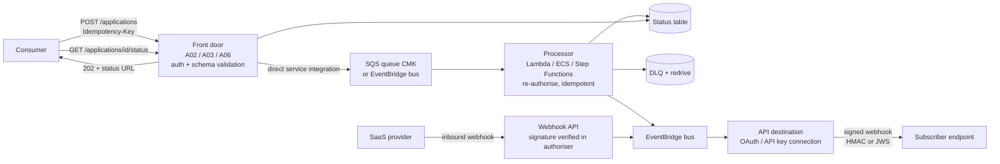

# A08: Asynchronous and Event-Driven API

An API that **accepts work quickly and processes it later**. Requests are validated, authorised and stored durably in **SQS**, **EventBridge** or **Step Functions** through direct service integrations; the API returns `202 Accepted` with a status URL. Consumers poll the status or receive a **signed webhook callback**. The same pattern covers **outbound events** to subscribers (EventBridge API destinations) and **inbound webhooks** from SaaS providers.

| Dimension | Rating |
|---|---|
| Budget band | **B1** (fixed floor ≈ $0; pay per request and per message) |
| Complexity | **C2** |
| Service level fit | **SL2–SL3** for *acceptance* (the accept path stays up when processing is down) |
| Time to first value | 3–6 weeks |
| Typical SAR tier | Tier 2 |

**Security and integration profile** ([definitions](../00-decision-framework.md#06-suitability-dimensions-for-apis))

| Dimension | Rating |
|---|---|
| Max authentication assurance | Inherits the front door: **L2–L4** (combine with A02, A03 or A06). Outbound webhooks: signed payloads plus OAuth or HMAC |
| Authorisation granularity | Coarse at acceptance; fine at processing (the processor re-checks entitlement before acting) |
| Exposure | Public / Partner / Private |
| Integration ease | **Medium** (consumers must handle 202, polling or callbacks, idempotency) |
| Protocols | REST (submit and status), webhooks, events |
| Classification fit | **OFFICIAL and OFFICIAL-SENSITIVE** (queues and event buses encrypted with CMK; payload minimisation in events) |
| Cost elasticity | Linear, low |
| Lock-in / exit cost | Medium (service integrations; the event schemas are portable) |
| Auditability | High (request ID through queue and processing; event archive) |
| Change and versioning | Event schema versioning (schema registry, additive fields, a version attribute) |
| Operational burden | Low–Medium (DLQ handling, replay) |

## Use when

- Processing is slow (over a few seconds), bursty, or depends on systems that may be unavailable (legacy, third parties). This is **load levelling**.
- Bulk submissions from partners (files, batches) go with [A06](A06-mtls-b2b-integration.md).
- Consumers need **notifications** when something changes, instead of polling.

## Avoid when

- The consumer needs the answer in the same request (lookups, validation). Use a synchronous pattern.

## Architecture

## Authentication and authorisation

- **Submit and status endpoints** use the front door's authentication. The status endpoint enforces that only the submitter (or its organisation) can read a request's status. Unguessable request IDs are **not** a substitute for the ownership check (BOLA).
- **Processor re-authorisation:** check entitlement again before acting, because permissions may change between acceptance and processing.
- **Outbound webhooks:**
  - EventBridge API destinations authenticate to the subscriber (OAuth client credentials, API key or basic auth held in a managed connection).
  - Sign payloads (HMAC with a per-subscriber secret, or JWS) with a timestamp so that subscribers can verify origin and reject replays.
  - Keep sensitive data out of the event: send an ID and let the subscriber fetch it through an authorised API ("thin events").
- **Inbound webhooks:** verify the provider's signature and timestamp in a Lambda authoriser before accepting. Allow-list the provider's IP ranges where published.

## Cost profile

- Fixed ≈ $0. Variable: API requests, messages, processing. Among the cheapest patterns per transaction.

## Service levels

- **Acceptance SLO** (for example 99.95%, p99 < 300 ms) is decoupled from **processing SLO** (for example 99% processed within 15 minutes). Queue depth and age of the oldest message are the key alarms.
- DLQs with automated redrive after fixes; an event archive and replay for recovery.

## Security review focus

- Queue and bus resource policies restrict senders to the API's integration role.
- Idempotency is enforced end to end (duplicate submissions do not create duplicate outcomes).
- Webhook secrets are rotated; subscribers are registered and verified (ownership challenge) before receiving events.
- Event payload minimisation for OFFICIAL-SENSITIVE data.

## Evolution

- Complex multi-step processing → Step Functions workflows. High-volume event streams → Kinesis Data Streams or MSK (outside this series' API focus).
