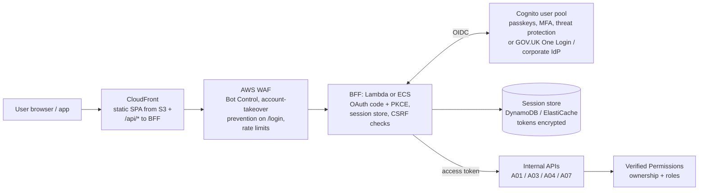

# A09: User-Facing API with Backend-for-Frontend (BFF) and Managed Identity

APIs for **citizen, customer or staff web and mobile applications**. Users sign in through **Amazon Cognito** or an external OIDC provider (such as **GOV.UK One Login** for citizen services, or the corporate IdP for staff). A **backend-for-frontend** handles the OAuth flow server-side, so **tokens never reach browser JavaScript**; the browser holds only a secure, HttpOnly session cookie. The edge adds bot and account-takeover protection.

| Dimension | Rating |
|---|---|
| Budget band | **B2** (fixed floor: WAF including Bot Control / account-takeover prevention; Cognito per monthly active user; BFF compute) |
| Complexity | **C2–C3** |
| Service level fit | **SL2** (the identity provider is part of the composite path) |
| Time to first value | 1–3 months |
| Typical SAR tier | Tier 1–2 (internet-facing, personal data) |

**Security and integration profile** ([definitions](../00-decision-framework.md#06-suitability-dimensions-for-apis))

| Dimension | Rating |
|---|---|
| Max authentication assurance | **L3 for users** (MFA; passkeys for phishing-resistant sign-in; step-up for sensitive actions) |
| Authorisation granularity | **Fine** (per-user resource ownership, delegated access, Verified Permissions for roles and relationships) |
| Exposure | **Public** |
| Integration ease | **High** for the app team (one first-party API, cookies, no token handling in the client) |
| Protocols | REST or GraphQL (the BFF can front [A07](A07-graphql-realtime-appsync.md)) |
| Classification fit | **OFFICIAL** including personal data; **OFFICIAL-SENSITIVE** with MFA/step-up, short sessions and per-record audit |
| Cost elasticity | Linear (per MAU and per request) |
| Lock-in / exit cost | Medium (user pool migration is the hard part; OIDC keeps the apps portable) |
| Auditability | **High** (user ID on every request; sign-in and risk events) |
| Change and versioning | The BFF absorbs back-end API changes; the front end and BFF release together |
| Operational burden | Medium (identity operations: account recovery, abuse, support) |

## Use when

- The consumers are **people using your own web or mobile apps**, often members of the public.
- Personal data is involved, and credential stuffing, account takeover and bots are real threats.
- You want the app team to integrate quickly without handling OAuth tokens securely in browsers.

## Avoid when

- Consumers are third-party developers or partner systems. Use [A02](A02-managed-api-product.md) or [A06](A06-mtls-b2b-integration.md).

## Architecture

**Mobile variant:** native apps use authorisation code + PKCE with the system browser (never embedded web views) and store tokens in the platform keystore. They can call the APIs directly through [A02](A02-managed-api-product.md), or through the BFF for consistency.

## Authentication and authorisation

- **Sign-in:** Cognito managed login or an external OIDC IdP. Enable MFA (mandatory for staff and privileged roles), offer **passkeys**, and use Cognito threat protection (Plus tier) or equivalent risk-based checks.
- **Session:** the BFF exchanges the code for tokens, stores them server-side, and issues a `Secure; HttpOnly; SameSite=Lax/Strict` session cookie. Set an idle timeout and an absolute session lifetime (shorter for OFFICIAL-SENSITIVE).
- **CSRF:** SameSite cookies plus an anti-CSRF token or custom-header check on state-changing requests. CORS locked to your own origin.
- **Step-up authentication** for sensitive actions (changing bank details, viewing sensitive records): re-authenticate or require MFA, with a recent `auth_time` check.
- **Authorisation:** every API call checks that the user owns the resource or has a delegated relationship. Model relationships (for example, "is the appointee for") in Verified Permissions rather than scattering them in code.

## Cost profile

- **Fixed:** WAF with Bot Control / account-takeover prevention (priced per request inspected; scope these rule groups to login and sensitive routes to control cost), and BFF minimum capacity if on ECS.
- **Variable:** Cognito MAUs by tier, requests, and session store.

## Service levels

- The IdP is on the critical path for sign-in (not for every API call, if sessions are server-side). Include it in the composite availability. Cognito is regional (see [A11](A11-multi-region-active-active.md) for the multi-region implications).
- Degraded mode: existing sessions continue during an IdP incident; new sign-ins show a clear service message.

## Security review focus

- No tokens in browser storage (`localStorage`/`sessionStorage`), in URLs, or in logs.
- Account recovery flows are as strong as sign-in, because recovery is a common takeover route.
- Enumeration resistance: identical responses for known and unknown accounts.
- Accessibility and assisted-digital routes do not weaken authentication.

## Evolution

- Add real-time features via **A07**. Staff admin functions go on a separate API with stronger authentication (L3, phishing-resistant MFA).
