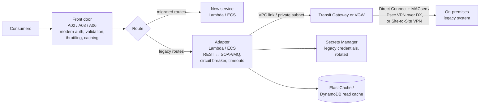

# A10: Legacy and On-Premises Integration Facade

A modern, secure API **facade in front of legacy or on-premises systems**: mainframes, SOAP services, packaged applications, databases behind the corporate network. The facade applies modern authentication, validation, throttling and caching at the edge, reaches back to the legacy estate over **Direct Connect or Site-to-Site VPN** through a **VPC link**, and supports **strangler-fig** migration route by route.

| Dimension | Rating |
|---|---|
| Budget band | **B2** (fixed floor: Direct Connect port or VPN, NLB/ALB for the VPC link, VPC endpoints) |
| Complexity | **C3** (hybrid networking, identity mapping, legacy constraints) |
| Service level fit | **SL1–SL2**, usually **bounded by the legacy system**; improve with caching and [A08](A08-async-event-driven-api.md) |
| Time to first value | 2–4 months |
| Typical SAR tier | Tier 1–2 (hybrid connectivity widens the blast radius) |

**Security and integration profile** ([definitions](../00-decision-framework.md#06-suitability-dimensions-for-apis))

| Dimension | Rating |
|---|---|
| Max authentication assurance | **L2–L3** at the facade (inherits the front door: A02, A03 or A06). The legacy leg often uses service accounts; record the gap |
| Authorisation granularity | Fine at the facade; the legacy system's own model behind it |
| Exposure | Public / Partner / Private (through the chosen front door) |
| Integration ease | **High for consumers** (modern REST replaces SOAP or file drops); Low for the delivery team |
| Protocols | REST in front; SOAP, MQ, JDBC or proprietary behind |
| Classification fit | **OFFICIAL and OFFICIAL-SENSITIVE**, provided the hybrid link is encrypted (Direct Connect is not encrypted by default) |
| Cost elasticity | Step (connectivity floor), then linear |
| Lock-in / exit cost | Low (the facade enables migration away from legacy) |
| Auditability | Medium–High (end-user identity is often lost at the legacy boundary unless propagated) |
| Change and versioning | **Strong decoupling**: consumers are insulated from legacy changes and from migration |
| Operational burden | Medium–High (hybrid network, legacy availability windows) |

## Use when

- Valuable data and functions sit in systems that cannot be exposed directly or rebuilt quickly.
- You are migrating incrementally: new routes go to new services while old routes still hit legacy.
- Consumers need modern authentication and formats that the legacy system cannot provide.

## Avoid when

- The legacy system can publish events or data extracts that fit an asynchronous replica. A read model in AWS may be simpler and more available.

## Architecture

**Reverse direction** (on-premises consumers calling AWS APIs): use private APIs ([A03](A03-private-api.md)) through `execute-api` endpoints reachable over Direct Connect, with Route 53 Resolver inbound endpoints for DNS, and IAM Roles Anywhere for on-premises workload identity.

## Authentication and authorisation

- **Consumers** authenticate to the facade with modern mechanisms (L2–L4 by classification).
- **Identity propagation to legacy** is the hard problem. The options, in order of preference:
  1. Pass a signed assertion or token the legacy system can validate.
  2. Map claims to per-consumer legacy accounts.
  3. Use a single service account, with the facade enforcing all authorisation and recording the end-user identity in its own audit log.

  Option 3 is common. Record it as a design decision and a risk.
- **Legacy credentials** are held in Secrets Manager, rotated, and scoped to the adapter's role.
- The facade enforces **least-functionality**: only the legacy operations consumers need are exposed, and the adapter validates and allow-lists parameters (legacy systems are often fragile to unexpected input).

## Network

- **Encrypt the hybrid link:** Direct Connect does not encrypt traffic by default. Use MACsec (on supported dedicated connections) or IPsec VPN over Direct Connect, and TLS at the application layer where legacy supports it.
- Restrict routes and security groups so that the AWS side reaches only the specific legacy endpoints, and the legacy network cannot initiate connections into AWS unless required.
- Redundant connectivity (two Direct Connect locations, or DX plus VPN backup) for SL2.

## Cost profile

- **Fixed:** Direct Connect ports (or VPN connections), Transit Gateway attachments, adapter minimum capacity, cache.
- **Variable:** data transfer out over Direct Connect, requests, and adapter compute.

## Service levels

- Consumers see the facade's SLO. Protect it from the legacy system's limits with:
  - **caching** of reference data;
  - **concurrency limits** matched to legacy capacity (throttle at the facade, not in the mainframe);
  - **circuit breakers**;
  - **asynchronous submission** ([A08](A08-async-event-driven-api.md)) for writes during legacy maintenance windows.
- Publish legacy maintenance windows as part of the SLO.

## Security review focus

- Hybrid connectivity reviewed as a Tier 1 platform component (blast radius into the corporate network).
- Encryption across Direct Connect; the identity propagation approach and its residual risk.
- Adapter input validation (legacy injection risks: SOAP/XML, command strings).
- Migration inventory: old routes decommissioned as they are replaced (API9 improper inventory).

## Evolution

- Each migrated route moves traffic from the adapter to a new service. When legacy is retired, the facade remains as a normal **A02**, **A03** or **A05** API.
