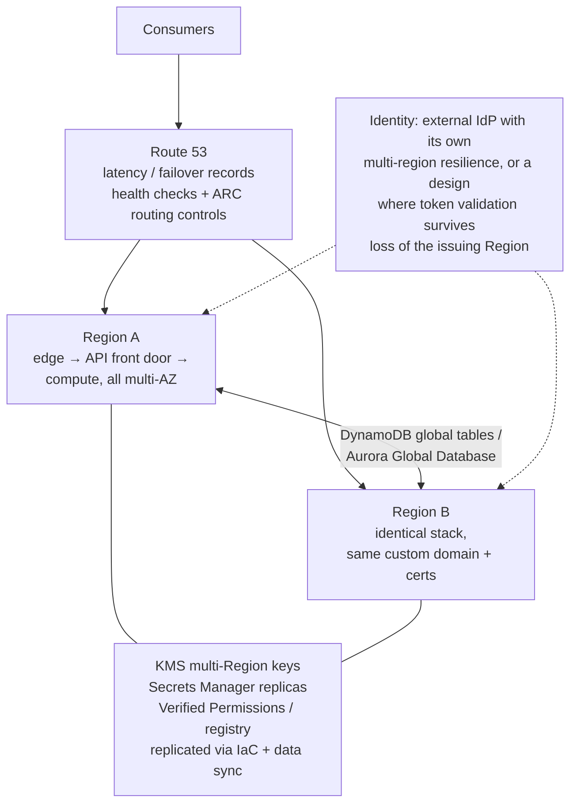

# A11: Multi-Region Active/Active API (SL3)

The **SL3 uplift** for any synchronous pattern (A01, A02, A05, A07, A09). The same API is deployed in **two AWS Regions**, each serving traffic behind a shared custom domain with **Route 53** latency or failover routing and health checks. Data is replicated with **DynamoDB global tables** or **Aurora Global Database**, and failover is deterministic through **Amazon Application Recovery Controller (ARC)**. Every dependency on the request path, **including identity**, is made multi-region or statically stable.

| Dimension | Rating |
|---|---|
| Budget band | **B3–B4** (roughly doubles the base pattern's fixed floor, plus replication, cross-Region data transfer, ARC and Shield Advanced) |
| Complexity | **C4** |
| Service level fit | **SL3** (99.95–99.99%) |
| Time to first value | 4–9 months (on top of the base pattern) |
| Typical SAR tier | **Tier 1** |

**Security and integration profile** ([definitions](../00-decision-framework.md#06-suitability-dimensions-for-apis))

| Dimension | Rating |
|---|---|
| Max authentication assurance | Inherits the base pattern. **Identity must be resilient too** (see below) |
| Authorisation granularity | Inherits the base pattern (policy stores and registries replicated) |
| Exposure | Inherits the base pattern |
| Integration ease | **High** (consumers see one endpoint; failover is transparent if idempotency and retries are designed in) |
| Protocols | As the base pattern |
| Classification fit | **OFFICIAL**; **OFFICIAL-SENSITIVE only with an explicit residency decision.** AWS has one UK Region (London), so UK-only residency rules out two-Region active/active |
| Cost elasticity | Step (a second Region's fixed floor) |
| Lock-in / exit cost | Medium–High (global tables, ARC, Global Database) |
| Auditability | High, if logs from both Regions are centralised with the Region recorded |
| Change and versioning | Releases roll out Region by Region; this is also a safety control |
| Operational burden | **High** (failover testing, replication monitoring, config drift between Regions) |

## Use when

- The service is critical enough that a **regional** outage is unacceptable (SL3), and the risk owner has signed off the cost.
- Residency policy permits a second Region for the data. Otherwise see the **UK-residency options** below.

## Avoid when

- SL2 is enough. Most APIs reach 99.9% in one Region with multi-AZ design at a fraction of the cost and complexity.
- The workload cannot tolerate multi-Region data semantics (conflicting writes, replication lag) and the strongly consistent options do not fit.

## Architecture

## Key design decisions

| Decision | Guidance |
|---|---|
| **Routing** | Route 53 latency-based records per Region with health checks on a deep health endpoint (checks critical dependencies in that Region). Use **ARC routing controls** (or Region switch plans) for deliberate, deterministic failover, instead of relying only on automated health checks |
| **Data** | DynamoDB global tables (last-writer-wins by default; multi-Region strong consistency is available in specific Region sets, so check yours). Aurora Global Database for relational data (secondary is read-only; managed failover/switchover, RPO typically about a second). Design writes to be **idempotent** and conflict-tolerant |
| **Identity** | **Cognito user pools are regional.** A pool in Region A cannot issue tokens if Region A is down. Options: an external IdP with its own multi-region resilience; independent pools per Region with user migration and re-authentication on failover; or long enough sessions that token *validation* (JWKS) continues while issuance recovers. Decide explicitly, because this is the most common gap in "multi-region" APIs |
| **Authorisation state** | Verified Permissions policy stores, client registries and API keys exist in both Regions: deploy policies via IaC to both, and replicate registry data (global tables) |
| **Secrets and keys** | Secrets Manager replica secrets; KMS multi-Region keys; ACM certificates issued in each Region (and in us-east-1 for CloudFront) |
| **CloudFront** | Origin failover only applies to GET, HEAD and OPTIONS. Writes need DNS-level (Route 53) failover or active/active origins |
| **Static stability** | The data plane in each Region runs without calling control planes (no scaling-from-zero or config changes needed during failover); pre-scaled capacity in both Regions |

## UK residency options

AWS has a single UK Region (London, eu-west-2). If OFFICIAL-SENSITIVE data must stay in the UK:

1. **Multi-AZ static stability in London** (three AZs), pre-scaled, with ARC zonal shift. This gives very high availability within the Region, but it is not protection against a regional event.
2. **London primary + a stateless second Region:** the second Region serves only non-data functions or a "service unavailable, try later" mode, and holds no personal data.
3. **Risk-owner approved replication** to a named second Region (for example, an EU Region), documented as a security ADR with legal and data-protection input.
4. **Renegotiate to SL2** with a tested restore, and publish a realistic SLO.

## Cost profile

- Roughly **2× the base pattern's fixed floor**, plus replicated writes, cross-Region data transfer, ARC, and usually Shield Advanced.
- An active/passive (warm standby) variant cuts compute cost but lengthens RTO. Pick it deliberately, not by accident.

## Service levels

- Target 99.95–99.99%, with a regional failover RTO measured in minutes and RPO in seconds (per the data store).
- **Game days:** fail over each Region at least twice a year. Rehearse the identity failover path and certificate/secret availability in the secondary Region.

## Security review focus

- Security controls are identical in both Regions: WAF rules, authorisers, logging and guardrails deployed from the same IaC. Drift detection is in place.
- Residency decision recorded for OFFICIAL-SENSITIVE data.
- Identity resilience is designed and tested, not assumed.
- Logs from both Regions are centralised; failover events are alarmed and audited.

## Evolution

- Start with SL2 in one Region. Adopt A11 only when the business case and the residency decision are both in place.
